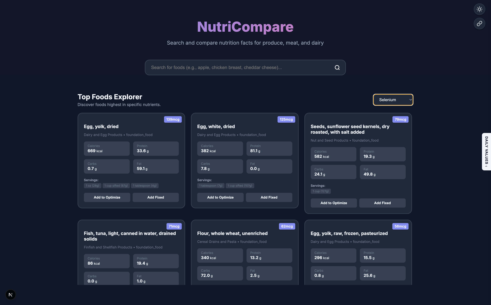
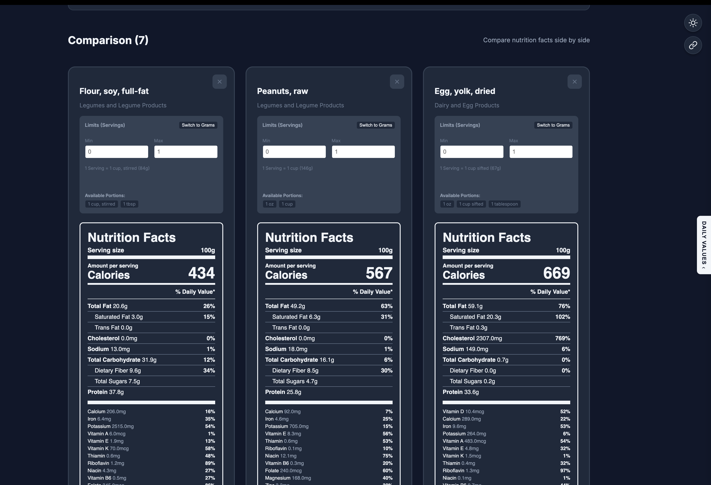
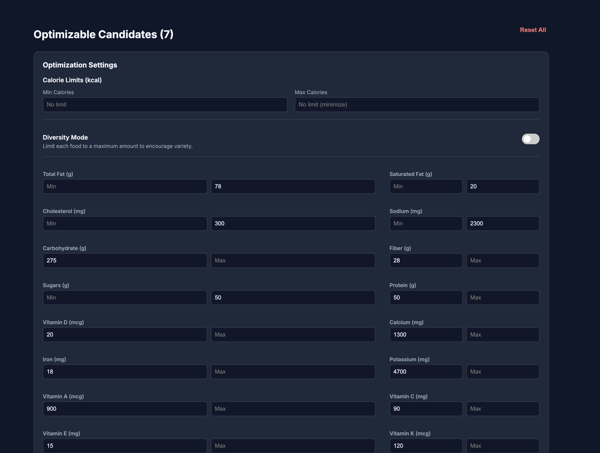

# NutriCompare - Intelligent Nutrition Optimizer

> **Find the healthiest, most cost-effective food combinations that meet all your daily nutritional needs.**

NutriCompare is a smart nutrition planning application that uses mathematical optimization to help you create the perfect diet. Simply tell it what nutrients you need, and it finds the optimal combination of foods to meet your goals while minimizing calories or cost.



---

## What Does This App Do?

Imagine you want to meet all your daily nutritional requirements (protein, vitamins, minerals, etc.) but you're not sure which foods to eat or how much. **NutriCompare solves this problem for you automatically.**

### How It Works (Simple Explanation)

1. **Search for Foods**: Type "chicken", "broccoli", or any food name
2. **Select Foods**: Pick the foods you want to include in your diet
3. **Set Your Goals**: Tell the app your nutritional targets (e.g., "I need 50g of protein")
4. **Optimize**: Click "Optimize Diet" and let the app calculate the perfect amounts
5. **Get Results**: See exactly how many grams of each food to eat

The app uses **Linear Programming** (a mathematical technique) to find the best combination that:
- ✅ Meets all your nutritional requirements
- ✅ Minimizes total calories (or cost, if you add prices)
- ✅ Respects food quantity limits (e.g., max 3 servings per food)

### Real-World Example

**Your Goal:** Get 50g protein, 90mg Vitamin C, ≤2000 calories

**You Select:** Chicken breast, Broccoli, Rice, Oranges

**NutriCompare Calculates:**
- 120g Chicken breast = 30g protein, 132 cal
- 200g Broccoli = 5.6g protein, 68mg Vitamin C, 68 cal
- 150g Rice = 4.5g protein, 195 cal
- 100g Orange = 1g protein, 47mg Vitamin C, 47 cal

**Total:** 41.1g protein, 115mg Vitamin C, 442 calories ✅

The app shows you if you're over/under your targets with progress bars and suggests adjustments.

---

## Features

### Core Features
- 🔍 **Search 9,400+ Foods** from USDA FoodData Central (Foundation Foods, SR Legacy, and FNDDS mixed dishes)
- 📊 **30+ Nutrients Tracked** (protein, vitamins A-K, minerals, fats, fiber, etc.)
- ⚙️ **Automatic Optimization** using linear programming solver
- 🎯 **Custom Constraints** for each nutrient (min/max limits)
- 🍽️ **Guaranteed Foods** - lock in specific foods with fixed amounts
- 🌙 **Dark/Light Mode** for comfortable viewing
- 💾 **LocalStorage** persistence - your selections are saved

### Advanced Features
- 📈 **Top Foods Explorer** - find foods highest in specific nutrients
- 🔬 **Nutrition Facts Labels** - FDA-style nutrition display
- 🧮 **Constraint Analysis** - see exactly how each requirement is met
- 🐛 **Debug Mode** - view the underlying mathematical equations
- 🎨 **Serving Size Support** - convert between grams and servings

---

## Installation & Setup

### Prerequisites
- **Node.js 22+** (current LTS recommended; CI and Docker use the latest LTS). [Download](https://nodejs.org/) or `nvm install --lts`
- **Git LFS**: the food database (`food-nutrition-app/nutrition.db`) is stored with [Git LFS](https://git-lfs.com/). Install it with `brew install git-lfs` or `sudo apt install git-lfs`, then run `git lfs install` once.
- **Python 3.8+**: only needed to rebuild the database with the scripts in `scripts/`

### Quick Start (Web App)

```bash
git clone https://github.com/yonaadug/FoodNutritionOptimize.git
cd FoodNutritionOptimize
./setup.sh            # checks Node, pulls the LFS database, installs the web app
                      # add --with-electron and/or --with-python for the extras

cd food-nutrition-app
npm run dev
```

Then open **http://localhost:3000** 🎉

<details>
<summary>Manual setup (what <code>setup.sh</code> does)</summary>

```bash
git lfs pull                       # replaces the LFS pointer with the real nutrition.db
cd food-nutrition-app
npm ci --ignore-scripts            # better-sqlite3 ships prebuilt binaries, so no compiler is needed
npm run dev
```
</details>

### Everyday Commands (`food-nutrition-app/`)

| Command | What it does |
|---|---|
| `npm run dev` | Dev server with hot reload (http://localhost:3000) |
| `npm run lint` | ESLint (flat config in `eslint.config.mjs`) |
| `npm run typecheck` | `next typegen` + `tsc --noEmit` |
| `npm test` | Unit tests |
| `npm run build` | Production build, including a self-contained server in `.next/standalone/` |
| `npm start` | Serve the production build (`npm start -- -p 3300` picks a different port) |

Configuration lives in `food-nutrition-app/.env.example`. `NUTRITION_DB_PATH` points the server at a different database file.

### Production / Self-Hosting

`npm run build` writes a standalone server, about 24 MB, with `nutrition.db` bundled. It can run from any directory:

```bash
cd food-nutrition-app && npm run build
cp -r .next/static .next/standalone/.next/static     # Next.js does not copy static assets for you
PORT=3000 node .next/standalone/server.js
```

Or build the container image from the repo root. It is multi-stage, runs as a non-root user, and the database is read-only:

```bash
git lfs pull
docker build -t nutricompare .
docker run --rm -p 3000:3000 nutricompare
```

---

### Desktop App (Electron)

Run NutriCompare as a **native desktop application** that works completely offline. The
app runs its own server on `127.0.0.1` with a random port, and its window is locked down:
it is sandboxed, has a CSP, and cannot load remote content. End users don't need Node.js.
See [electron-app/README.md](electron-app/README.md) for details.

#### Development Mode

```bash
./setup.sh --with-electron     # or: (cd food-nutrition-app && npm ci) && (cd electron-app && npm ci)
cd electron-app
npm start                      # starts `next dev` and opens the app window
```

#### Build Installers

```bash
cd electron-app
npm run pack        # quick check: unpacked app in dist/<platform>/
npm run build:mac   # .dmg + .zip
npm run build:win   # NSIS installer + portable .exe
npm run build:linux # .AppImage + .deb
```

Each build runs the web app's production build first. Installers end up in `electron-app/dist/`. Build each platform on a matching OS and CPU, because the bundled SQLite driver is a native binary.

### Continuous Integration

`.github/workflows/ci.yml` runs on every push to `main` and on every pull request. It runs
`npm ci`, lint, typecheck, tests, and the production build, then smoke-tests the
standalone server against the real (LFS) database.

---

## Data Setup (Optional)

The app ships with a pre-built database (`food-nutrition-app/nutrition.db`, Git LFS, ~7 MB) of
9,435 foods from USDA FoodData Central:
- 389 Foundation Foods (2026-10 release)
- 7,448 SR Legacy foods
- 1,598 FNDDS mixed dishes

Missing nutrient values are stored as `NULL` (no data), not `0`. You only need the steps below
to rebuild or customize the data.

### Rebuild the Database

The builder uses only the Python standard library. It downloads the pinned USDA bulk releases
(sha256-verified) into `data/raw/` and writes `food-nutrition-app/nutrition.db`. No API key is needed.

```bash
python3 -I scripts/build_db.py --download   # fetch + verify + build
python3 -I scripts/build_db.py              # rebuild from data/raw (already downloaded)
python3 -I scripts/verify_data_integrity.py # validate; exits non-zero on any failure
```

To move to a newer USDA release, update `SOURCES` in `scripts/build_db.py`. See
[docs/VERIFICATION_INSTRUCTIONS.md](docs/VERIFICATION_INSTRUCTIONS.md) for details and
[docs/KEY_NUTRIENTS.md](docs/KEY_NUTRIENTS.md) for nutrient definitions and units.

### USDA API Key (optional)

You only need a key for live API spot checks (`verify_data_integrity.py --api <fdcId>`) and the
`usda_fdc_api.py` wrapper. Get a free key at https://fdc.nal.usda.gov/api-key-signup.html, then
`export USDA_API_KEY=...` or put it in `config/api_keys.txt` (gitignored). Never commit it.

---

## Project Structure

```
FoodNutritionOptimize/
├── food-nutrition-app/          # Next.js web application
│   ├── app/                     # Next.js App Router
│   │   ├── api/                 # API endpoints (search, optimize, etc.)
│   │   ├── page.tsx             # Main UI page
│   │   └── layout.tsx           # Root layout
│   ├── components/              # React components
│   │   ├── SearchBar.tsx
│   │   ├── FoodCard.tsx
│   │   ├── TopFoods.tsx
│   │   └── ...
│   ├── lib/                     # Business logic
│   │   ├── db.ts                # SQLite database access
│   │   ├── optimizer.ts         # Linear programming solver
│   │   └── nutrient-defaults.ts # Nutrient configurations
│   ├── nutrition.db             # SQLite database (9,435 USDA foods, Git LFS)
│   └── package.json
│
├── electron-app/                # Electron desktop wrapper
│   ├── main.js                  # Main process: local server + hardened window
│   ├── scripts/stage-web.js     # Copies the Next.js standalone build for packaging
│   ├── README.md                # Desktop architecture, security, build docs
│   └── package.json             # electron-builder config
│
├── .github/workflows/ci.yml     # CI: lint, typecheck, test, build, smoke test
├── Dockerfile                   # Container image (standalone server + read-only DB)
├── setup.sh                     # One-shot developer setup
│
├── scripts/                     # Data ingestion scripts (Python)
│   ├── build_db.py              # USDA bulk downloads → nutrition.db (reproducible)
│   ├── nutrient_spec.py         # Nutrient ID/unit mapping used by the builder
│   ├── verify_data_integrity.py # Automated validation (exit 1 on failure)
│   ├── usda_fdc_api.py          # Optional FDC API wrapper
│   └── key_nutrients.py         # Nutrient reference helpers
│
├── docs/                        # Documentation
│   ├── README_API.md            # API documentation
│   ├── KEY_NUTRIENTS.md         # Nutrient reference
│   └── VERIFICATION_INSTRUCTIONS.md
│
├── data/                        # Data files
│   └── raw/                     # Downloaded USDA releases (gitignored)
│
├── config/                      # Configuration (gitignored)
│   └── api_keys.txt.example     # API key template
│
└── README.md                    # This file
```

---

## Technology Stack

### Frontend
- **Next.js 16** - React framework with App Router
- **TypeScript** - Type-safe development
- **CSS Variables** - Themeable styling (dark/light mode)
- **LocalStorage** - Client-side persistence

### Backend
- **Next.js API Routes** - Serverless API endpoints
- **SQLite** (better-sqlite3) - Embedded database
- **javascript-lp-solver** - Linear programming optimization
- **Node.js** - Runtime environment

### Data Pipeline
- **Python 3** - Data ingestion scripts
- **USDA FoodData Central API** - Official nutrition data source
- **CSV parsing** - Bulk data import

### Desktop
- **Electron 45** - Cross-platform desktop framework
- **electron-builder** - Build native installers

---

## How the Optimization Works (Technical)

NutriCompare uses **Linear Programming**, specifically the **Simplex Algorithm**, to solve this problem:

### Mathematical Formulation

**Decision Variables:**
- `x₁, x₂, x₃, ...` = amount of each food (in 100g units)

**Objective Function:**
```
Minimize: Total Calories = Σ(calories_i × x_i)
```

**Subject to Constraints:**
```
Protein:    Σ(protein_i × x_i) ≥ 50g       (minimum requirement)
Vitamin C:  Σ(vitC_i × x_i) ≥ 90mg         (minimum requirement)
Sodium:     Σ(sodium_i × x_i) ≤ 2300mg     (maximum limit)
Calories:   Σ(calories_i × x_i) ≤ 2000     (calorie cap)
Food 1:     0 ≤ x₁ ≤ 3                      (max 3 servings)
Food 2:     0 ≤ x₂ ≤ 3
...
```

The solver finds the optimal values of `x₁, x₂, ...` that:
1. Minimize the objective (calories)
2. Satisfy all constraints (nutrient requirements)

### Why This Matters

Instead of manually trying thousands of food combinations, the algorithm mathematically proves the optimal solution in seconds. This is the same technique used in:
- Supply chain optimization
- Production planning
- Resource allocation
- Financial portfolio optimization

---

## Usage Guide

### Basic Workflow

1. **Search for Foods**
   - Type food name in search bar
   - Browse paginated results
   - Click cards to select foods

2. **Set Nutrient Constraints**
   - Expand "Customize Constraints" section
   - Enter min/max for each nutrient
   - Set calorie limits (min/max)

3. **Optional: Guaranteed Foods**
   - Click "Add to Guaranteed" for must-have foods
   - Enter exact amounts (in grams)
   - These amounts are fixed, not optimized

4. **Optimize**
   - Click "Optimize Diet" button
   - View results:
     - Diet plan (foods + amounts)
     - Total calories and nutrients
     - Constraint analysis (progress bars)
     - Nutrient breakdown per food

5. **Iterate**
   - Adjust constraints if infeasible
   - Add/remove foods
   - Re-optimize

### Advanced Features

#### Food Constraints
Set per-food min/max amounts:
- Click on food card in comparison view
- Enter min/max grams
- Optimizer respects these limits

#### Diversity Mode
Limit max amount per food globally:
- Enable "Diversity Mode"
- Set "Max Food Amount" (grams)
- Encourages variety

#### Top Foods Explorer
Find nutrient-dense foods:
- Select nutrient from dropdown
- View top 50 foods ranked by that nutrient
- Click to add to selection

#### Debug Mode
View optimization equations:
- Click "Debug" button (top-right)
- Expand "Optimization Equations"
- See mathematical formulation
- Inspect LP solver model (JSON)

---

## Troubleshooting

### Database Errors

**Problem:** "Cannot open database" or "Database locked"

**Solution:**
```bash
# Ensure database exists
ls food-nutrition-app/nutrition.db

# If it's a tiny text file, it's an LFS pointer: fetch the real DB
git lfs pull

# Or rebuild it from USDA data
python3 -I scripts/build_db.py --download
```

### Optimization Fails (Infeasible)

**Problem:** "No feasible solution found"

**Causes:**
1. Constraints are too strict (impossible to satisfy)
2. Not enough foods selected
3. Guaranteed foods already violate max constraints

**Solutions:**
- Relax some constraints (lower mins or raise maxes)
- Add more food options
- Remove guaranteed foods temporarily
- Check debug output for which constraint is problematic

### Search Returns No Results

**Problem:** Typing food names returns empty results

**Solutions:**
- Check database has foods: `sqlite3 food-nutrition-app/nutrition.db "SELECT COUNT(*) FROM foods;"`
- Try simpler search terms ("carrot" not "organic baby carrots")
- Re-run data ingestion if database is corrupt

### "file is not a database" / the database is a few hundred bytes

`nutrition.db` is still a Git LFS pointer. Install git-lfs, then run:
```bash
git lfs install
git lfs pull
```

### Web App Won't Start

**Problem:** `npm run dev` or `npm install` fails

**Solutions:**
```bash
node --version             # must be 22 or newer
cd food-nutrition-app
rm -rf .next node_modules  # clear the Next.js cache and dependencies (keep package-lock.json)
npm ci --ignore-scripts
```

### better-sqlite3 / native module errors

**Problem:** `npm install` prints `gyp ERR!` or `No module named 'distutils'`, or startup fails with `Could not locate the bindings file` or `NODE_MODULE_VERSION`.

better-sqlite3 13 ships prebuilt Node-API binaries for macOS, Linux (glibc and musl), and Windows on x64 and arm64. You don't need a compiler. The errors above usually mean one of two things:
- An old lockfile or `node_modules` from before the upgrade. Delete `node_modules` and run `npm ci --ignore-scripts`. `--ignore-scripts` stops npm from falling back to a `node-gyp` source build, which needs Python and a C++ toolchain.
- Copying `node_modules` or `.next/standalone` between machines. The bundled binary only matches the OS and CPU it was installed on, so build on the target platform. For Docker, build inside the image (the provided `Dockerfile` does this).

Check that it loads:
```bash
cd food-nutrition-app
node -e "console.log(new (require('better-sqlite3'))('nutrition.db',{readonly:true}).prepare('select count(*) n from foods').get())"
```

### Electron App Won't Launch

**Problem:** The Electron window doesn't open, or an error dialog appears

**Solutions:**
- Read the log at `~/Library/Logs/NutriCompare/main.log` (macOS), `%APPDATA%\NutriCompare\logs\main.log` (Windows), or `~/.config/NutriCompare/logs/main.log` (Linux).
- In dev mode, make sure `food-nutrition-app` is installed (`npm ci --ignore-scripts`) and the LFS database is pulled.
- If `electron .` acts like plain Node, unset `ELECTRON_RUN_AS_NODE` (some IDE terminals set it). The npm scripts already unset it.
- The app picks a random free port, so you never need to free port 3000.

---

## Contributing

Contributions welcome! Here are some ideas:

### High-Priority Features
- **Cost Optimization** - Add food prices, minimize cost instead of calories
- **Multi-Day Planning** - Plan entire weeks of meals
- **Save/Load Diet Plans** - Bookmark successful optimizations
- **Dietary Restrictions** - Filters for vegan, gluten-free, allergens
- **Shopping List Export** - Generate grocery lists from diet plans
- **PDF Reports** - Export nutrition labels and meal plans

### Code Quality
- Add unit tests (Jest, Vitest)
- E2E tests (Playwright)
- Release pipeline (signed desktop builds, container publishing)

### Data Enhancements
- Add branded foods (cereals, yogurt, etc.)
- Restaurant menu items
- Recipe builder (combine foods into meals)
- Meal timing optimization (pre/post-workout)

See `docs/` for API documentation and technical details.

---

## License

MIT License - see LICENSE file

---

## Credits

- **USDA FoodData Central** - Official nutrition database
- **javascript-lp-solver** - Linear programming library
- **better-sqlite3** - Fast SQLite driver
- **Next.js** - React framework
- **Electron** - Desktop framework

---

## Support

- **Issues**: [GitHub Issues](https://github.com/yonaadug/FoodNutritionOptimize/issues)
- **Email**: primeyonathan@gmail.com

---

## Screenshots

### Top Foods Explorer
Discover foods highest in specific nutrients. Select any nutrient (protein, vitamins, minerals, etc.) and instantly see the top-ranked foods. Click to add foods to your optimization or comparison.


### Nutrition Facts Comparison
Compare nutrition facts labels side-by-side for multiple foods. View detailed nutrient breakdowns in FDA-style nutrition labels, making it easy to see how different foods stack up.



### Optimization Settings
Set your nutritional goals with customizable constraints. Define minimum and maximum values for calories, macronutrients, vitamins, and minerals. Toggle diversity mode to encourage variety in your diet plan.



---

**Built with ❤️ for nutrition optimization**

*Making healthy eating effortless through mathematics*
