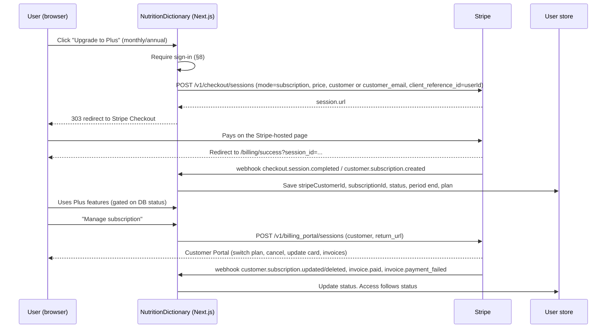

# NutritionDictionary: Stripe Integration Plan

*Generated 2026-11-04 with Stripe's `stripe_implementation_planner` (guide `iguide_61VhbzFAc0bobNT3c41BJBe1RKB2N`, account `acct_1UYAsNBJBe1RKB2N`, live), then adapted to this codebase. Stripe products: **Payments, Billing, Invoicing**. Status: **plan only**. Nothing has been created in Stripe, and no Stripe code exists in the app yet.*

## 1. What we're building

- **Free** (today's app): planning with no account and no card.
- **NutritionDictionary Plus**: a subscription at **$5.99/month or $39.99/year** that unlocks premium features. Which features is still open; see §9.
- People subscribe on a **Stripe-hosted Checkout page**. They manage their subscription in the **Stripe Customer Portal**: switch monthly ↔ annual, cancel, update their card, download invoices and receipts.
- **Webhooks** keep our database in sync, and the app turns Plus features on or off from that data.
- Stripe sends receipts and invoices automatically. We sell no physical goods and give no medical advice.

## 2. Decisions (from the planner)

| Planner question | Choice | Why |
|---|---|---|
| Surface | **Web** | Browser app; no mobile app |
| No-code (Payment Link / Pricing Table)? | **No: code integration** | Subscriptions must link to our own user accounts and sync by webhook |
| Control page layout or branding? | **No** → redirect is fine | Use **Stripe-hosted Checkout** ⭐ (Stripe's default). Brand it under Dashboard → Settings → Branding |
| Managed Payments (Stripe handles tax, fraud and compliance)? | **No, for now** | Standard fees (2.9% + 30¢ + 0.7% Billing) instead of an extra ~3.5%. Revisit if global VAT/GST compliance becomes a burden ([docs](https://docs.stripe.com/payments/managed-payments/set-up?mode=subscription)) |
| Pricing model | **Flat rate** ⭐ | One product, "NutritionDictionary Plus", with two recurring prices: monthly and annual |
| Free access before charging | **Freemium** (no card) | The free tier needs no card. A Plus trial (§9) is a plan-design detail on top |
| Subscription changes | **Customer Portal** ⭐ | Upgrades, downgrades, cancellations, card updates and invoice history, with no custom UI |
| Failed payments | **Smart Retries + automated emails** ⭐ | Configured in the Dashboard; no code |
| Tax | **Free threshold monitoring** | No tax registrations yet. Set the product tax code and head-office address, and Stripe alerts you before you cross a threshold ([docs](https://docs.stripe.com/tax/monitoring)) |
| Sales-led quotes/contracts | Not applicable | Self-serve consumer product |

**Billing mode:** subscriptions created on Stripe API `2025-09-30.clover` or later default to **flexible billing mode**. That's the planner's recommended setting, which gives more accurate prorations when people switch monthly ↔ annual. Use the latest `stripe` Node SDK so this is automatic ([docs](https://docs.stripe.com/billing/subscriptions/billing-mode)).

**Customer objects:** the planner's portal blueprint uses Accounts v2 (`customer_account`). For non-Connect businesses that API is still in **public preview** and requires opting in. We'll use the generally available **Customers v1** (`customer`) and can migrate later ([docs](https://docs.stripe.com/accounts-v2/use-accounts-as-customers)).

## 3. How it fits together

## 4. Stripe Dashboard setup (sandbox first, then live)

Do each step in the **sandbox** ("NutritionDictionary sandbox", the `STRIPE_TEST_*` keys) first. Repeat it in **live** only when launching.

1. **Product catalog** → add product **"NutritionDictionary Plus"**.
   - Add a description, and set the tax code to SaaS for personal use. We'll check the exact `txcd_` code at setup.
   - Add two recurring prices: **$5.99 / month** with lookup key `plus_monthly`, and **$39.99 / year** with lookup key `plus_annual`.
   - With lookup keys, the code can find each price by name in both sandbox and live. Copy the price IDs into `STRIPE_*_PRICE_PLUS_MONTHLY/ANNUAL` as a fallback.
2. **Settings → Billing → Customer portal:**
   - Turn on: update payment method, invoice history, cancel at **period end**, and switch plans between the two Plus prices (with prorations).
   - Set the default return URL (`http://localhost:3000/account` while testing).
3. **Settings → Billing → Revenue recovery:** turn on Smart Retries, failed-payment emails, and automatic card updates. After all retries fail, **cancel the subscription**.
4. **Settings → Billing → Subscriptions and emails:** turn on receipts and upcoming-renewal emails (for the annual plan). Set the default billing mode to **Flexible**.
5. **Settings → Branding:** add the logo, colours and public business name "NutritionDictionary".
6. **Tax:** add the head-office address and enable threshold monitoring.
7. **Webhooks:** create an endpoint, `https://nutritiondictionary.com/api/stripe/webhook` in production. Locally, `stripe listen` forwards events (§7). Subscribe to:
   - `checkout.session.completed`
   - `customer.subscription.created`, `customer.subscription.updated`, `customer.subscription.deleted`
   - `invoice.paid`, `invoice.payment_failed`
   - optional: `entitlements.active_entitlement_summary.updated`, if you use Stripe Entitlements to gate features
8. **API keys:** use a **restricted key** in production. Grant write access only to Checkout Sessions, Customers, Subscriptions and Customer portal sessions, and read access to Prices, Products, Invoices and Events.

## 5. Code plan for this repo

Server code lives in `food-nutrition-app/`. Add the official **`stripe`** Node SDK (latest). Never import it in client components.

| File | Purpose |
|---|---|
| `lib/stripe.ts` | Builds the Stripe client from `STRIPE_MODE`: `live` reads `STRIPE_*`, `test` reads `STRIPE_TEST_*`. Fails loudly when a key is missing or the mode doesn't match the key prefix (e.g. `STRIPE_MODE=test` with an `sk_live_` key). Exposes `getPlusPrice(interval)` via lookup key, with the env price ID as fallback |
| `app/api/billing/checkout/route.ts` | `POST {interval: 'month' \| 'year'}` from a signed-in user. Creates a Checkout Session: `mode: 'subscription'`; `line_items: [{price, quantity: 1}]`; the existing `customer` or `customer_email` plus `client_reference_id: userId`; `metadata.userId`; `allow_promotion_codes: true`; `subscription_data.trial_period_days` if `STRIPE_TRIAL_DAYS` is set; `success_url: {SITE}/billing/success?session_id={CHECKOUT_SESSION_ID}`; `cancel_url: {SITE}/pricing`. Returns a 303 to `session.url` |
| `app/api/billing/portal/route.ts` | `POST` from a signed-in user who has a `stripeCustomerId`. Creates a `billingPortal.sessions` session with a `return_url` and redirects to it |
| `app/api/stripe/webhook/route.ts` | Reads the **raw body**, verifies the signature with `STRIPE_WEBHOOK_SECRET` (`stripe.webhooks.constructEvent`), and records `event.id` so retried deliveries aren't processed twice. Handles: `checkout.session.completed` (link `customer` ↔ `client_reference_id`, store `subscription`); `customer.subscription.*` (store status, price/interval, `current_period_end`, `cancel_at_period_end`); `invoice.paid` (keep access); `invoice.payment_failed` (flag the account, show "update your card" with a portal link). Returns 2xx fast |
| `lib/entitlements.ts` | One rule: **Plus is on when the subscription status is `active` or `trialing`**. Allow a `past_due` grace period while Smart Retries run. `unpaid`, `canceled` and `incomplete_expired` mean Free. Webhooks are the source of truth; the success page only says "Welcome to Plus, finishing setup…" |
| `app/pricing/page.tsx`, `app/billing/success/page.tsx`, `app/account/page.tsx` | Pricing (Free vs Plus, monthly/annual toggle); the post-checkout confirmation; account page with plan, renewal date and a "Manage subscription" button |
| `lib/user-store.ts` | Interface for users and subscriptions. Local dev uses a **writable** SQLite file (`data/users.db`, gitignored), never the read-only `nutrition.db`. AWS uses DynamoDB (`docs/aws/AWS_HOSTING_DESIGN.md` §3.4) |
| Tests | Webhook handler with Stripe-signed fixture events (`stripe.webhooks.generateTestHeaderString`), entitlement rules, mode/key mismatch guard, Checkout request shape |

## 6. Fees (what a subscriber nets you)

Fees are 2.9% + 30¢ per card payment, plus 0.7% Stripe Billing, plus 0.5% Stripe Tax once you collect tax. The figures come from `AWS_HOSTING_DESIGN.md` §4.3.

| | Monthly $5.99 | Annual $39.99 |
|---|---|---|
| Card fee | $0.47 | $1.46/yr |
| Billing 0.7% | $0.04 | $0.28/yr |
| **Net** | **≈ $5.44/mo** | **≈ $38.25/yr (≈ $3.19/mo)** |

International cards add 1.5% and currency conversion adds 1%. Disputes cost $15 each.

## 7. Testing locally (no real money)

1. Set `STRIPE_MODE=test` in `food-nutrition-app/.env.local`. The `STRIPE_TEST_*` keys are already filled in and point at the sandbox.
2. Install the Stripe CLI (`brew install stripe/stripe-cli/stripe`), run `stripe login`, then `stripe listen --forward-to localhost:3000/api/stripe/webhook`. Copy the `whsec_…` it prints into `STRIPE_TEST_WEBHOOK_SECRET`.
3. `make dev`, then subscribe with test cards:

   | Card | Behaviour |
   |---|---|
   | `4242 4242 4242 4242` | Succeeds |
   | `4000 0025 0000 3155` | Asks for 3D Secure |
   | `4000 0000 0000 0341` | Attaches, then fails at renewal (tests dunning) |

   Any future date, any CVC.
4. Use **test clocks** (Dashboard → Billing → Test clocks) to fast-forward renewals, trial ends and failed-payment retries.
5. Use `stripe trigger customer.subscription.deleted` and similar commands to exercise the webhook handlers.

> **Live keys are currently active locally** (`STRIPE_MODE=live`). In live mode, completing Checkout charges a **real card** and creates real customers, subscriptions and invoices. Before trying the subscription flow, switch to `STRIPE_MODE=test`. If you must test live, use a 100%-off promotion code or refund straight away.

## 8. Prerequisite: sign-in

A subscription has to belong to a person, and today the app has no accounts (everything lives in the browser). Before Checkout can be built, we need at least:
- sign-in
- a user record holding `stripeCustomerId` and subscription state
- server-side checks on Plus-only API routes

**Update: decided and built.** Accounts use **Better Auth with passwordless email links** (see [ACCOUNTS.md](ACCOUNTS.md)), and users live in `lib/user-store` (SQLite locally, DynamoDB on AWS). Stripe should add `stripeCustomerId` and subscription state there, and account deletion must cancel the subscription first. The rest of this section is the original reasoning.

The AWS design proposes **Amazon Cognito** for production. For a laptop-testable first version, an email-link sign-in behind an interface that Cognito can replace later is the simplest path. **Decision pending.**

## 9. Open decisions

1. **What Plus unlocks first.** The roadmap's candidates: unlimited saved plans and history, a week planner with grocery list, recipe import by link or photo, full nutrient-gap insights.
2. **Trial:** none, a no-card "reverse trial" (the AWS doc's suggestion), or a card-on-file trial via `trial_period_days` (Stripe's "Free Trial" path).
3. ~~**Sign-in method** (§8).~~ Decided: Better Auth email links.
4. **Managed Payments** later, if you'd rather Stripe handle global tax as merchant of record.

## 10. Go-live checklist

Follow Stripe's [go-live checklist](https://docs.stripe.com/get-started/checklist/go-live). In particular:
- Recreate the product, prices, portal settings and webhook endpoint in **live**.
- Store live keys in the production secret store (AWS SSM Parameter Store SecureString), never in the repo or on a laptop.
- Use a restricted key.
- Verify the webhook signature secret for the production endpoint.
- Do one real $5.99 purchase and refund it.
- Confirm receipts and portal links work on `nutritiondictionary.com`.
