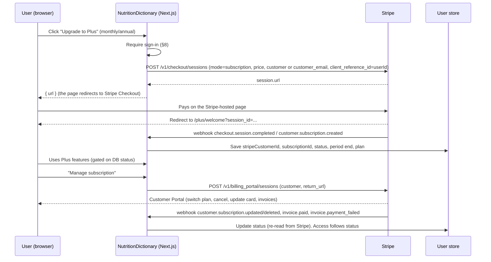

# NutritionDictionary: Stripe Integration Plan

*Generated 2026-11-04 with Stripe's `stripe_implementation_planner` (guide `iguide_61VhbzFAc0bobNT3c41BJBe1RKB2N`, account `acct_1UYAsNBJBe1RKB2N`, live), then adapted to this codebase. Stripe products: **Payments, Billing, Invoicing**. Status: **built 2026-11-14 and tested against a fake Stripe client only** (§5, §7). Nothing has been created in Stripe and the app has never called it.*

## 1. What we're building

- **Free** (today's app): planning with no account and no card.
- **NutritionDictionary Plus**: a subscription at **$5.99/month or $39.99/year** that unlocks the week planner with a grocery list, a whole-plan contaminant check, 50 AI photo reads a month, and all saved plans and recipes on every device ([DECISIONS.md](DECISIONS.md)). Every new account gets 14 days of Plus with no card.
- People subscribe on a **Stripe-hosted Checkout page**. They manage their subscription in the **Stripe Customer Portal**: switch monthly ↔ annual, cancel, update their card, download invoices and receipts.
- **Webhooks** keep our database in sync, and the app turns Plus features on or off from that data.
- Stripe sends receipts and invoices automatically. We sell no physical goods and give no medical advice.

## 2. Decisions (from the planner)

| Planner question | Choice | Why |
|---|---|---|
| Surface | **Web** | Browser app; no mobile app |
| No-code (Payment Link / Pricing Table)? | **No: code integration** | Subscriptions must link to our own user accounts and sync by webhook |
| Control page layout or branding? | **No** → redirect is fine | Use **Stripe-hosted Checkout** ⭐ (Stripe's default). Brand it under Dashboard → Settings → Branding |
| Managed Payments (Stripe handles tax, fraud and compliance)? | **No, for now** | Standard fees (2.9% + 30¢ + 0.7% Billing) instead of an extra ~3.5%. Revisit if global VAT/GST compliance becomes a burden ([docs](https://docs.stripe.com/payments/managed-payments/set-up?mode=subscription)) |
| Pricing model | **Flat rate** ⭐ | One product, "NutritionDictionary Plus", with two recurring prices: monthly and annual |
| Free access before charging | **Freemium** (no card) | The free tier needs no card. A Plus trial (§9) is a plan-design detail on top |
| Subscription changes | **Customer Portal** ⭐ | Upgrades, downgrades, cancellations, card updates and invoice history, with no custom UI |
| Failed payments | **Smart Retries + automated emails** ⭐ | Configured in the Dashboard; no code |
| Tax | **Free threshold monitoring** | No tax registrations yet. Set the product tax code and head-office address, and Stripe alerts you before you cross a threshold ([docs](https://docs.stripe.com/tax/monitoring)) |
| Sales-led quotes/contracts | Not applicable | Self-serve consumer product |

**Billing mode:** subscriptions created on Stripe API `2025-09-30.clover` or later default to **flexible billing mode**. That's the planner's recommended setting, which gives more accurate prorations when people switch monthly ↔ annual. Use the latest `stripe` Node SDK so this is automatic ([docs](https://docs.stripe.com/billing/subscriptions/billing-mode)).

**Customer objects:** the planner's portal blueprint uses Accounts v2 (`customer_account`). For non-Connect businesses that API is still in **public preview** and requires opting in. We'll use the generally available **Customers v1** (`customer`) and can migrate later ([docs](https://docs.stripe.com/accounts-v2/use-accounts-as-customers)).

## 3. How it fits together



## 4. Stripe Dashboard setup (sandbox first, then live)

Do each step in the **sandbox** ("NutritionDictionary sandbox", the `STRIPE_TEST_*` keys) first. Repeat it in **live** only when launching.

1. **Product catalog** → add product **"NutritionDictionary Plus"**.
   - Add a description, and set the tax code to SaaS for personal use. We'll check the exact `txcd_` code at setup.
   - Add two recurring prices: **$5.99 / month** with lookup key `plus_monthly`, and **$39.99 / year** with lookup key `plus_annual`.
   - With lookup keys, the code can find each price by name in both sandbox and live. Copy the price IDs into `STRIPE_*_PRICE_PLUS_MONTHLY/ANNUAL` as a fallback.
2. **Settings → Billing → Customer portal:**
   - Turn on: update payment method, invoice history, cancel at **period end**, and switch plans between the two Plus prices (with prorations).
   - Set the default return URL (`http://localhost:3000/account` while testing).
3. **Settings → Billing → Revenue recovery:** turn on Smart Retries, failed-payment emails, and automatic card updates. After all retries fail, **cancel the subscription**.
4. **Settings → Billing → Subscriptions and emails:** turn on receipts and upcoming-renewal emails (for the annual plan). Set the default billing mode to **Flexible**.
5. **Settings → Branding:** add the logo, colours and public business name "NutritionDictionary".
6. **Tax:** add the head-office address and enable threshold monitoring.
7. **Webhooks:** create an endpoint, `https://nutritiondictionary.com/api/stripe/webhook` in production. Locally, `stripe listen` forwards events (§7). Subscribe to:
   - `checkout.session.completed`
   - `customer.subscription.created`, `customer.subscription.updated`, `customer.subscription.deleted`
   - `invoice.paid`, `invoice.payment_failed`
   - optional: `entitlements.active_entitlement_summary.updated`, if you use Stripe Entitlements to gate features
8. **API keys:** use a **restricted key** in production. Grant write access only to Checkout Sessions, Customers, Subscriptions and Customer portal sessions, and read access to Prices, Products, Invoices and Events.

## 5. What's built

Server code is in `food-nutrition-app/`. The `stripe` Node SDK is pinned at **23.1.0** (API `2026-10-28.endive`, flexible billing mode by default). It's loaded only on the server, and only when billing runs.

| Where | What |
|---|---|
| `lib/billing/entitlements.ts` | **The one source of truth.** `entitlementsFor(record, now)` gives `free`, `trial` or `plus` and its features; `has(entitlements, feature)` checks `photoQuota`, `unlimitedHistory`, `weekPlanner` or `planContaminants`. Plus means the subscription is `active` or `trialing`, or `past_due` for at most 3 days while Smart Retries run. The trial is 14 days from the first time the app sees the account: a new account's creation, or an older account's first visit after this shipped |
| `lib/user-store/entitlements.ts` | Storage in the existing single table, on SQLite and DynamoDB: `USER#<id>/ENT`, photo counters, a `STRIPECUS#` pointer for webhooks, and processed `STRIPEEVT#` ids. Tests run on both backends |
| `lib/billing/stripe-config.ts` | Reads `STRIPE_MODE` and the matching keys, and enforces the **live-key guard** (below) |
| `lib/billing/checkout.ts` | `POST /api/stripe/checkout { interval: 'month' \| 'year' }` → `{ url }`. Creates the Customer once (Customers v1, with an idempotency key per user and mode), then a subscription Checkout Session. The session sets `customer` and `client_reference_id`, puts `metadata.userId` on the session and the subscription, allows promotion codes, and sends people to `/plus/welcome` on success or back to `/plus` on cancel. A second subscription is refused (409). `POST /api/stripe/portal` → `{ url }` of a Customer Portal session that returns to `/account` |
| `lib/billing/webhook.ts` | `POST /api/stripe/webhook`. Verifies `Stripe-Signature` on the raw body with the SDK, skips event ids it has already processed, and re-reads the subscription from Stripe on every event, so out-of-order delivery can't leave stale state. Handles `checkout.session.completed`, `customer.subscription.created/updated/deleted`, `invoice.paid` and `invoice.payment_failed` (which flags "update your card"). A failure returns 500 and isn't marked processed, so Stripe's retry applies it. If the account behind a paid Checkout was deleted meanwhile, the subscription is cancelled |
| `lib/billing/cancel.ts` | **Account deletion cancels an active subscription first** (`DELETE /api/account`). If Stripe can't be reached, or billing is off, nothing is deleted and the person sees "We couldn't cancel your Plus subscription, so your account hasn't been deleted…". No refund is issued automatically. Stripe keeps the Customer and its invoices for tax records |
| `lib/billing/quota.ts`, `photo-gate.ts`, `history-limits.ts`, `gate.ts`, `server.ts` | The limits below, plus `requireFeature` / `plusRoute` for Plus-only API routes |
| `GET /api/me` | `user.plan`: the plan, trial days left, subscription status, renewal date, cancel state, photo reads used, the history limit, and whether billing is set up. No Stripe ids reach the browser |
| `app/plus`, `app/plus/welcome`, `components/billing/*` | The `/plus` page, linked from the account menu and every gate. The post-Checkout page that waits for the webhook. The plan panel on `/account` with **Manage subscription**, `PlusGate`, and the photo and history notes |

**Live-key guard.** A live key (`sk_live_`, `rk_live_`) is refused unless `NODE_ENV=production` **and** `STRIPE_ALLOW_LIVE=1`. `npm run dev`, `npm test` and `npm run preview` (a production build, but without the flag) never build a Stripe client with a live key. Checkout, the portal and webhooks answer "billing isn't set up", and the server log says why. A key that doesn't match `STRIPE_MODE` is refused the same way. With no Stripe settings at all, the site works and the upgrade buttons say billing isn't set up.

**Gating a Plus feature.** The week planner and the plan contaminant check are marked `// PLUS-GATE: weekPlanner` and `// PLUS-GATE: planContaminants`. Wrap each one like this:

```tsx
// UI: one line
import PlusGate from '@/components/billing/PlusGate';
<PlusGate feature="weekPlanner"><WeekPlanner /></PlusGate>

// API: 401 when signed out, 403 { code: 'plus_required' } on free
import { plusRoute } from '@/lib/billing/server';
export const POST = plusRoute('weekPlanner', async (request, { userId }) => Response.json({}));
```

A server component can call `pageHasFeature('weekPlanner')`, and client code can use `usePlus().has('weekPlanner')`.

### Limits, and why

| | Free | Trial (14 days) | Plus |
|---|---|---|---|
| AI photo reads | **3 a month** | **10 in total** | **50 a month** |
| Saved plans and recipes shown | newest **5** of each | all | all |
| Week planner, plan contaminant check | – | ✓ | ✓ |
| Pasted-text recipes, food pages, meters, one-day planner, export | ✓ | ✓ | ✓ |

- **Photo reads are the only per-account AI quota.** §3.7 of the AWS design puts a photo at about $0.0013 on Haiku and $0.027 when it escalates to Sonnet (plated food goes straight to Sonnet). In the worst case, all on Sonnet:
  - free costs at most $0.08 per active account a month
  - a trial costs at most $0.27, once
  - Plus costs at most $1.35 a month, against at least $3.17 net revenue per payer (about $0.37 at the blended $0.0074)

  That's looser than §3.7's "5 lifetime imports" for free accounts. That figure predates the free built-in text reader: text rarely needs AI now, so the AI budget can go to photos. The $5/day global cap ([DECISIONS.md](DECISIONS.md)) and the per-IP limits stay as backstops.
- **Pasted text costs nothing and is never counted.** The built-in reader handles most of it at $0. When it's unsure and AI reads the text (Haiku, about $0.0017), that read isn't counted either, because pasted recipes are always free. Those reads are bounded by the per-IP limits (10 a minute, 50 a day) and the daily AI budget instead.
- **How reads are counted.** A read reserves one unit with an atomic increment before the model is called, so parallel uploads can't overshoot, and gives it back if the read fails.
  - Months are **UTC calendar months** for everyone, resetting at 00:00 UTC on the 1st. A counter then means the same thing on every server, and the reset date is one fact the UI can show.
  - Each plan has its own counter, so an upgrade, or the end of the trial, starts fresh.
  - Photo reads need a free account. Signed-out visitors are asked to sign in.
- **History.** Free accounts list and reopen only their newest 5 plans and 5 recipes. Older rows are **kept, not deleted**: they come back with Plus and are always in the export. Viewed foods are never limited. The existing 500-per-kind abuse cap still applies to everyone.

## 6. Fees (what a subscriber nets you)

Fees are 2.9% + 30¢ per card payment, plus 0.7% Stripe Billing, plus 0.5% Stripe Tax once you collect tax. The figures come from `AWS_HOSTING_DESIGN.md` §4.3.

| | Monthly $5.99 | Annual $39.99 |
|---|---|---|
| Card fee | $0.47 | $1.46/yr |
| Billing 0.7% | $0.04 | $0.28/yr |
| **Net** | **≈ $5.44/mo** | **≈ $38.25/yr (≈ $3.19/mo)** |

International cards add 1.5% and currency conversion adds 1%. Disputes cost $15 each.

## 7. Testing locally (no real money)

**Without Stripe at all.** `npm test` covers:
- the entitlement rules and trial dates
- quota counting, including month rollover in UTC
- history limits and account deletion
- the live-key guard
- Checkout and portal requests, against an in-memory fake client
- the webhook, with fixture events signed using Stripe's documented scheme (`t=<time>,v1=<HMAC-SHA256 of "<time>.<body>">`) and verified by the real SDK

To see an upgrade in a running app without Stripe, deliver a signed fixture to `postWebhook` against your local database, as `lib/billing/webhook.test.ts` does.

**In the Stripe sandbox** (never with live keys):

1. In the sandbox, do §4 steps 1–2: the product with both prices, and the Customer Portal settings.
2. In `food-nutrition-app/.env.local`:
   - set `STRIPE_MODE=test`
   - fill in `STRIPE_TEST_SECRET_KEY` (`sk_test_…` or `rk_test_…`), `STRIPE_TEST_PRICE_PLUS_MONTHLY` and `STRIPE_TEST_PRICE_PLUS_ANNUAL`
   - leave `STRIPE_ALLOW_LIVE` unset

   The live `STRIPE_*` values can stay: test mode ignores them, and they'd be refused anyway.
3. Install the Stripe CLI (`brew install stripe/stripe-cli/stripe`), run `stripe login`, then:
   ```bash
   stripe listen --forward-to localhost:3000/api/stripe/webhook \
     --events checkout.session.completed,customer.subscription.created,customer.subscription.updated,customer.subscription.deleted,invoice.paid,invoice.payment_failed
   ```
   Copy the `whsec_…` it prints into `STRIPE_TEST_WEBHOOK_SECRET`. Then start the app on port 3000 (`npm run dev`) in another terminal.
4. Sign in at <http://localhost:3000/account/sign-in>. The sign-in link prints in the app's terminal. `/account` shows the 14-day trial.
5. Open `/plus`, pick monthly or yearly, and press **Get Plus**. Pay on Stripe's page with a test card, using any future expiry date, any CVC and any postcode:

   | Card | What happens |
   |---|---|
   | `4242 4242 4242 4242` | Succeeds |
   | `4000 0025 0000 3155` | Asks for 3D Secure; complete it to succeed |
   | `4000 0000 0000 9995` | Declined at Checkout (insufficient funds) |
   | `4000 0000 0000 0341` | Attaches, then fails on the next charge. Use it with a test clock to see `past_due`, the card warning and the 3-day grace |

6. You land on `/plus/welcome`, which changes to "Welcome to Plus" when the webhook arrives (watch the `stripe listen` output). `/account` then shows Plus, the renewal date and **Manage subscription**.
7. **Manage subscription** opens the portal. Switch between monthly and yearly, cancel (the account page then says when Plus ends), or update the card. Each change comes back through `customer.subscription.updated`.
8. **Deletion.** Delete the account on `/account`. The subscription is cancelled in the sandbox first; check Dashboard → Subscriptions. To see deletion refuse with a clear message, repeat with a subscribed account after changing `STRIPE_TEST_SECRET_KEY` to an invalid test key.
9. **Time travel.** Create a subscription on a **test clock** (Dashboard → Billing → Test clocks) to fast-forward renewals and failed-payment retries. `stripe trigger customer.subscription.deleted` and similar commands send synthetic events. Those belong to new test customers, so the app acknowledges and ignores them unless the customer is one of yours.

> **Live keys stay safe on a laptop.** Even with `STRIPE_MODE=live` and live keys in `.env.local`, the app refuses them unless `NODE_ENV=production` and `STRIPE_ALLOW_LIVE=1`. So `npm run dev` and `npm run preview` can't charge a real card. Set `STRIPE_ALLOW_LIVE=1` only on the production server, from the secret store.

## 8. Prerequisite: sign-in

A subscription has to belong to a person, and today the app has no accounts (everything lives in the browser). Before Checkout can be built, we need at least:
- sign-in
- a user record holding `stripeCustomerId` and subscription state
- server-side checks on Plus-only API routes

**Update: decided and built.** Accounts use **Better Auth with passwordless email links** (see [ACCOUNTS.md](ACCOUNTS.md)), and users live in `lib/user-store` (SQLite locally, DynamoDB on AWS). The plan record with `stripeCustomerId` and subscription state lives there too (§5), and account deletion cancels the subscription first. The rest of this section is the original reasoning.

The AWS design proposes **Amazon Cognito** for production. For a laptop-testable first version, an email-link sign-in behind an interface that Cognito can replace later is the simplest path. **Decision pending.**

## 9. Open decisions

1. ~~**What Plus unlocks first.**~~ Decided 2026-11-14 ([DECISIONS.md](DECISIONS.md)): AI photo quota, unlimited history, week planner + grocery list, and a whole-plan contaminant check. Price stays $5.99/month or $39.99/year.
2. ~~**Trial.**~~ Decided 2026-11-14: a 14-day no-card "reverse trial" with capped AI.
3. ~~**Sign-in method** (§8).~~ Decided: Better Auth email links.
4. **Managed Payments** later, if you'd rather Stripe handle global tax as merchant of record.
5. **EU/UK VAT** before selling there (AWS design §3.6): restrict Checkout to US/CA, register for VAT OSS, or use Managed Payments.

## 10. Go-live checklist

Follow Stripe's [go-live checklist](https://docs.stripe.com/get-started/checklist/go-live). In particular:
- Recreate the product, prices, portal settings and webhook endpoint in **live**.
- Store live keys in the production secret store (AWS SSM Parameter Store SecureString), never in the repo or on a laptop. Set `STRIPE_MODE=live` and `STRIPE_ALLOW_LIVE=1` there only.
- Use a restricted key.
- Verify the webhook signature secret for the production endpoint.
- Do one real $5.99 purchase and refund it.
- Confirm receipts and portal links work on `nutritiondictionary.com`.
