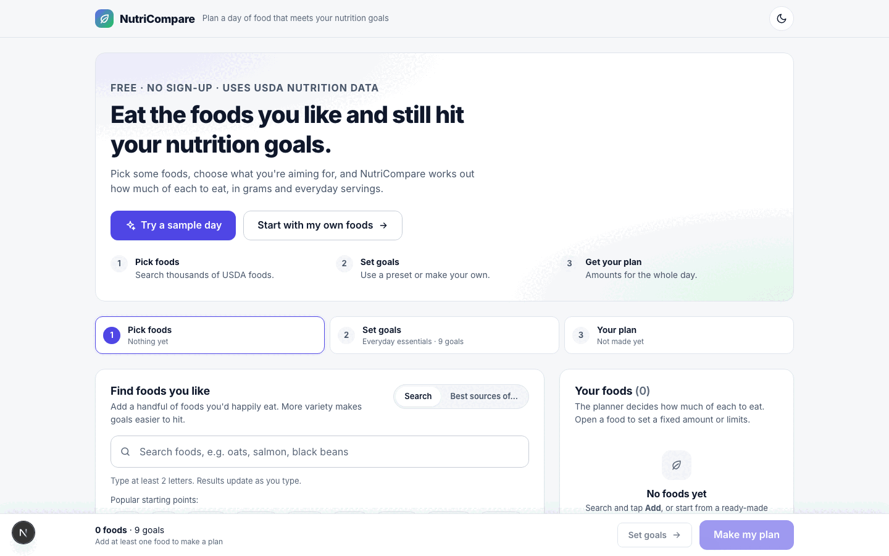
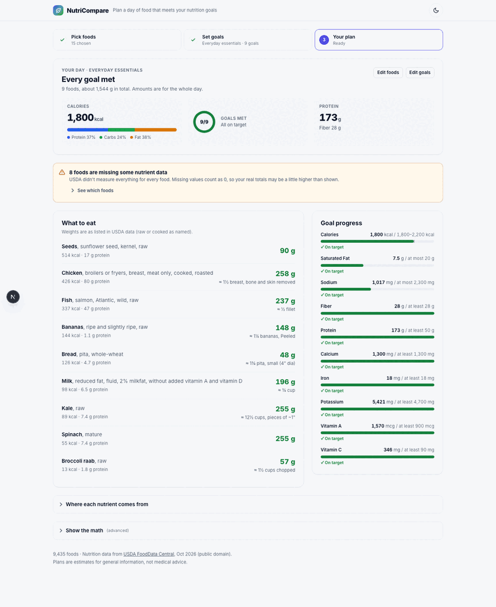
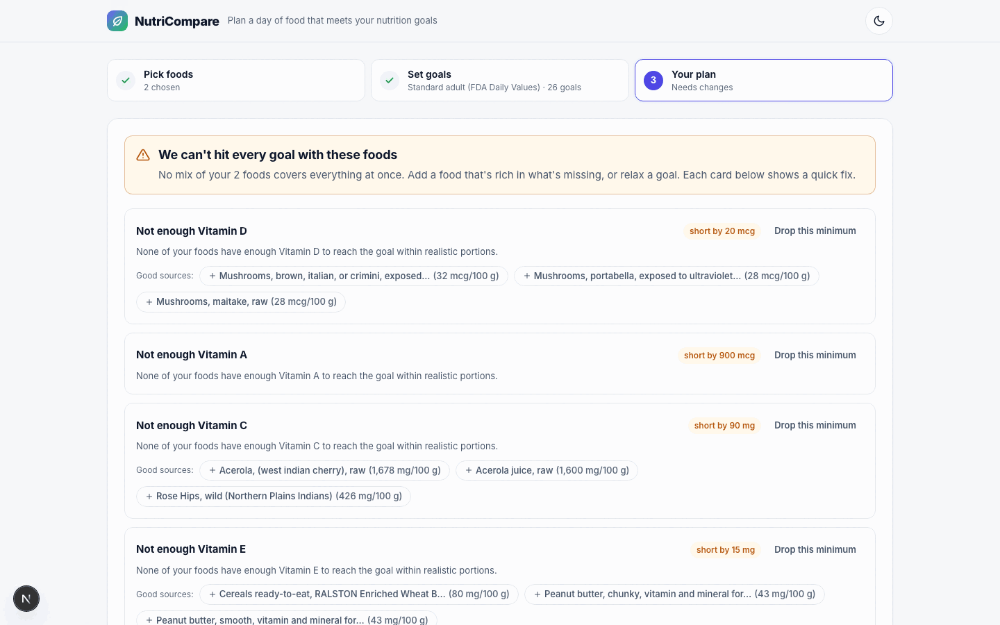
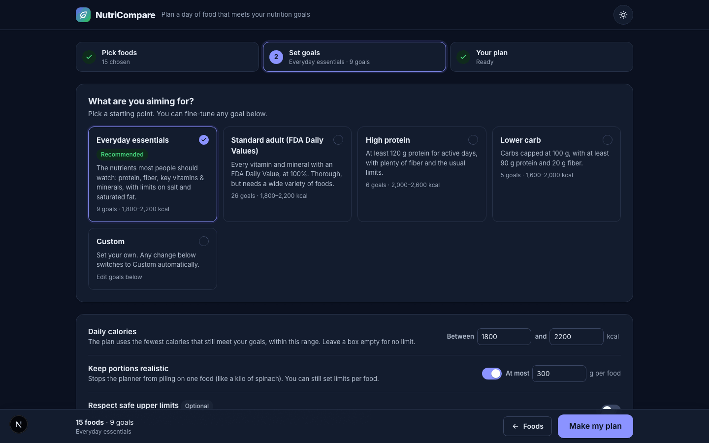
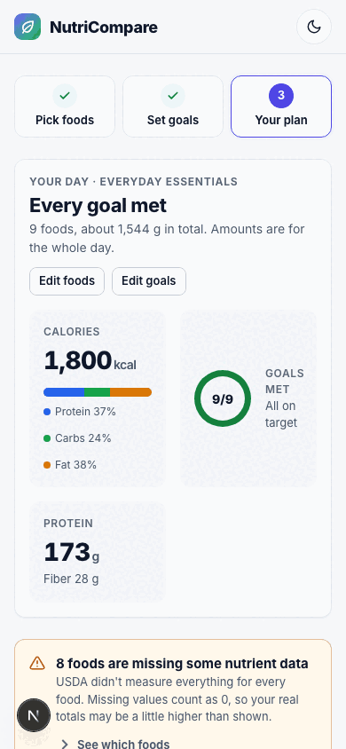
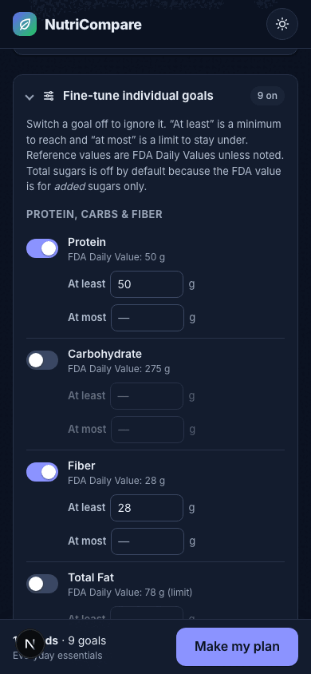

# NutriCompare UX Audit

_Section C (UX) review, November 2026. Tested with headless Chromium (Playwright 1.58.2) against `npm run dev` on port 3100, at 1440×900 (desktop) and 390×844 (phone), in light and dark themes, using the 411-food Foundation Foods DB._

## How it was tested

The persona was a first-time, non-technical visitor who wants "a day of food that covers my nutrients". Scripted journeys:

1. Land on the page and form a first impression.
2. Search "chicken", add it, then search and add rice, broccoli, milk, beans and orange.
3. Press **Optimize Diet** with the default goals.
4. Read the result, then explore Top Foods, the comparison, serving sizes and dark mode.
5. Use the phone width, keyboard only (Tab order and focus styles), and check labels and contrast.

## Before: findings ranked by severity

### S1: blockers (a newcomer cannot get a useful result)

| # | Finding | Evidence |
|---|---------|----------|
| 1 | **The default goals are close to impossible.** All 27 nutrients are switched on at 100 % of the FDA Daily Value. The 6-food journey failed on all 4 device/theme runs. A first useful plan needs roughly 15 well-chosen foods *and* knowing which of the 27 goals to loosen. Nothing tells the user this. | `before-desktop-infeasible.png` |
| 2 | **The infeasible result is jargon with no way forward.** It says "Optimization Failed: Cannot stay under Sugars limit (exceeds by 523g)…" in red, with two "Debug: LP Constraints (Raw)" panels below. It doesn't explain what to change and doesn't suggest foods. | `before-desktop-infeasible.png` |
| 3 | **Clearing a goal doesn't remove it.** Emptying an input sends `{}` for that nutrient, and the optimizer then re-applies the default (verified: clear Vitamin D → the request has `vitamin_d_ug: {}` → "Cannot meet Vitamin D target" still appears). The UI silently ignores the user's edit. | Playwright request capture |
| 4 | **Many foods show "0 kcal / 0 g protein".** 225 of the 411 foods have calories stored as 0 because the data is missing. Search for "chicken" and the first 3 results show 0 kcal. They look like real values, so users add them and get nonsense plans. | `before-desktop-search-zero-kcal.png` |
| 5 | **The phone layout is broken.** The goals grid uses a fixed `1fr 340px`, so on a 390 px screen the inputs shrink to about 30 px and the page scrolls sideways (`scrollWidth` is 680 px against a 390 px viewport). The comparison cards (`min-width: 320px` × 3 columns) overflow too. | `before-phone-dark-goals.png` |

### S2: major friction

| # | Finding |
|---|---------|
| 6 | **There is no guided path.** The landing page is a search box above 50 "Top Foods Explorer" cards (dried egg white, soy flour…). Nothing explains what the app does or what to do first. The headline promises "compare nutrition facts", but the real value, a day plan that meets goals, is hidden until you add a food. |
| 7 | **The page is one very long scroll** (around 6,000 px on desktop with 6 foods): search results, then Top Foods, then 27 goal input pairs, then the result, then 6 full FDA labels. The Optimize button sits below 54 number inputs, and the result appears far from where the user started. |
| 8 | **The language is LP and dev jargon.** "Optimizable Candidates", "Add Fixed", "Guaranteed Foods (Fixed)", "Diversity Mode", "Constraints Analysis", "Optimization Failed", "Debug: Optimization Equations". Units come out as "vitamin d ug". |
| 9 | **Each goal is a bare Min/Max pair with no context.** Nothing says which nutrients matter, what the FDA reference value is (that lives in a separate slide-out "DAILY VALUES" tab), or whether the default is a floor or a ceiling. |
| 10 | **Results read like a spreadsheet, not a meal plan.** Only grams are shown (e.g. "1020g spinach"), with no household servings. With 15 foods, the default plan is about 1 kg of spinach and 400 g of dry oats, because nothing caps a single food at a realistic portion unless "Diversity Mode" is found and switched on. |
| 11 | **Any change wipes the result.** Adding a food or changing a weight sets the result to `null`, so tweaking and comparing is impossible. |
| 12 | **Search is slow and clunky.** You have to press Enter, there are no live results, and each result is a large card (about 330 px tall), so only 3 to 6 are visible. Result names aren't split ("Chicken, broiler or fryers, breast, skinless, boneless, meat only, cooked, braised"). Pagination scrolls to the top of the page. This won't scale to the planned database of several thousand foods. |
| 13 | **Fixed-amount foods ("guaranteed") are a separate list from selected foods.** The same food can be in both. Removing it uses a bare "×" with no label. |
| 14 | **There are no error states.** A failed search shows an empty list, a failed Top Foods load spins forever, and loading shows a bare "Loading...". |

### S3: polish, accessibility and consistency

| # | Finding |
|---|---------|
| 15 | **Keyboard navigation has problems.** The first Tab stops are two floating icon buttons, then the off-screen sidebar's "×" button (focusable while hidden). Search and icon buttons have no visible focus ring (`outline: 0px`). The search submit button has no accessible name. The theme and debug buttons rely on `title` only. |
| 16 | **Inputs have no programmatic labels.** Goal inputs use placeholder "Min"/"Max" with a visually adjacent `<label>` that isn't associated. Screen readers announce "edit text, 20". |
| 17 | **Contrast is too low.** `--text-muted` (#94a3b8) on white is 2.6:1 and is used for food categories, serving chips and the footer text (WCAG AA needs 4.5:1). The 10–11 px text in serving chips makes it worse. |
| 18 | **Results aren't announced.** There is no `aria-live` region, so screen-reader users don't hear when a plan is ready or fails. |
| 19 | **Dark mode ignores the OS setting** (it always starts light) and flashes light on load. Comparison inputs have hard-coded white backgrounds in dark mode. |
| 20 | **The floating "link" icon (debug) and the "DAILY VALUES" tab overlap content on phones.** Nothing explains what the icons mean. |
| 21 | **The Daily Values table is defined 3 times** (sidebar, nutrition label, `NUTRIENT_CONFIG`) and has already drifted (pantothenic acid appears in only one copy). |
| 22 | **The Nutrition Facts label shows "0.0g" for nutrients with no data** and "0%" DV, which reads as "this food has none". |

### Clicks to a first useful plan (before)

* The scripted 6-food attempt took **14 interactions and failed**.
* A successful plan needs about 15 well-chosen foods with data (around 30 interactions) *plus* editing several of the 54 goal inputs (and, because of finding 3, clearing a field doesn't work). In practice a newcomer **doesn't reach a useful plan**.

## Redesign plan

1. **A guided 3-step flow: Foods, then Goals, then Plan.** A stepper sits at the top and a sticky action bar ("8 foods · Everyday essentials · **Make my plan**") is always one click from a result.
2. **"Try a sample day".** On the welcome screen, one click loads 15 staple foods (found by search, so it survives the DB rebuild), picks a goal preset and builds a plan.
3. **Goal presets in plain language.**
   * *Everyday essentials* (recommended): 10 key nutrients and 1,800–2,200 kcal.
   * *Full FDA Daily Values*: all 27.
   * *High protein*.
   * *Lower carb*.
   * *Custom*: any edit switches to this.
   Each nutrient row shows "at least / at most", an on/off switch and the FDA reference value inline, which replaces the slide-out Daily Values sidebar. Turning a goal off really removes it: the request sends `''`, which the optimizer treats as "no limit".
4. **Realistic portions are on by default** (at most 300 g of any one food) and can be changed in the Goals step.
5. **The plan reads like a meal plan.**
   * A summary with total kcal, food count and "9 of 10 goals met".
   * Goal progress bars, grouped.
   * Each food shows grams *and* household servings ("≈ 1½ cups, chopped").
   * Fixed foods are tagged.
   * "Where each nutrient comes from" and "Show the math" sit in collapsed sections.
6. **Infeasible plans help the user fix them.** The message is "We can't hit every goal with these foods". It lists which goals fall short or run over, and for each shortfall it suggests top foods from `/api/foods/top` with one-click **Add**. It also offers "Turn off this goal" and "Switch to Everyday essentials".
7. **Progressive disclosure.** Fixed amounts and per-food min/max limits live in a "More options" panel on each food in "Your foods". Debug equations are hidden under "Show the math". The comparison is an optional "Compare labels" view.
8. **Search for scale.**
   * Live, debounced search (it aborts stale requests).
   * Compact rows with the name split into a bold first part and a muted remainder, a category chip, kcal and protein per 100 g, and a "limited data" badge.
   * A scroll-capped list with "Show more".
   * A "Best sources of…" tab replaces the giant Top Foods grid.
9. **States.** Every async area gets skeleton/loading, empty and error-with-retry states. A "Plan out of date: Update plan" banner replaces the wipe-on-change behaviour. Results get `aria-live`.
10. **Accessibility and visuals.**
    * Labelled inputs and a focus ring on everything.
    * AA contrast tokens.
    * Theme follows the OS on first visit, with no flash.
    * Responsive single-column layout on phones.
    * Consistent spacing and type scale.
    * Restrained motion (bar fills, step transitions) that respects `prefers-reduced-motion`.
11. **Code.** Split the 888-line `page.tsx` into hooks (`usePlannerState`, `useFoodSearch`, `usePlan`) and step components. Existing `localStorage` keys keep working (`selectedFoods`, `guaranteedFoods`, `customConstraints` in all 3 legacy formats, `foodConstraints`, min/max calories, `maxFoodAmount`).

## After: what changed

These were re-tested with the same Playwright setup against the merged 9,435-food database (Foundation + SR Legacy + FNDDS) and Section B's API.

| | Before | After |
|---|---|---|
| Clicks to a first useful plan | Not reached (14 interactions, then failure) | **1 click** ("Try a sample day", about 1 s) gives "Every goal met" on all 4 device/theme runs |
| Manual path (8 foods) | 14+ interactions, then failure with jargon | 18 actions (2 per food + "Make my plan"). Shortfalls get a plain-language explanation, one-click food suggestions and quick fixes |
| Default goals | 27 nutrients at 100 % DV, can't be switched off | Preset *Everyday essentials* (9 goals, 1,800–2,200 kcal); FDA, high-protein and lower-carb presets; per-goal on/off switches |
| Phone width | `scrollWidth` 680 px on a 390 px viewport | 390 px on every step (no horizontal scroll) |
| Missing data | Shown as "0 kcal / 0.0 g" | "—" everywhere, a "Limited data" badge in results, and one calm callout built from the API `warnings` |
| Keyboard | Hidden sidebar button focusable, no focus ring | A skip link comes first, then header, stepper and search; every control has a 2 px focus ring (inputs use a 3 px focus halo) |
| Theme | Always light, flashes on load | Follows the OS on first visit; an inline script sets it before paint |
| Console errors | — | None across all journeys (including hydration) |

 

### Implemented

* **Guided flow.**
  * A stepper (Pick foods → Set goals → Your plan) and a sticky action bar ("8 foods · 9 goals · **Make my plan**").
  * A welcome hero with **Try a sample day**. It resolves 15 staples by search, preferring foods with complete data, so it survives DB rebuilds.
* **Goals.**
  * Preset radio cards.
  * Calorie range.
  * "Keep portions realistic", on by default at 300 g per food. This uses the optimizer's `diversityMode`.
  * Opt-in "Respect safe upper limits" (`applyUpperLimits`).
  * A collapsible "Fine-tune individual goals" section, grouped as macros, limits, vitamins, minerals and omega-3s. Every nutrient row has a switch, "at least" and "at most" inputs, and its reference value (FDA DV, adequate intake or none) plus the upper limit.
  * Turning a goal off sends `{min:'', max:''}`.
  * Total sugars is off by default, with an explanation of the added-vs-total distinction.
* **Foods.**
  * Live debounced search that aborts stale requests.
  * Compact two-line rows: bold short name plus detail, category chip, kcal and protein per 100 g, data-source label, Add/Added toggle with `aria-pressed`.
  * A scroll-capped list with "Show more", quick-start chips, and a "Best sources of…" tab covering all nutrients.
  * "Your foods" basket. Each item has an options panel: "Let the planner choose" or "I'll eat exactly ___ g" (this replaces the separate guaranteed list), and optional at least/at most limits with household serving references.
  * "Clear all" with Undo.
  * "Compare nutrition labels" with a per-food serving-size picker.
* **Plan.**
  * Summary: headline "Every goal met" or "7 of 9 goals met", total kcal with a macro split bar, goals-met ring, protein and fiber, and cost if the API ever provides it.
  * "What to eat" lists grams plus household amounts (e.g. "≈ 3¼ cups, chopped", "≈ 1½ breast"). Fixed foods are tagged.
  * Goal progress bars with plain status text ("Short by 155 mcg") and a `role="meter"` label.
  * Collapsed "Where each nutrient comes from" and "Show the math (advanced)".
  * An "out of date: Update plan" banner instead of wiping the result. Focus moves to the result heading. An `aria-live` region announces the outcome.
* **Infeasible.**
  * The message is "We can't hit every goal with these foods". Each issue is a card ("Not enough Vitamin D · short by 20 mcg") with **Drop this minimum** and up to 3 one-click **Add** suggestions from `/api/foods/top`, skipping specialty items such as powders, oils and organ meats where possible.
  * Global quick fixes: switch to Everyday essentials, allow bigger portions, review goals, try again.
* **States.** Skeletons for search, top foods and plan. Error callouts with **Try again** for search, top foods and optimize (the API `error` text is shown). Empty states for no results, no foods and no plan.
* **Code.**
  * `page.tsx` went from 888 lines to about 120.
  * State lives in `hooks/usePlannerState.ts`, a persisted `useSyncExternalStore` store with no setState-in-effect, so lint is clean. The other hooks are `useFoodSearch`, `useTopFoods` and `usePlan`.
  * Components live in `components/{shell,foods,goals,plan,planner,ui}`.
  * The duplicated Daily Values tables were removed. Everything reads `lib/nutrient-defaults`.
  * `DailyValuesSidebar`, `FoodCard`, `TopFoods` and `SearchBar` were deleted.
* **Storage compatibility.** `selectedFoods`, `guaranteedFoods` and `foodConstraints` keep their keys and shapes. Goals move to `nc.goals.v2`, and the legacy `customConstraints` (all 3 historical shapes), `minCalories` and `maxCalories` are migrated on first load. This was verified with a seeded legacy profile: protein `{value:80,type:'min'}` became "at least 80", sodium `2000` became "at most 2000", and the preset showed as Custom.

### Known remaining issues

* **Search ranking (API).** "egg" ranks "Egg, yolk, dried" first and "salmon" ranks "Salmon nuggets, breaded". New users who tap the first result get odd foods.
* **"Best sources" and suggestions rank per 100 g.** Dried, fortified and organ foods dominate (vitamin A → liver). The UI filters these heuristically, but a per-serving or per-kcal ranking from the API would be better.
* **The optimizer minimizes calories,** so plans sit at the calorie minimum and can include very small amounts (for example 4 g of something). Household amounts show "a little" for these.
* **Sample-day foods still have gaps** (Foundation foods often lack saturated fat and vitamin A), so the missing-data callout usually appears.
* **Household servings are heuristic** ("≈ ¼ cup", "≈ 2 containers"). Some USDA portion labels read oddly ("pieces of ~1"").
* **The comparison scroller** shows about 4 labels per screen on desktop, and there is no side-by-side diff highlighting yet.

