# Micronutrient Diary: a guided tour of the redesigned site

_Toured on 4 November 2026 against the production build (`npm run build`, standalone server) with the full 9,435-food database. Screenshots were taken with headless Chromium at 1440×900 (desktop) and 390×844 (phone), in light and dark themes._

This tour is for the site's owner. You built the original version, but the interface was just redesigned, so much of it will look new. Each section shows a screenshot and then explains what you're looking at and what each control does. The last section is an honest list of rough edges I ran into along the way.

## Contents

1. [What this site is](#1-what-this-site-is)
2. [The 60-second tour](#2-the-60-second-tour)
3. [First look: welcome screen, header, footer](#3-first-look-welcome-screen-header-footer)
4. [Try a sample day](#4-try-a-sample-day)
5. [Step 1: Pick foods](#5-step-1-pick-foods)
   - [Search and popular starting points](#51-search-and-popular-starting-points)
   - ["Limited data" foods](#52-limited-data-foods)
   - [Best sources of…](#53-best-sources-of)
   - [Your foods: fixed amounts and per-food limits](#54-your-foods-fixed-amounts-and-per-food-limits)
   - [Compare nutrition labels](#55-compare-nutrition-labels)
   - [Clear all and Undo](#56-clear-all-and-undo)
6. [Step 2: Set goals](#6-step-2-set-goals)
   - [Presets](#61-presets)
   - [Calories, portions and safe upper limits](#62-calories-portions-and-safe-upper-limits)
   - [Fine-tune individual goals](#63-fine-tune-individual-goals)
7. [Step 3: Your plan](#7-step-3-your-plan)
   - [The summary](#71-the-summary)
   - [What to eat and goal progress](#72-what-to-eat-and-goal-progress)
   - [The missing-data callout](#73-the-missing-data-callout)
   - [Where each nutrient comes from](#74-where-each-nutrient-comes-from)
   - [Show the math](#75-show-the-math)
   - [The "Update plan" banner](#76-the-update-plan-banner)
   - [What upper limits look like in a plan](#77-what-upper-limits-look-like-in-a-plan)
8. [When the goals can't all be met](#8-when-the-goals-cant-all-be-met)
9. [When something goes wrong](#9-when-something-goes-wrong)
10. [Dark mode](#10-dark-mode)
11. [On a phone](#11-on-a-phone)
12. [Keyboard and accessibility](#12-keyboard-and-accessibility)
13. [What's remembered after a reload](#13-whats-remembered-after-a-reload)
14. [Behind the scenes](#14-behind-the-scenes)
15. [Tips: two questions people will ask](#15-tips-two-questions-people-will-ask)
16. [Rough edges noticed while touring](#16-rough-edges-noticed-while-touring)
17. [About these screenshots](#17-about-these-screenshots)

---

## 1. What this site is

Micronutrient Diary plans a day of eating. You pick foods you'd happily eat and choose what you're aiming for, such as enough protein, fiber, iron and vitamin C without too much salt. The site then works out **how much of each food to eat**, in grams and in everyday amounts like "≈ 1½ cups". If your foods can't cover every goal, it tells you which goals fall short and suggests foods to add.

It is free, needs no account, and remembers your choices in your own browser. The food data comes from the US Department of Agriculture (USDA).

## 2. The 60-second tour

1. **Open the site.** A welcome panel explains the idea in one sentence and offers two buttons ([section 3](#3-first-look-welcome-screen-header-footer)).
2. **Click "Try a sample day".** About half a second later you land on a finished plan built from 15 everyday foods, with "Every goal met" ([section 4](#4-try-a-sample-day)).
3. **Read the plan.** At the top are calories with a protein/carbs/fat split, a "goals met" ring and protein. Below that, "What to eat" lists each food with grams and household amounts, and "Goal progress" shows a bar per goal ([section 7](#7-step-3-your-plan)).
4. **Change something.** Click **Edit goals**, pick another preset such as *High protein*, and return to the plan. A banner says the plan is out of date. Click **Update plan** ([section 7.6](#76-the-update-plan-banner)).
5. **Try a hard goal set.** Pick *Standard adult (FDA Daily Values)* and click **Make my plan**. You'll see "We can't hit every goal with these foods", with one card per problem and one-click fixes ([section 8](#8-when-the-goals-cant-all-be-met)).
6. **Make it yours.** Go back to **Pick foods**, search for foods you actually eat, and click **Add**. Use the sliders icon on any food to fix an exact amount or set limits ([section 5](#5-step-1-pick-foods)).

The three steps (**Pick foods → Set goals → Your plan**) are always shown in the stepper near the top. A bar fixed to the bottom of the screen always offers **Make my plan**.

---

## 3. First look: welcome screen, header, footer

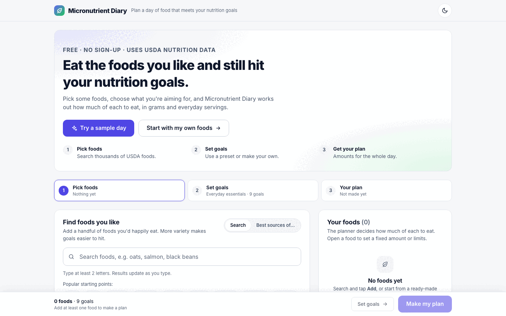

**What you see**

- **Header (top strip).** The leaf logo and "Micronutrient Diary" with the tagline "Plan a day of food that meets your nutrition goals". Clicking the logo always takes you back to step 1. The round moon/sun button on the right switches between light and dark mode.
- **Welcome panel.** "Free · No sign-up · Uses USDA nutrition data", the headline "Eat the foods you like and still hit your nutrition goals.", and two buttons:
  - **Try a sample day** loads 15 staple foods and builds a plan straight away ([section 4](#4-try-a-sample-day)).
  - **Start with my own foods** puts the cursor in the search box so you can start typing.
  - Underneath, a short "how it works" strip: 1 Pick foods, 2 Set goals, 3 Get your plan.
- **Stepper.** Three clickable cards: **Pick foods** ("Nothing yet" / "15 chosen"), **Set goals** (the current preset and goal count, such as "Everyday essentials · 9 goals") and **Your plan** ("Not made yet", "Ready", "Out of date" or "Needs changes"). Finished steps get a green tick. You can jump to any step at any time.
- **Step 1 panels.** "Find foods you like" on the left and "Your foods (0)" on the right, which also has its own **Try a sample day** button.

The welcome panel only shows while your food list is empty. It disappears as soon as you add a food, and comes back if you clear the list.

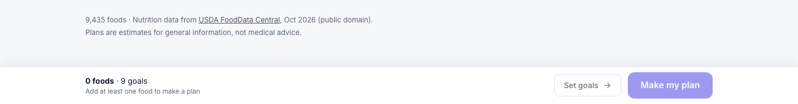

**Footer.** The first line is the data-source line: "9,435 foods · Nutrition data from USDA FoodData Central, Oct 2026 (public domain)". The food count and release month come live from the server, and the link goes to USDA's download page. The second line is the disclaimer: "Plans are estimates for general information, not medical advice."

**Action bar (fixed to the bottom of the screen on steps 1 and 2).** On the left is a running summary ("0 foods · 9 goals", plus a hint such as "Add at least one food to make a plan"). On the right is a secondary button (**Set goals →** on step 1, **← Foods** on step 2) and the main **Make my plan** button. Both stay greyed out until you have at least one food. The bar is hidden on the plan step.

## 4. Try a sample day

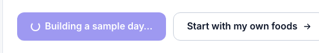

Clicking **Try a sample day** briefly shows "Building a sample day…". Behind the scenes the site searches the database for 15 staples (oats, salmon, spinach, yogurt, banana, almonds, broccoli, chicken breast, orange, whole-wheat bread, carrots, sunflower seeds, egg, kale and milk). For each one it picks the version with the most complete nutrition data. It adds them all to your list and runs the planner. If your goals were set to *Custom* or *FDA Daily Values*, it first switches them to *Everyday essentials* so the sample succeeds. On the local server the whole thing took about 0.4 seconds.

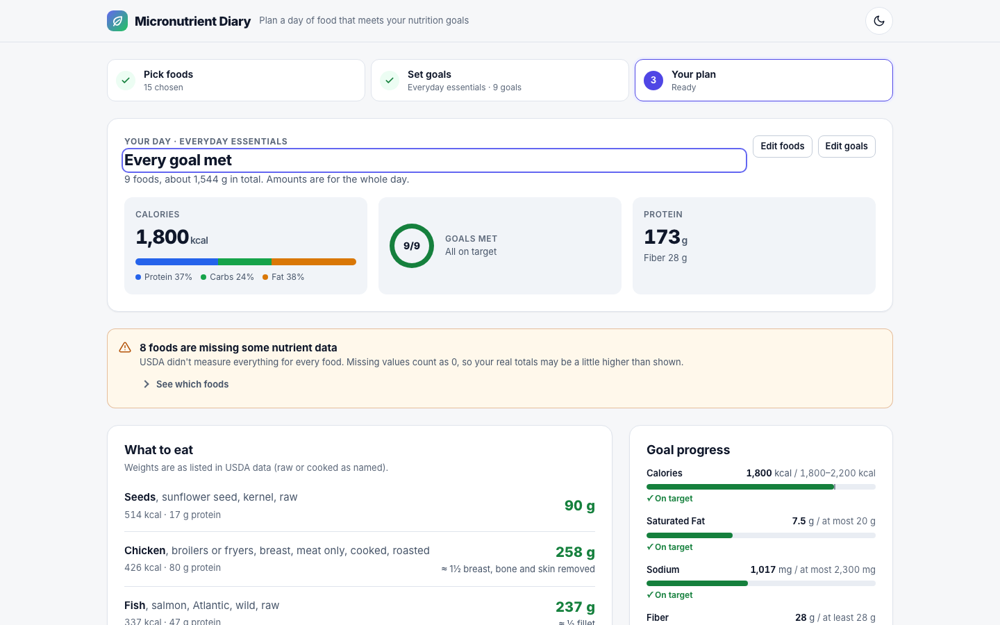

**The resulting plan** (Everyday essentials):

- **"Every goal met"**, with 9 of the 15 foods used, about 1,544 g of food in total.
- **1,800 kcal.** That is the bottom of the 1,800–2,200 kcal range, because the planner always looks for the fewest calories that still meet every goal.
- **Macro split:** protein 37 %, carbs 24 %, fat 38 %. Protein is 173 g, well over the 50 g minimum.
- **Goals met:** 9/9.
- A yellow note says 8 foods are missing some nutrient data ([section 7.3](#73-the-missing-data-callout)).

> **Worth knowing:** you chose 15 foods but the plan uses 9. Oats, yogurt, egg, almonds, orange and carrots were left out because the cheapest way, in calories, to hit these goals didn't need them. The page doesn't currently say this anywhere (see [rough edges](#16-rough-edges-noticed-while-touring)).

---

## 5. Step 1: Pick foods

### 5.1 Search and popular starting points

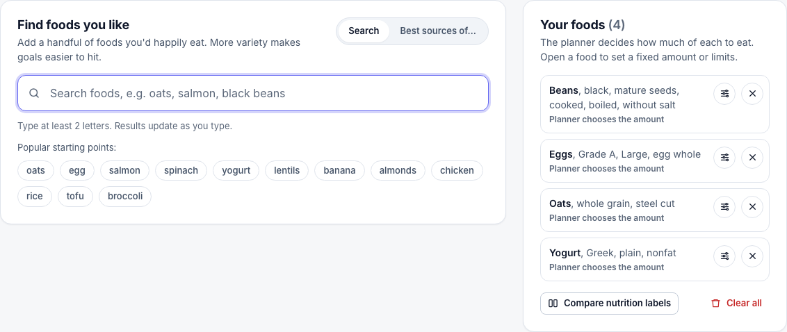

- **The search box** searches as you type once you've entered 2 letters. There's no need to press Enter. The **×** button clears it.
- The line under the box shows status: "Type at least 2 letters…", "Searching…", or "465 matches, showing 20".
- **Popular starting points** are one-click searches: oats, egg, salmon, spinach, yogurt, lentils, banana, almonds, chicken, rice, tofu, broccoli. They're shown while the box is empty.
- **Search / Best sources of…** at the top right switches between the two ways of finding foods ([section 5.3](#53-best-sources-of)).

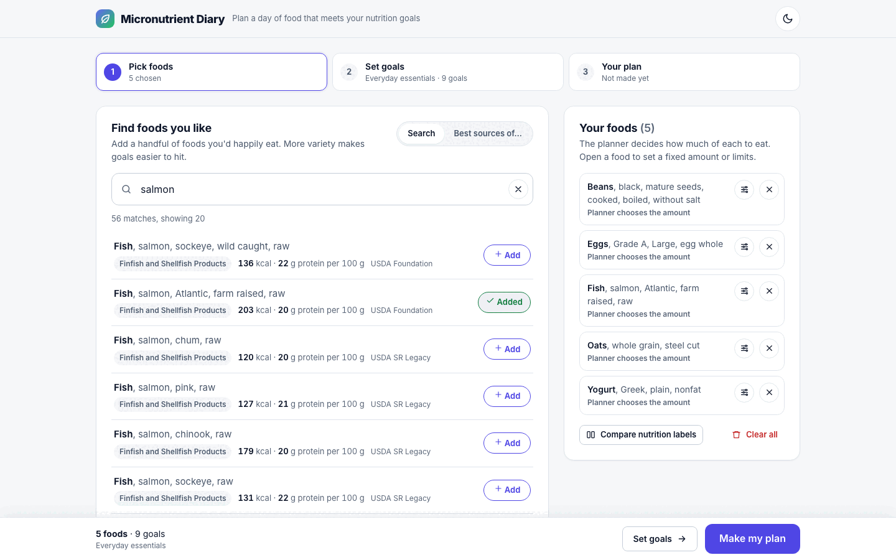

**Each result row shows:**

- **The name,** split into a bold first part and a lighter rest ("**Fish**, salmon, sockeye, wild caught, raw"). Hover over it to see the full USDA name.
- **A grey category chip** (for example "Finfish and Shellfish Products").
- **Calories and protein per 100 g.**
- **The data source:** "USDA Foundation", "USDA SR Legacy" or "Mixed dish (FNDDS)".
- **An Add button** that becomes a green **✓ Added** once the food is on your list. Clicking **Added** again removes it.

Results come 20 at a time. **Show more results** at the bottom of the list loads the next 20. If nothing matches, you get "No foods match…" with a hint to try a simpler word.

### 5.2 "Limited data" foods

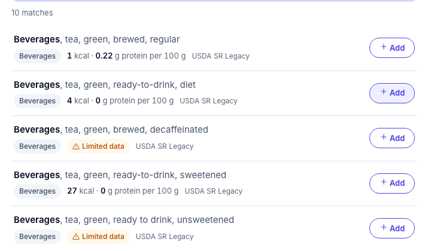

Some USDA entries have no calories or macronutrients recorded at all. Instead of showing a misleading "0 kcal", these rows show an orange **⚠ Limited data** badge. If you hover over it, it says plans may undercount the food. If you add one anyway, the "Your foods" panel warns you that "1 food has limited USDA data and may be undercounted".

### 5.3 Best sources of…

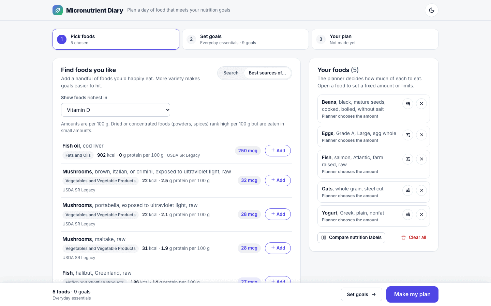

This tab lists the 40 foods richest in a single nutrient. Choose the nutrient from the **Show foods richest in** menu, which is grouped into macros, limits, vitamins, minerals and omega-3s. The purple badge shows the amount per 100 g, and **Add** works the same way as in search.

A note above the list warns that dried or concentrated foods rank high per 100 g but are eaten in small amounts. That's why cod liver oil tops the vitamin D list. Use this tab to find a food that fixes a specific gap, such as UV-exposed mushrooms for vitamin D.

### 5.4 Your foods: fixed amounts and per-food limits

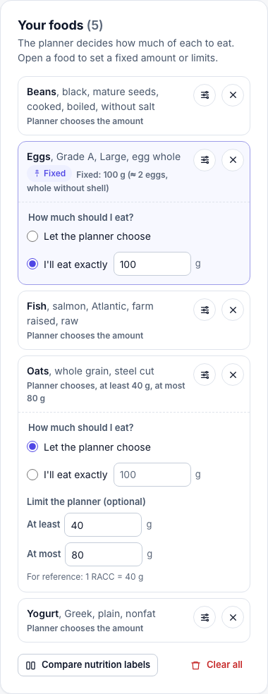

The right-hand panel is your shopping basket. Each food shows a one-line summary of how the planner will treat it, and has two small round buttons:

- **Sliders icon ("More options")** opens the food's settings.
- **×** removes the food.

Inside the options, under **How much should I eat?**:

- **Let the planner choose** is the default.
- **I'll eat exactly ___ g** locks the amount. The food gets a purple **📌 Fixed** tag and a summary such as "Fixed: 100 g (≈ 2 eggs, whole without shell)". The planner then plans the rest of your day around it. This is the "I'm definitely having two eggs" feature.
- **Limit the planner (optional)**, shown only when the planner chooses, has **At least ___ g** and **At most ___ g** boxes for that one food. The summary updates to "Planner chooses, at least 40 g, at most 80 g".
- **For reference** shows household serving weights from USDA, such as "1 egg, whole without shell = 50 g", to help you pick sensible numbers.

At the bottom of the panel are **Compare nutrition labels** and **Clear all**.

### 5.5 Compare nutrition labels

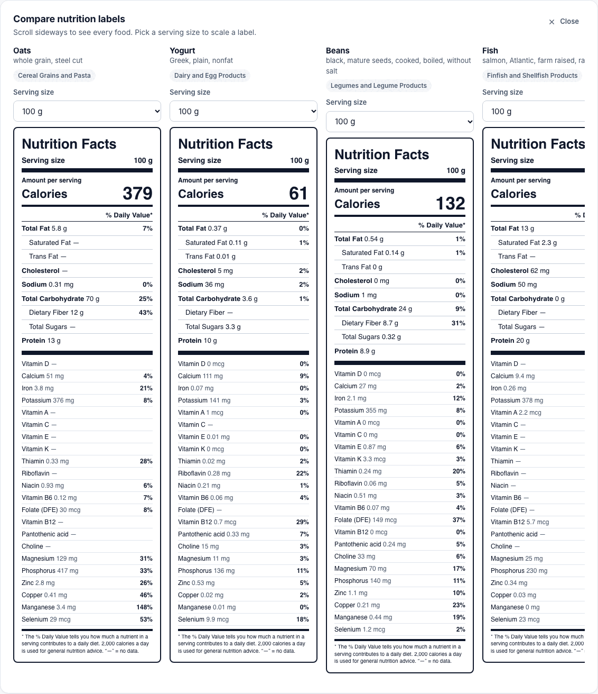

**Compare nutrition labels** opens a panel below the search area with an FDA-style Nutrition Facts label for every food on your list. The labels sit side by side and you scroll sideways to see more. Each label has its own **Serving size** menu (100 g, or any USDA household serving such as "1 egg (50 g)"), and the whole label rescales when you change it. **Close** hides the panel.

On the labels:

- **% Daily Value** is shown where the FDA defines one.
- **"—" means USDA didn't measure that nutrient for this food. It does not mean zero.** In the example above, the banana entry has no calcium, iron or potassium recorded, which is surprising for a banana but is how the data comes.

### 5.6 Clear all and Undo

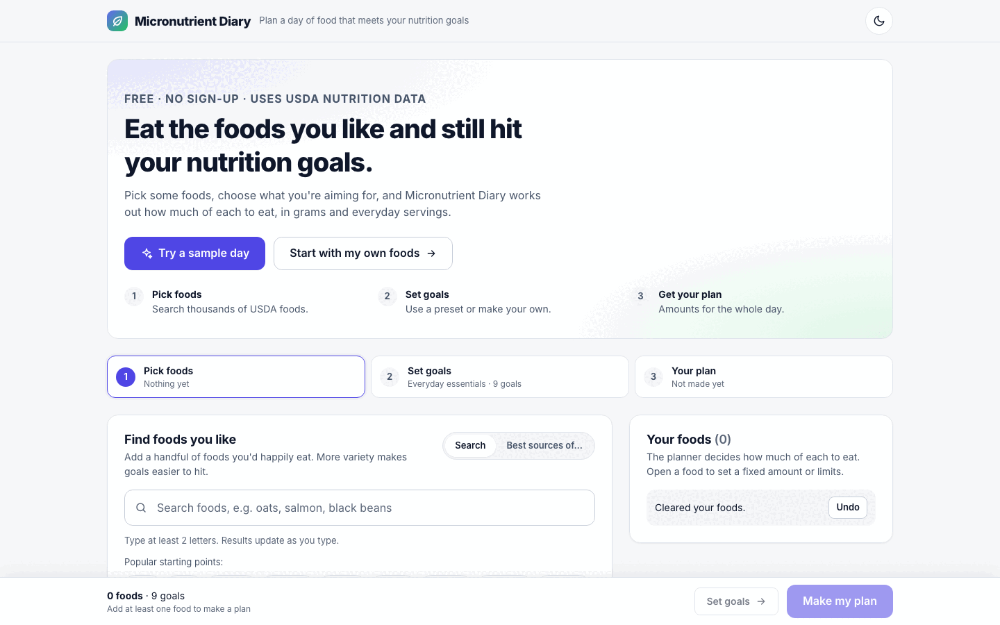

**Clear all** empties the list immediately, with no confirmation dialog, and leaves a "Cleared your foods. **Undo**" bar in the panel. Undo puts back the foods, fixed amounts and limits. Because the list is now empty, the big welcome panel reappears at the top.

---

## 6. Step 2: Set goals

### 6.1 Presets

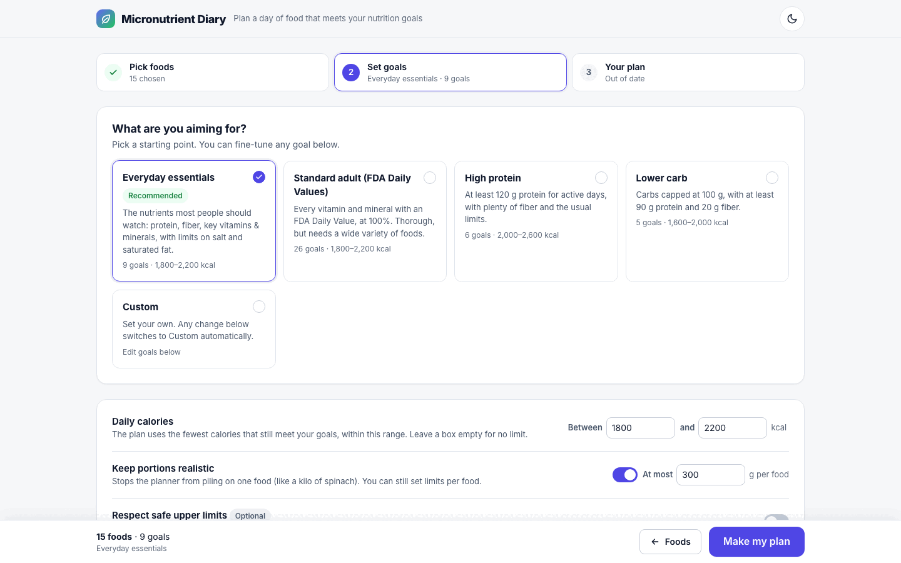

**"What are you aiming for?"** offers five cards. Pick one and every goal below it is set for you.

| Preset | What it sets | Calories |
|---|---|---|
| **Everyday essentials** (Recommended, the default) | 9 goals: at least 50 g protein, 28 g fiber, 1,300 mg calcium, 18 mg iron, 4,700 mg potassium, 900 mcg vitamin A and 90 mg vitamin C; at most 20 g saturated fat and 2,300 mg sodium | 1,800–2,200 |
| **Standard adult (FDA Daily Values)** | 26 goals: every vitamin and mineral with an FDA Daily Value, at 100 %, plus the macro references | 1,800–2,200 |
| **High protein** | At least 120 g protein, plus fiber, calcium, potassium and the saturated-fat and sodium limits (6 goals) | 2,000–2,600 |
| **Lower carb** | At most 100 g carbs, at least 90 g protein and 20 g fiber, plus the saturated-fat and sodium limits (5 goals) | 1,600–2,000 |
| **Custom** | Whatever you set below. Any manual edit switches to Custom automatically, and choosing Custom opens the fine-tune list. | yours |

The stepper's middle card always shows the active preset and goal count.

### 6.2 Calories, portions and safe upper limits

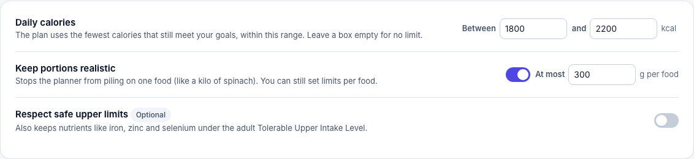

- **Daily calories, Between ___ and ___ kcal.** The plan uses the fewest calories that still meet your goals, within this range. In practice it almost always lands on the lower number. Leave a box empty for no limit.
- **Keep portions realistic** (on by default, **At most 300 g per food**) stops the planner from piling on one food, such as a kilo of spinach. Per-food limits from step 1 still apply on top. _Note:_ the planner also has a built-in cap of about 3 standard servings per food that stays on even when this switch is off (see [rough edges](#16-rough-edges-noticed-while-touring)).
- **Respect safe upper limits** (optional, off by default) also keeps nutrients such as iron, zinc and selenium under the adult Tolerable Upper Intake Level. Only limits that apply to food are used. Supplement-only limits, such as magnesium's, are skipped.

### 6.3 Fine-tune individual goals

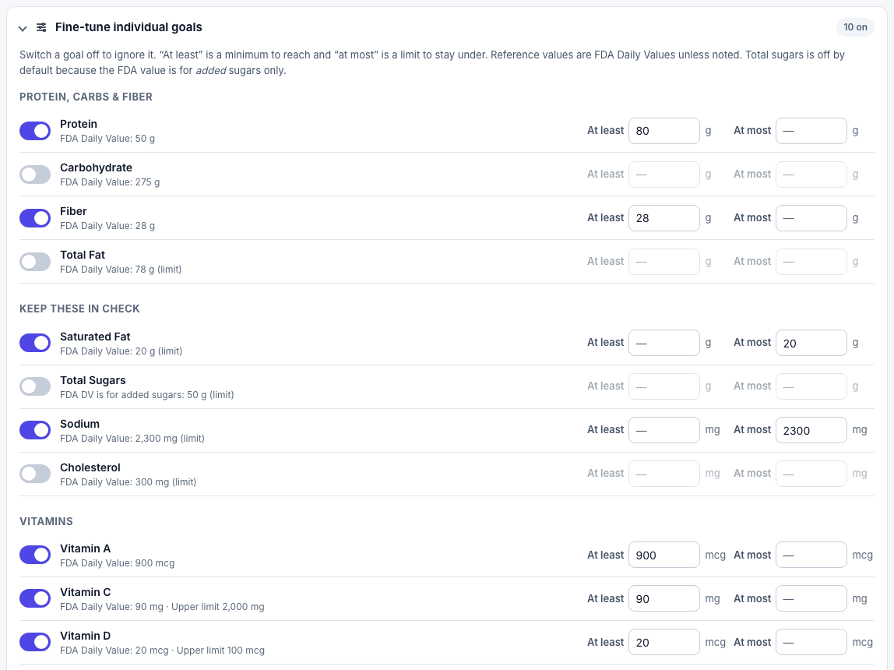

Click **Fine-tune individual goals** to open the full list (the chip on the right counts how many goals are on). Nutrients are grouped as *Protein, carbs & fiber*, *Keep these in check*, *Vitamins*, *Minerals* and *Omega-3 fats*. Each row has:

- **An on/off switch.** Switching a goal on fills in its reference value. Switching it off really removes it from the plan.
- **The nutrient name and its reference value,** for example "FDA Daily Value: 90 mg · Upper limit 2,000 mg". "(limit)" marks values that are ceilings rather than targets. Some rows say "Adequate intake" (omega-3 ALA) or "No official target" (EPA, DHA).
- **At least ___ and At most ___ boxes,** with units. "At least" is a minimum to reach and "at most" is a ceiling to stay under. You can fill in both to set a range. Typing in a box of a goal that's off switches it on.

Total sugars is off by default because the FDA value is for *added* sugars only, and the intro text above the list explains this.

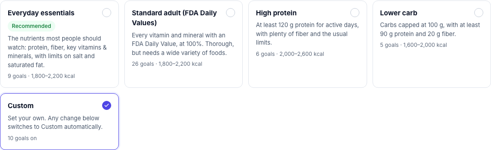

After any edit (here protein raised to 80 g and vitamin D switched on), the **Custom** card is ticked and shows "10 goals on".

---

## 7. Step 3: Your plan

You get here with **Make my plan**, **Try a sample day**, or by clicking **Your plan** in the stepper. With no plan yet, you see "No plan yet" with a **Make my plan** button. While the planner works, you see "Balancing your foods…" with grey placeholder blocks, though it's usually too fast to notice.

### 7.1 The summary

The top card (see [the sample plan](#4-try-a-sample-day)) shows:

- **Header.** "Your day · *preset name*" and a headline: **Every goal met**, or for example **7 of 9 goals met**. Below it, the number of foods and the total weight. **Edit foods** and **Edit goals** jump back to steps 1 and 2.
- **Calories.** The total, with a coloured bar and legend for protein, carbs and fat as a percentage of calories.
- **Goals met.** A ring such as "9/9" with "All on target" or "2 need attention".
- **Protein,** in grams, with fiber below it.
- (An **Estimated cost** tile is built in but only appears if the data ever includes prices. It doesn't today.)

### 7.2 What to eat and goal progress

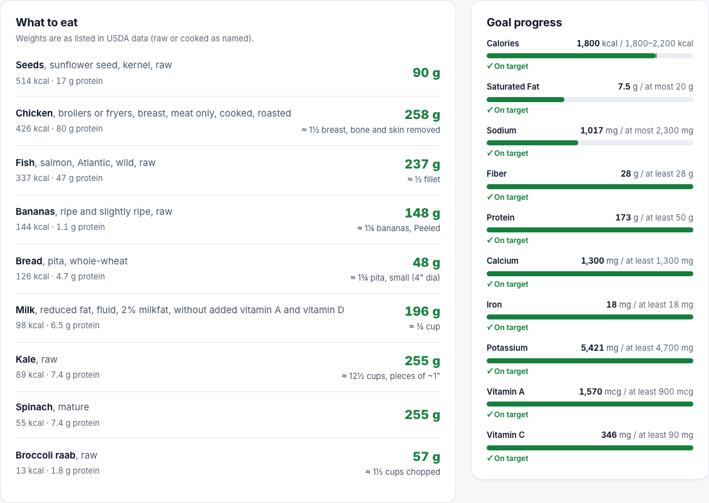

**What to eat** lists every food in the plan, highest-calorie first:

- the name, with calories and protein for that amount;
- the amount in **grams** (big green number);
- a **household amount** underneath where USDA has one: "≈ 1½ breast, bone and skin removed", "≈ ½ fillet", "≈ ¾ cup";
- a **📌 Fixed amount** tag on foods you locked in step 1.

A note says "Weights are as listed in USDA data (raw or cooked as named)", so "salmon, raw" means raw weight.

**Goal progress** gives each goal (calories first) a bar, the actual amount against the target ("28 g / at least 28 g") and a plain status: **✓ On target**, "Short by 155 mcg", "Over by 3 g" or "No data". For a range goal, a small tick on the bar marks where the minimum is.

### 7.3 The missing-data callout

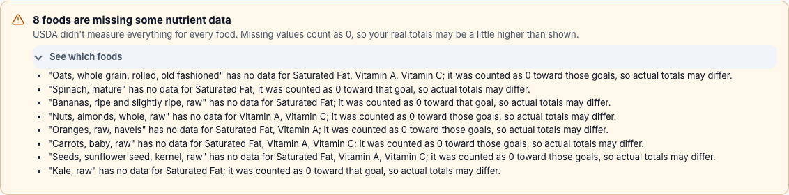

When any of your foods lacks data for a goal you've switched on, a yellow callout appears: "**8 foods are missing some nutrient data.** USDA didn't measure everything for every food. Missing values count as 0, so your real totals may be a little higher than shown." **See which foods** expands the exact list, for example "'Kale, raw' has no data for Saturated Fat…". This callout is normal. With USDA data it appears on almost every plan.

### 7.4 Where each nutrient comes from

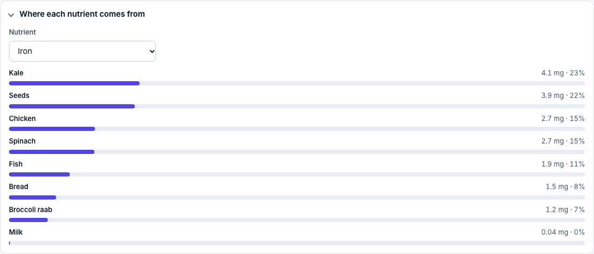

This collapsed section answers "where does my iron come from?". Choose any nutrient from the **Nutrient** menu to see one bar per food, with its amount and share of the day (kale 23 %, sunflower seeds 22 %, and so on). Fixed foods are labelled "(fixed)" and drawn in grey.

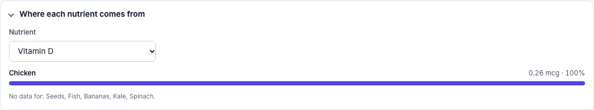

The line under the bars, "No data for: …", is where data gaps become visible. In the sample day, the only vitamin D counted is 0.26 mcg from chicken, because the salmon entry the sample picked has no vitamin D recorded.

### 7.5 Show the math

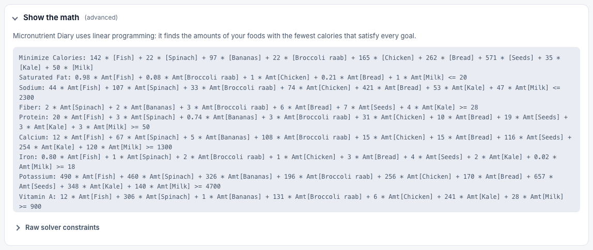

**Show the math (advanced)** shows the actual optimization problem in readable form: "Minimize Calories: 142 × [Fish] + 22 × [Spinach] …", then one line per goal ("Fiber: 2 × Amt[Spinach] + … >= 28"). The numbers are per 100 g of each food. A nested **Raw solver constraints** section shows the solver's input as JSON. This is the old debug panel, now tucked away.

### 7.6 The "Update plan" banner

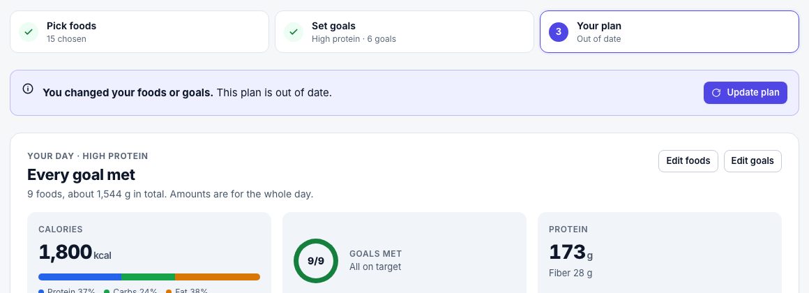

If you change foods or goals after making a plan, the old plan stays on screen instead of disappearing, with a purple banner: "**You changed your foods or goals.** This plan is out of date. **Update plan**". The stepper also says "Out of date". Click **Update plan** to re-run it.

### 7.7 What upper limits look like in a plan

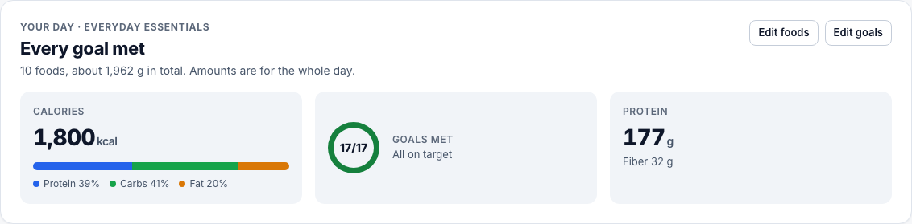
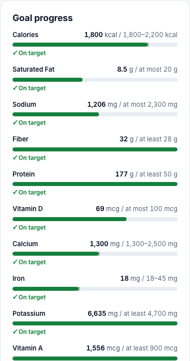

With **Respect safe upper limits** on, every nutrient that has a food-relevant upper limit gets an "at most" bar. Some goals become ranges ("Calcium 1,300 mg / 1,300–2,500 mg"), and new ceiling-only rows appear (vitamin D, B6, zinc, copper, manganese, selenium, phosphorus, choline). The ring then counts these limits as goals, which is why it jumps from 9/9 to **17/17**.

---

## 8. When the goals can't all be met

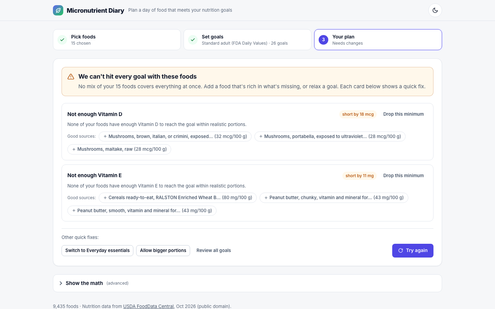

Choosing **Standard adult (FDA Daily Values)** with the 15 sample foods gives this screen. The stepper says "Needs changes".

- **Headline:** "We can't hit every goal with these foods", with a one-sentence explanation.
- **One card per problem goal:** "Not enough Vitamin D", with a **short by 18 mcg** chip and a sentence explaining why. Problems with limits read "Too much sodium" with **over by…**.
- **Drop this minimum** (or **Drop this limit**) removes just that bound. This switches your preset to Custom.
- **Good sources:** up to 3 chips per shortfall, each with its amount per 100 g. Click a chip to add that food to your list in one click.
- **Other quick fixes:** **Switch to Everyday essentials** (hidden if you're already on it), **Allow bigger portions** (turns off the portion cap), **Review all goals** (opens step 2), and **Try again**.
- **Show the math** is available below the cards.

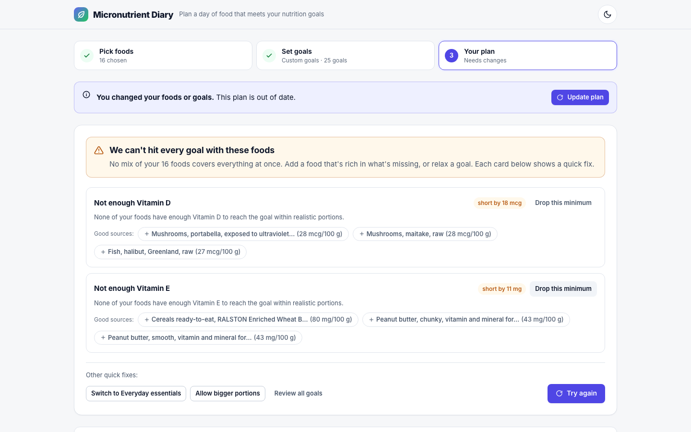

After clicking the first vitamin D suggestion (crimini mushrooms exposed to UV light) and **Drop this minimum** on vitamin E, the out-of-date banner appears and the step 1 count rises to 16. The cards themselves don't change, though: the mushroom chip simply vanishes and the next suggestion takes its place, and the vitamin E card stays put. Clicking **Update plan** then gives:

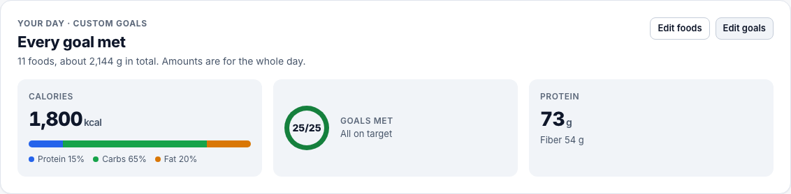

"Every goal met" on Custom goals (25 goals). Mushrooms supply the vitamin D.

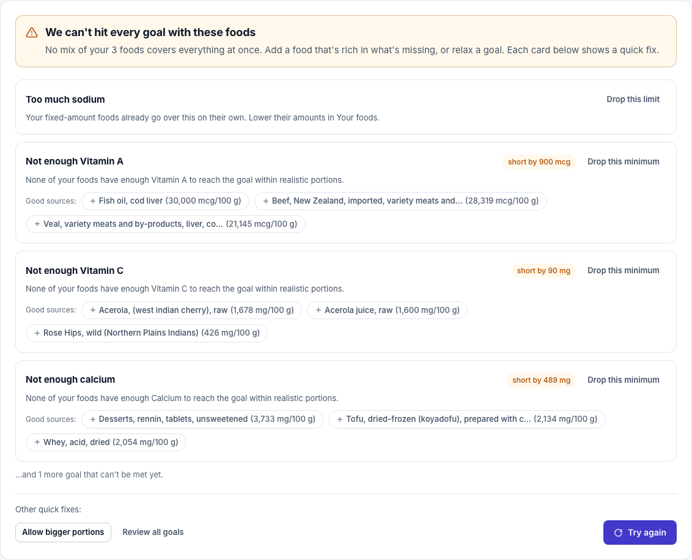

**A harder case:** only rice, chicken and bread, with bread fixed at 600 g. This shows the other card types:

- **Too much sodium:** "Your fixed-amount foods already go over this on their own. Lower their amounts in Your foods."
- **Shortfalls** in vitamin A, vitamin C and calcium, each with suggestions.
- "…and 1 more goal that can't be met yet."

Look at the suggestions here: cod liver oil, imported beef variety meats, veal liver, acerola, wild rose hips, rennin dessert tablets and dried acid whey. They're technically rich sources, but not what a beginner wants to add (see [rough edges](#16-rough-edges-noticed-while-touring)).

## 9. When something goes wrong

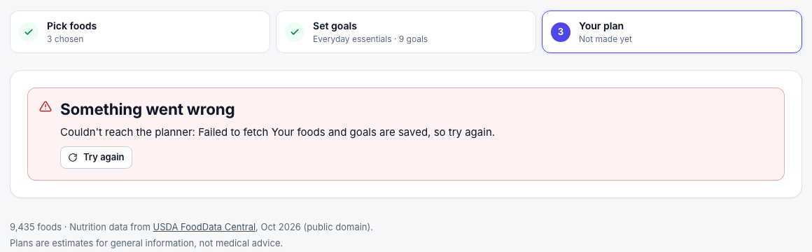

If the planner can't be reached, the plan step shows a red "**Something went wrong**" card. It explains that your foods and goals are saved and offers **Try again**. (I triggered this by blocking the request in the test browser. Search and "Best sources" have similar error cards with retry buttons.)

---

## 10. Dark mode

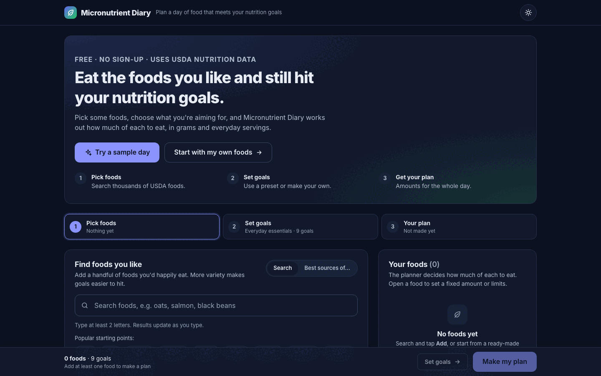
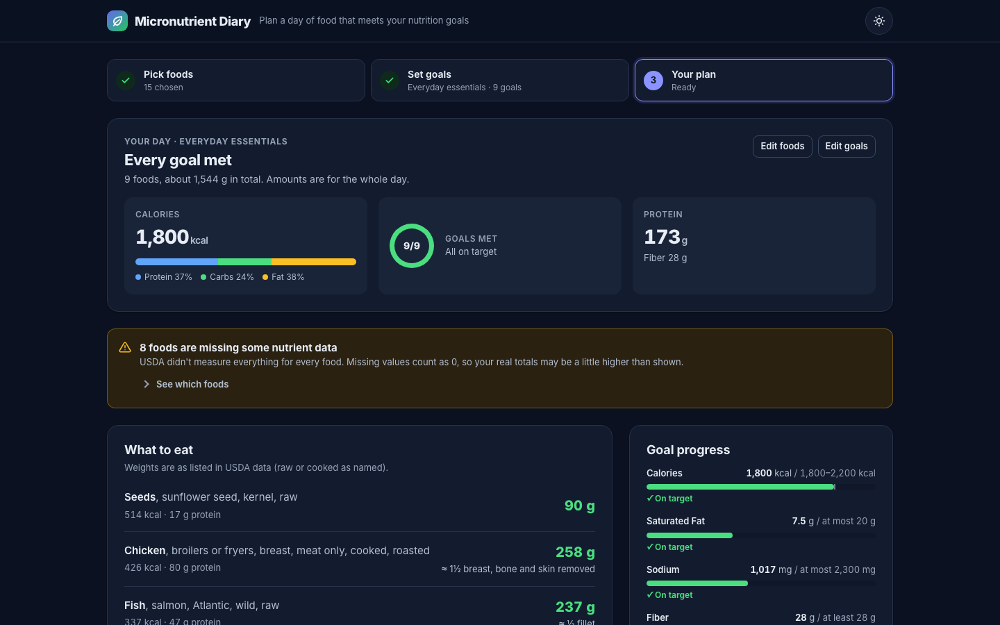
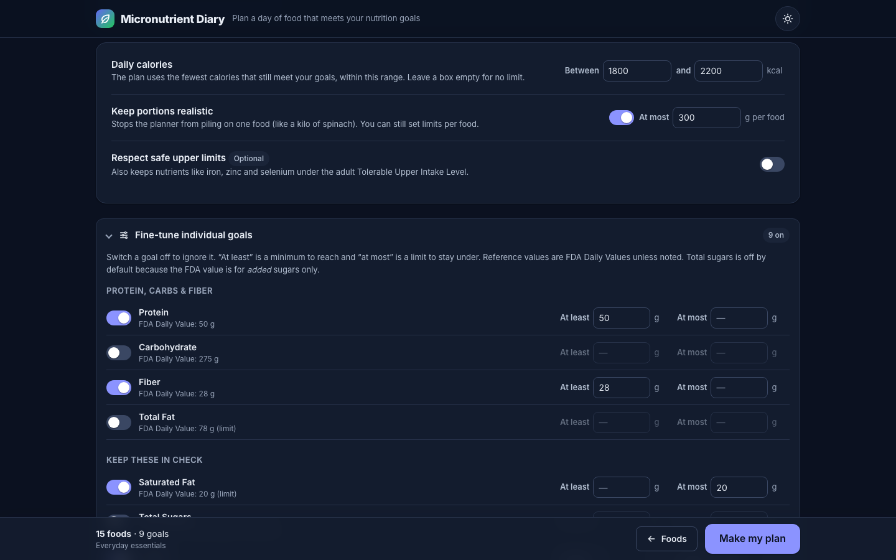
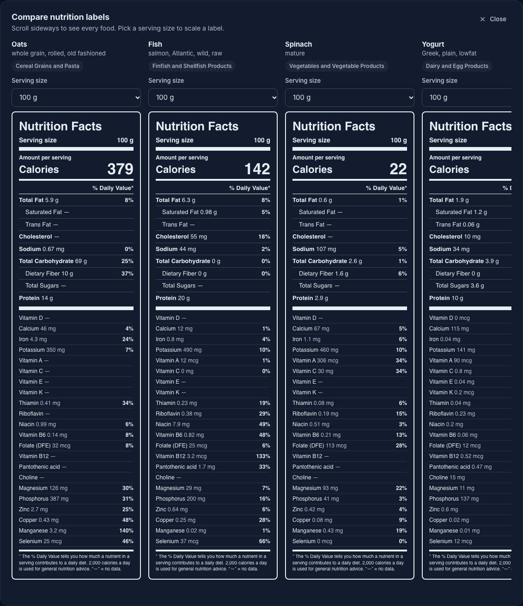

On a first visit the theme follows your device's light/dark setting, with no flash of white while the page loads. The moon/sun button in the header switches it, and that choice is remembered. Every screen, including the nutrition labels, has a proper dark version.

## 11. On a phone

| | | |
|---|---|---|
| 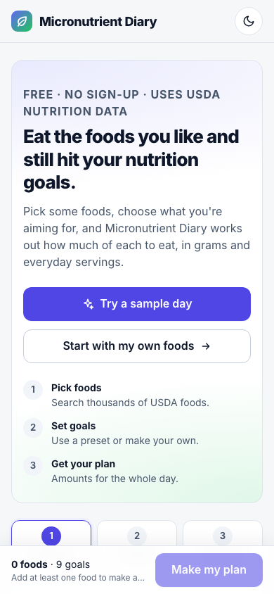 | 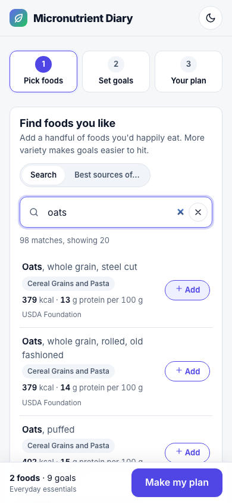 | 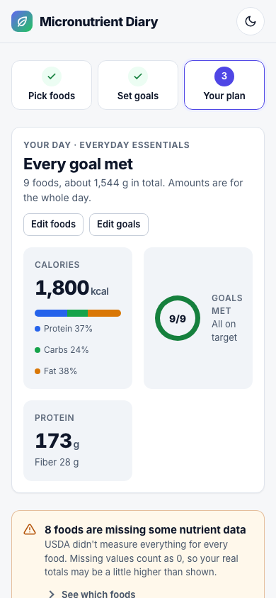 |
| 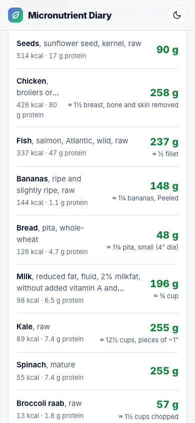 | 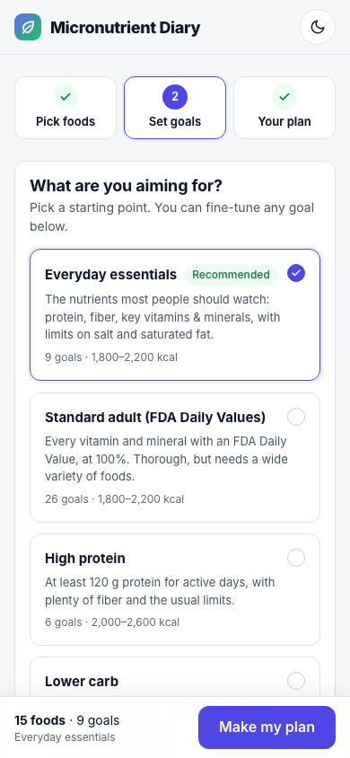 | 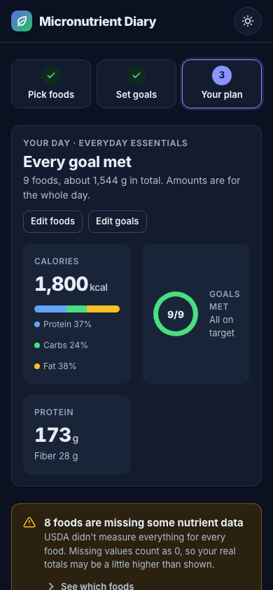 |
| 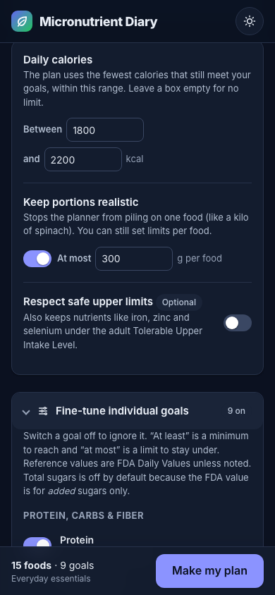 | | |

At phone width (390 px) everything collapses to one column, and the page never scrolls sideways (checked on every step, light and dark):

- The stepper becomes three compact tiles.
- The "Your foods" panel moves below search.
- Goal rows stack their inputs.
- The bottom bar keeps only **Make my plan**. Use the stepper to move between steps.

## 12. Keyboard and accessibility

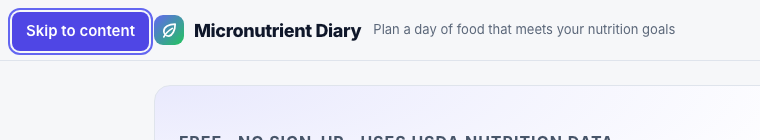
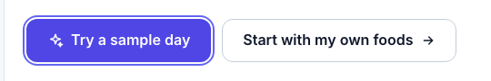

- **The first Tab press shows "Skip to content",** which jumps past the header. The Tab order after that is logical: logo, theme switch, the welcome buttons, the three steps, then search.
- **Every control has a visible focus ring.** I checked a 2 px outline on each of the first stops.
- Switches, presets and radio buttons all work with the keyboard (Space toggles a switch).
- When a plan finishes, focus moves to its headline and a hidden announcement ("Your plan is ready.") is read out to screen-reader users. Every input has a proper label.

## 13. What's remembered after a reload

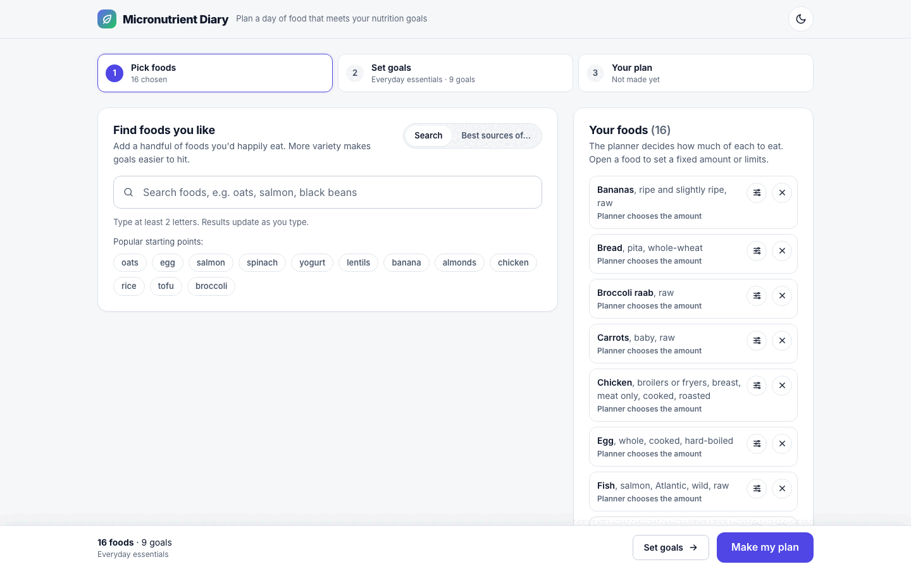

After a reload:

- **Kept:** your food list (16 here), fixed amounts, per-food limits, your goals and preset, the calorie range, the portion cap, the upper-limits switch, and your light/dark choice.
- **Not kept:** the plan itself, which step you were on (you always land back on **Pick foods**, and the stepper shows "Your plan: Not made yet"), anything typed in search, and open panels such as the comparison.

One click on **Make my plan** rebuilds the plan instantly.

---

## 14. Behind the scenes

> **Where the data comes from.** 9,435 foods from the USDA's FoodData Central (release Oct 2026, public domain), drawn from three USDA collections: *Foundation* (carefully measured basics), *SR Legacy* (the classic reference set) and *FNDDS* (mixed dishes). All values are per 100 g. When USDA didn't measure a nutrient, the site stores "unknown" rather than zero, which is why you see "—" and the missing-data callout.
>
> **How the plan is calculated.** A technique called *linear programming* tries every possible mix of your foods at once. It looks for the amounts with the **fewest total calories** that still satisfy every goal you've switched on, every calorie bound, and every portion limit. If no mix can do it, the site reports which goals are blocking it. That's why plans tend to sit at your calorie minimum, and why foods that aren't needed get left out.
>
> **What's saved, and where.** Only in your own browser (its "local storage"): your foods, fixed amounts, per-food limits, goals and settings, and your theme. Nothing is sent anywhere except the anonymous requests the page makes to its own server to search foods and build the plan. There are no accounts and no tracking.
>
> **More depth:** [README](../README.md) · [Why the UI was redesigned (UX audit)](UX_AUDIT.md) · [Which nutrients and why](KEY_NUTRIENTS.md) · [API reference](README_API.md) · [Testing it locally](LOCAL_TESTING.md)

## 15. Tips: two questions people will ask

**"Why can't the FDA Daily Values preset be met?"** It switches on 26 goals at 100 % at once. Some of them are hard to reach from ordinary foods within 1,800–2,200 kcal and realistic portions:

- **Vitamin D** (20 mcg): very few foods have much, and many entries have no vitamin D recorded at all.
- **Vitamin E** (15 mg): mostly nuts, seeds and oils.
- **Potassium** (4,700 mg).
- The preset also asks for *at least* 275 g of carbohydrate, the FDA's reference amount.

Because missing data counts as zero, a food that really contains vitamin D can still count for nothing. To get a plan, either add the foods suggested on each card, use **Drop this minimum** for the one or two blockers, or start from *Everyday essentials*, which covers the nutrients most people actually fall short on.

**"Why do some values show "—"?"** A dash means USDA never measured that nutrient for that exact food entry. It does **not** mean the food contains none. Calories and protein use "—" (or the "Limited data" badge) for the same reason. The planner has to count unknowns as 0, so plans can undercount (minimums might actually be met more easily) and, for limits like saturated fat, can also miss some of the amount. Choosing "USDA Foundation" entries, which have the fullest data, reduces the gaps.

---

## 16. Rough edges noticed while touring

Severity: **High** = undermines the core job or misleads; **Medium** = confusing or not doing what it says; **Low** = polish.

Things that worked well and need no action: every page action was fast (API calls took under 40 ms locally, and the sample day took about 0.4 s), there were no console errors in any journey, there was no sideways scrolling on phones, and the skip link, focus rings and dark mode all work.

**High**

- [ ] **Fix-it suggestions are often obscure.** With a small food list, the "Good sources" chips offered cod liver oil, imported beef variety meats, veal liver, acerola, wild rose hips ("Northern Plains Indians"), rennin dessert tablets and dried acid whey ([screenshot 27](walkthrough/27-infeasible-few-foods.png)). For vitamin E they offered a fortified Ralston cereal and fortified peanut butter. The "everyday food" filter falls back to whatever ranks highest per 100 g when it finds nothing else. This is the main rescue path for new users, so it matters.

**Medium**

- [ ] **Data gaps quietly undermine goals.** The sample day's salmon has no vitamin D recorded, and its milk is the version "without added vitamin A and vitamin D". So the FDA preset fails on vitamin D while salmon is on the list ([screenshot 19](walkthrough/19-nutrient-breakdown-vitamin-d.png)). The search result "Bananas, overripe, raw" has no potassium, calcium or iron. For *limits*, missing values count as 0 too: saturated fat was unmeasured for 7 of the 9 foods in the sample plan, so "7.5 g / at most 20 g" is a floor, not a total. The callout's wording ("real totals may be a little higher") is honest, but the sample day could prefer better-documented entries.
- [ ] **"Keep portions realistic" off often changes nothing.** The planner always caps each food at about 3 USDA reference servings (300 g when there's no reference serving). With the sample foods, the plan was identical with the switch on or off (kale, spinach and carrots all stop at 255 g). The **Allow bigger portions** quick fix therefore often doesn't help. The switch's description doesn't mention the hidden cap.
- [ ] **The plan doesn't explain unused foods.** The sample day picks 15 foods and the plan uses 9, with no mention of the other 6. Users may think something went wrong.
- [ ] **One-click fixes give no feedback.** After **Drop this minimum**, the card stays exactly as it was. After clicking a suggestion chip, the chip vanishes and another takes its place, with no "Added" confirmation ([screenshot 25](walkthrough/25-after-one-click-fixes.png)). It's easy to click twice or wonder whether anything happened.
- [ ] **Upper limits inflate the "goals met" count.** Turning on safe upper limits turns 9/9 into 17/17 and lists vitamin D as "✓ On target" at 0.26 mcg (1 % of the Daily Value), because only the ceiling applies ([screenshot 23](walkthrough/23-upper-limits-progress.png)).
- [ ] **The plan is lost on reload,** and the site always reopens on step 1. The steps also aren't part of the page address, so the plan step can't be bookmarked or shared.
- [ ] **Sample-day plans look odd for "Everyday essentials".** 173 g protein (3.5× the target) and 38 % fat from 237 g salmon plus 258 g chicken. "Broccoli raab" stands in for broccoli, and "pita" for whole-wheat bread. That's mathematically fine (low calories, high nutrients) but not a typical day.

**Low**

- [ ] **Stale plans show the new preset name.** After switching to High protein, the old Everyday-essentials plan is headed "Your day · High protein" until you update it ([screenshot 21](walkthrough/21-update-plan-banner.png)).
- [ ] **Household amounts can read oddly.** "≈ 12½ cups, pieces of ~1"" for kale, "≈ 1¼ bananas, Peeled" (capital P), "≈ 1 cup, chopped" for 150 g of hard-boiled egg (3 eggs would be clearer), "≈ ¾ oz" for 19 g of salmon, and no household amount for spinach, carrots or oats.
- [ ] **"RACC" jargon** appears in serving hints ("For reference: 1 RACC = 40 g") and in the label serving menu ("1 RACC (50 g)").
- [ ] **"Limited data" badge on genuinely zero-calorie foods.** Plain tea, bottled water and table salt are flagged, although 0 kcal is correct for them.
- [ ] **The bold "short name" is sometimes the USDA category word,** not the food: "**Beverages**, tea, green…", "**Fish**, salmon…", "**Seeds**, sunflower…". On the phone plan this leaves "Chicken, broilers or…".
- [ ] **The error message is run together:** "Couldn't reach the planner: Failed to fetch Your foods and goals are saved…" is missing a full stop and shows the browser's raw error text.
- [ ] **"…and 1 more goal that can't be met yet"** doesn't say which goal.
- [ ] **"Too much sodium" has no "over by" amount,** unlike the shortfall cards.
- [ ] **Switching on a "No official target" goal** (EPA, DHA) sets "at least 0", which constrains nothing but still counts toward "goals met".
- [ ] **The phone search box has two clear (×) buttons:** the browser's own and the site's ([screenshot 34](walkthrough/34-phone-search.png)).
- [ ] **The bottom action bar covers content.** On the welcome screen it fades out the "Popular starting points" chips. At 1440×900 it sat on top of the "Respect safe upper limits" switch until I scrolled.
- [ ] **Clear all makes the page jump.** The welcome panel reappears and pushes everything down about 430 px.
- [ ] **Search ranking quirks.** "banana" lists "Bananas, overripe" first, and "chicken" starts with "Chicken, wing, meat and skin, raw". "Best sources of vitamin D" opens with cod liver oil (explained by the note, but still a strange first impression).
- [ ] **The preset grid leaves "Custom" alone on a second row** at desktop width ([screenshot 12](walkthrough/12-goals-presets.png)).

## 17. About these screenshots

The screenshots were taken with headless Chromium (Playwright 1.64.1) against `npm run build` plus `node scripts/standalone.mjs` on port 3520, with each browser session starting empty. Two states were set up artificially: the "Building a sample day…" spinner (searches were slowed down so it stayed on screen) and the error card (the planner request was blocked). I didn't test a real screen reader, the desktop (Electron) app, or the migration of settings saved by the old version of the site.
