# NanoNutrition: a guided tour

_Toured on 5 November 2026 against the production build on a laptop (`npm run preview`, port 3620), with the full 9,435-food database, a throwaway account database and the offline demo AI. Screenshots come from headless Chromium at 1440×900 and 390×844, in light and dark themes._

The site used to be one thing, a meal planner. It is now four things that were built side by side and then merged: a food lookup, contaminant meters on every food, a recipe analyzer, and optional accounts. This tour walks through all of it as a customer would. The first tour recorded where the parts didn't quite fit, in the [rough edges checklist](#14-rough-edges-checklist). The integration items have since been fixed, and the tour below describes the site as it is now. Some screenshots predate the fixes where the change doesn't affect them.

**The short version:** the site is fast, has no broken internal links, and the contaminant meters always match the chosen serving. A food now has one set of values everywhere, plans and recipes reopen from an account on any device, and nothing is left behind in a browser after signing out. What's left is mostly polish, plus privacy and terms pages, which need legal review.

## The 60-second tour

1. **Open the home page** and type "rice". Results appear as you type ([section 1](#1-home-and-search)).
2. **Open a food.** Change **Serving size** and watch the Nutrition Facts label and the contaminant meters move together ([sections 2](#2-food-pages) and [3](#3-contaminant-meters)).
3. **Click Add to my plan,** then **Plan** in the header. Click **Try a sample day** if you'd rather start from 15 staples. You get amounts in grams and household measures ([section 6](#6-the-planner)).
4. **Click Recipes,** then **Try an example** and **Work out the nutrition.** Fix anything misread, and the per-serving totals update ([section 7](#7-recipes)).
5. **Click Add a serving to my plan,** then rebuild the plan. The recipe now appears in the day ([section 7.4](#74-adding-a-recipe-to-a-plan)).
6. **Click Sign in** if you want a history. No password: a link is emailed, or printed in the terminal on a laptop ([section 8](#8-accounts)).

## Contents

1. [Home and search](#1-home-and-search)
2. [Food pages](#2-food-pages)
3. [Contaminant meters](#3-contaminant-meters)
4. [Compare](#4-compare)
5. [Browse by category or nutrient](#5-browse-by-category-or-nutrient)
6. [The planner](#6-the-planner)
7. [Recipes](#7-recipes)
8. [Accounts](#8-accounts)
9. [Dark mode](#9-dark-mode)
10. [On a phone](#10-on-a-phone)
11. [Keyboard](#11-keyboard)
12. [Behind the scenes](#12-behind-the-scenes)
13. [Tips: questions people will ask](#13-tips-questions-people-will-ask)
14. [Rough edges checklist](#14-rough-edges-checklist)
15. [What was checked, and what couldn't be](#15-what-was-checked-and-what-couldnt-be)

---

## 1. Home and search

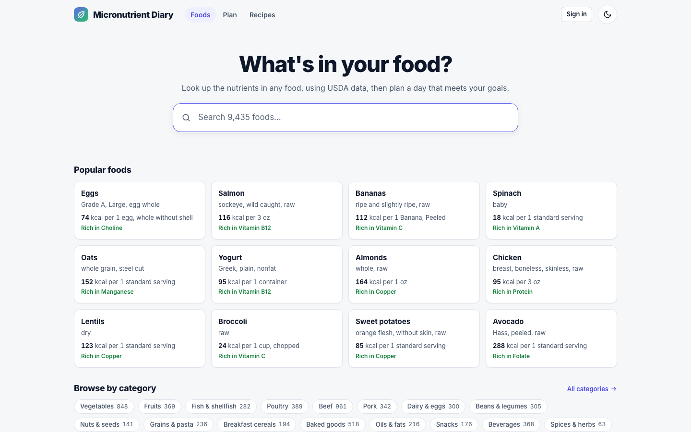

**What you see.** Every page shares the same header and footer.

- **Header:** the logo (back to home), **Foods**, **Plan** and **Recipes**, then **Sign in** and the moon/sun theme button.
- **"What's in your food?"** and one big search box, already in focus on a computer.
- **Popular foods:** 12 cards. Each shows the name, the calories in a typical serving, and what the food is richest in. A card opens that food's page.
- **Footer:** the food count, the USDA data release (linked) and "not medical advice".

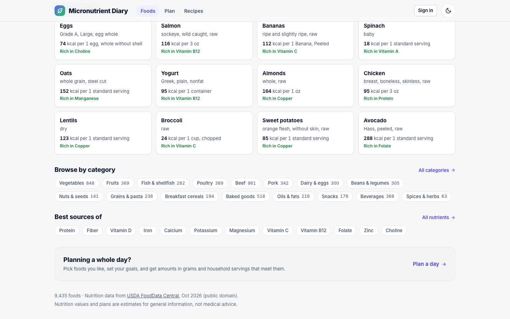

Further down:

- **Browse by category:** 16 chips with friendly names and counts, plus **All categories**.
- **Best sources of:** 12 nutrient chips, plus **All nutrients**.
- **Planning a whole day?** links to the planner. Once you've picked foods, its link changes to "Continue your plan (2 foods)".

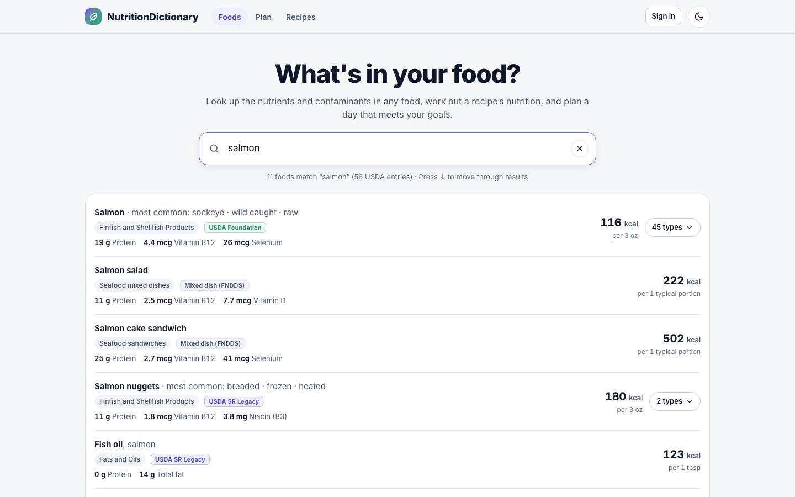

**Searching.**

- Results start at 2 letters and update as you type. The address changes to `/?q=salmon`, so a search can be shared and the Back button returns to it.
- Each row shows the name, category, a USDA dataset badge, the top three nutrients, and calories per typical serving. Clicking a row opens the food page. There's no Add button here; adding happens on the food page.
- **Show more (N left)** loads the next 20.
- Keyboard: `/` jumps to the box from anywhere on the page, ↓ moves into the results, Esc clears.
- Foods you open are remembered as **Recent** chips under the box, in this browser only. Each has an × and there's a **Clear** button.
- No matches gives "No foods match…" with a tip to use a simpler word and **Browse foods instead**.

## 2. Food pages

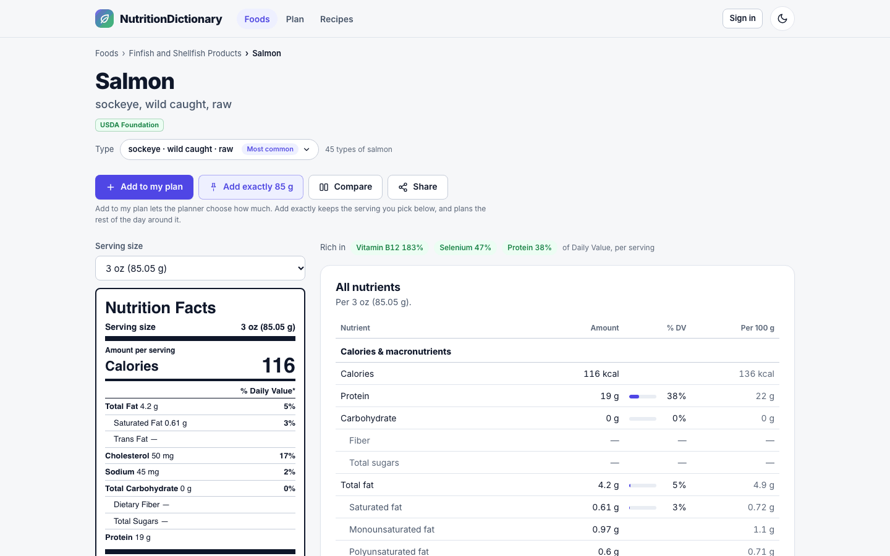

**What you see, top to bottom.**

- **Breadcrumb:** Foods › category › food.
- **Name,** with a badge for the USDA dataset. Foods with almost no data also get a **Limited data** badge. An older record that USDA has replaced gets a note linking to the newer one.
- **Add to my plan** puts the food on your planner list, and the planner chooses how much. **Add exactly 216 g** does the same but keeps the serving you picked as a fixed amount, and plans the rest of the day around it. A short line under the buttons says which is which. The button then becomes **In your plan · Open plan**, with the amount if it's fixed.
- **Compare** opens the [comparison panel](#4-compare).
- **Share** copies the link, or opens the share sheet on a phone.
- **Serving size:** household measures from USDA ("1 cup, chopped (91 g)", "1 standard serving"), then **By weight**: 1 oz (28.35 g), 3 oz (85.05 g) and 100 g for every food, then **Custom amount (g or oz)…** (1 to 5,000 g either way; anything else shows a warning and uses 100 g for now). Ounces show their exact grams underneath ("= 127.57 g"). Every household measure shows its grams. This one menu drives everything else on the page, including the contaminant meters, and Compare uses the same menu.
- **Nutrition Facts:** the FDA-style label for that serving.
- **Rich in:** up to five nutrients at 20% of the Daily Value or more for that serving.
- **All nutrients:** every nutrient, with the amount, a % Daily Value bar and the value per 100 g. "—" means USDA has no measurement. **†** marks a value from USDA's older entry for the same food, used because the newest entry has none. A note under the table links to that entry, and the label and "Where this data comes from" say so too. Measured values are never replaced.
- **Contaminants:** see the [next section](#3-contaminant-meters).

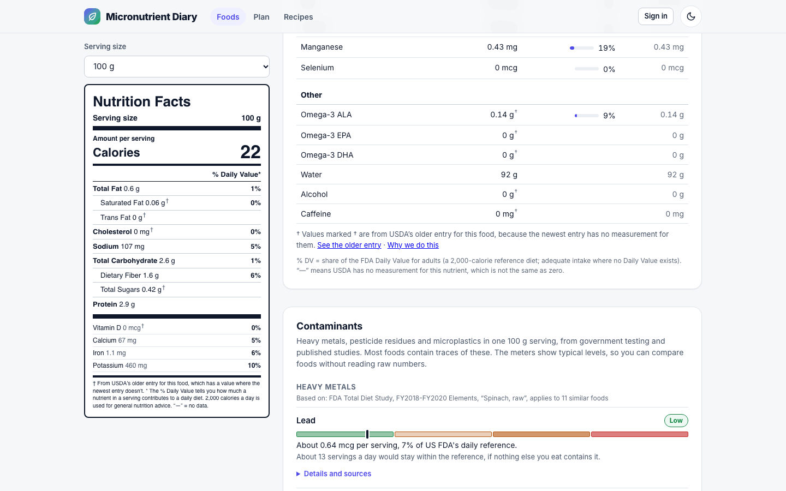

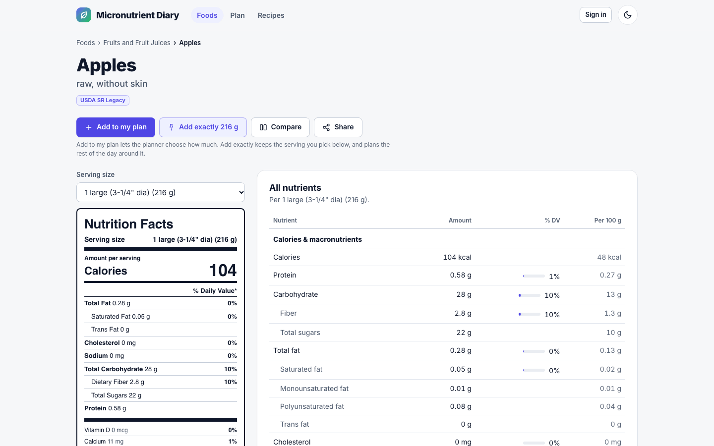

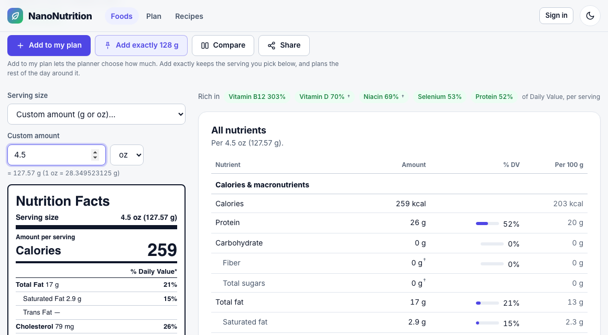

**How the numbers scale.** USDA stores every nutrient per 100 g, and that is all the database holds. A serving's amount is that value × grams ÷ 100, from the unrounded value, and only the shown number is rounded (0 decimals from 10, 1 from 1, 2 below 1). % Daily Value comes from the unrounded amount. Ounces are exact: 1 oz = 28.349523125 g, so 3 oz = 85.05 g. Where USDA lists "3 oz" as 85 g, or "1 oz" as 28 or 28.35 g, it is the same menu entry as the standard weight, at the exact grams. The difference is 0.06%, which only moves a number sitting right on a rounding edge, by one in its last digit. "—" stays "—" at every weight, † stays on values from the older entry, and a recipe's lower bounds keep their "≥". All of this is in `lib/serving-scale.ts`, with tests.

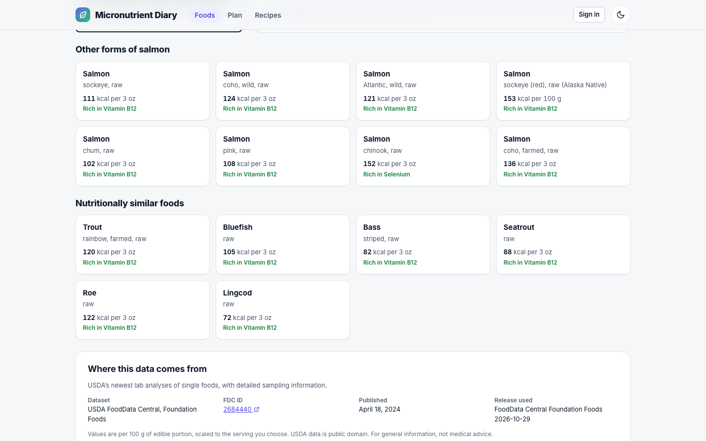

At the bottom:

- **Other forms** and **Nutritionally similar foods** are cards that open those foods.
- **Where this data comes from** names the dataset, links the USDA record, and gives the publication date and release. Where USDA holds the same food in another dataset, **Same food elsewhere** links to it.

## 3. Contaminant meters

Each food page has a **Contaminants** panel covering heavy metals, pesticide residues and microplastics. It always describes the serving chosen above it.

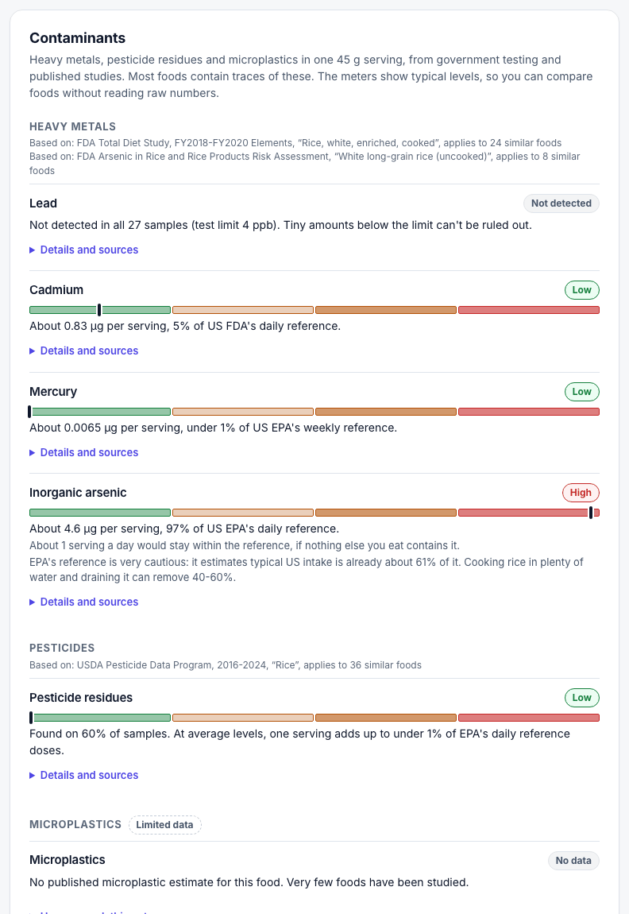

**Reading one row:**

- **The name and a badge:** Low, Moderate, Elevated or High.
- **The meter:** four coloured bands with a marker showing where this serving sits.
- **A sentence with the numbers:** "About 4.6 µg per serving, 97% of US EPA's daily reference."
- **Sometimes a servings line:** "About 1 serving a day would stay within the reference, if nothing else you eat contains it."
- **Sometimes context,** such as the note on rice about EPA's cautious reference and cooking in plenty of water.
- **A Rough estimate tag** when the number rests on few samples, a loose match or old data.

The **Based on** line under each group heading names what was actually tested, because similar foods share one set of measurements. For this rice: "Rice, white, enriched, cooked", applied to 24 similar foods.

**What the bands mean:**

| Level | Lead, cadmium, arsenic, pesticides (share of a **day's** reference) | Mercury (share of a **week's** reference) | Microplastics (particles per serving, **not a safety rating**) |
|---|---|---|---|
| Low | under 10% | under 10% | under 10 |
| Moderate | 10% to under 25% | 10% to under 33% | 10 to under 50 |
| Elevated | 25% to under 50% | 33% to under 100% | 50 to under 200 |
| High | 50% or more | 100% or more | 200 or more |

These cut-offs are the site's own judgment, not an agency's. The references they're measured against do come from agencies.

**Meters follow the serving.** Here is the same rice at 100 g. Cadmium moves from Low to Moderate, and arsenic goes from 97% to 215% of the daily reference.

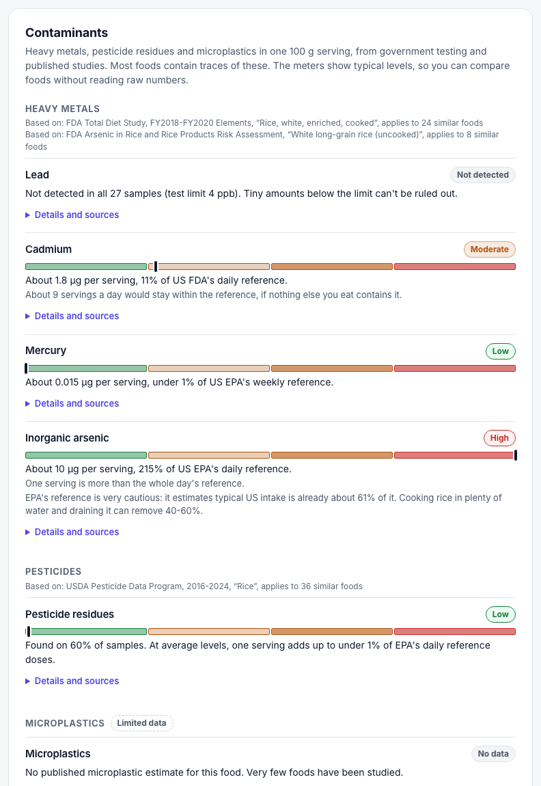

**Details and sources** opens the working for one row: the amount per serving, the measured level and highest sample, the reference used and why, how good the data is, what to keep in mind, and links to the sources.

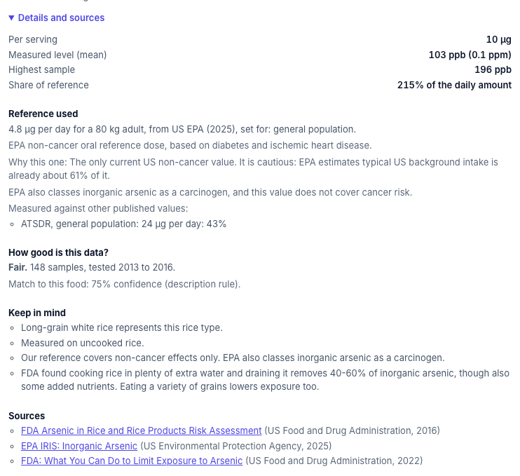

**The other states a row can show:**

| Row says | Meaning | Where to see it |
|---|---|---|
| **Not detected** | Testing found none, down to the test's limit | Lead in salmon |
| **Not rated** | The amount can't be fairly judged. Arsenic in seafood is mostly the far less harmful organic forms | Total arsenic in salmon |
| **No data** | No testing could be matched. It says nothing either way, and it's never shown as zero | Microplastics in rice |
| **Low among studied foods** | The microplastics wording, with a Limited data badge and a note that this isn't a safety rating | Microplastics in salmon |

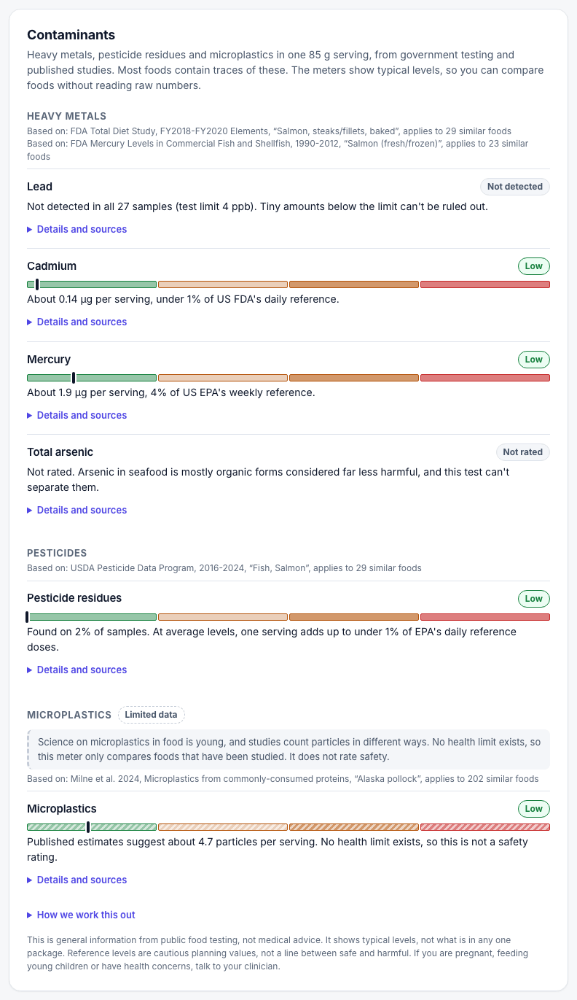

When nothing at all can be matched, the panel shrinks to one calm line. This is deliberate for organ meats like this liver, because they concentrate metals and muscle meat is a poor stand-in.

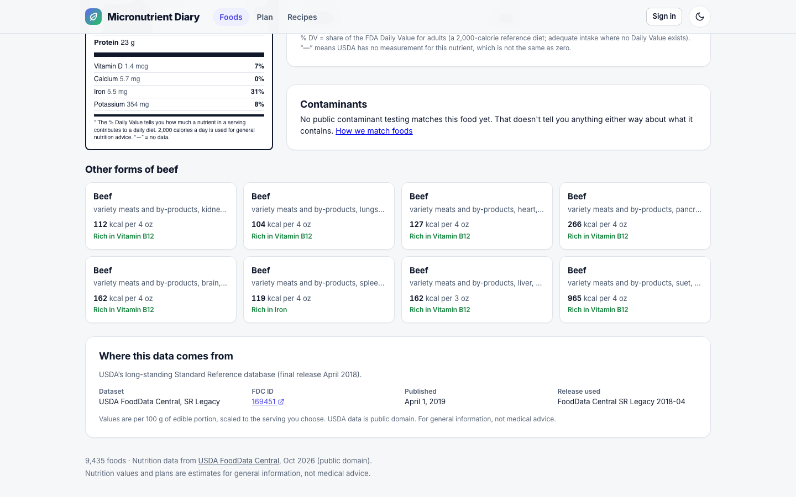

At the bottom of a full panel, **How we work this out** repeats the bands and links to the [methodology page](#3-contaminant-meters) (`/methodology`, also linked from every footer), and a disclaimer says this is general information, not medical advice. If the data can't load, the panel says so and offers **Try again**.

## 4. Compare

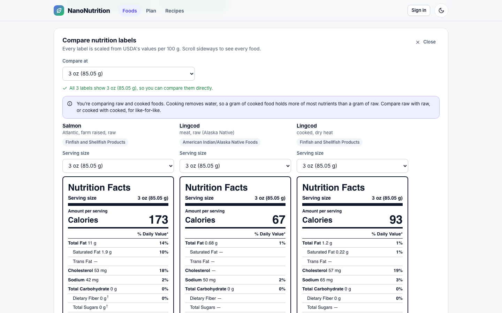

**Compare** on a food page opens a panel below the page.

- **Suggestion chips** offer other forms and similar foods. Click to add or remove one.
- **Or search for another food** finds anything else. You can add up to three foods, and the rest grey out once you have.
- **Compare at** puts every label on the same weight: **1 oz**, **3 oz** or **100 g**, one food's serving ("Broccoli (this page): 1 cup, chopped (91 g)", so the others are shown at 91 g), **Each food's usual serving**, or **Custom amount…** in grams or ounces. It starts at the weight the food page is showing, so the page's food doesn't jump and every food is comparable straight away. A line under it says "All 3 labels show 3 oz (85.05 g), so you can compare them directly."
- **The labels** sit side by side, and you scroll sideways if they don't fit. Each has its own **Serving size** menu, the same one as on its food page, so a food that USDA only lists at 100 g still has 1 oz and 3 oz. Changing one label's menu overrides **Compare at** for that label only: it gets a **Different weight** tag, and a warning names each food's weight with a **Put every food at 3 oz (85.05 g)** button. Changing **Compare at** puts every label back on it.
- When raw and cooked foods are side by side (raw salmon and cooked lingcod), a note says that cooking removes water, so equal weights aren't like for like.
- **Close** hides the panel. The comparison isn't saved and is gone after a reload.

The planner has the same view, **Compare nutrition labels**, for the foods on your list, with the same **Compare at** menu. It starts at 100 g, the weight USDA measures every food at, which suits any mix of foods. **Each food's usual serving** shows each at its typical serving instead. Each name links to the food's page. Neither view shows contaminants.

## 5. Browse by category or nutrient

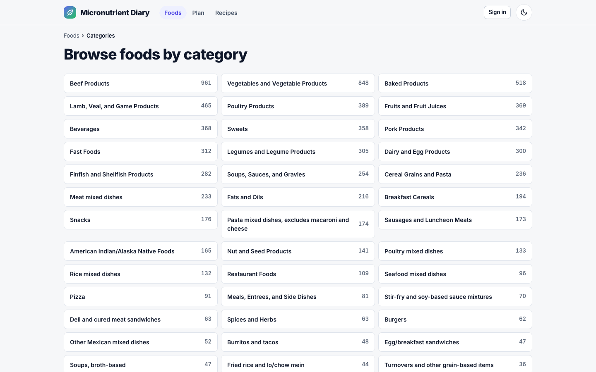

**All categories** (`/food/category`) lists every USDA category with its food count.

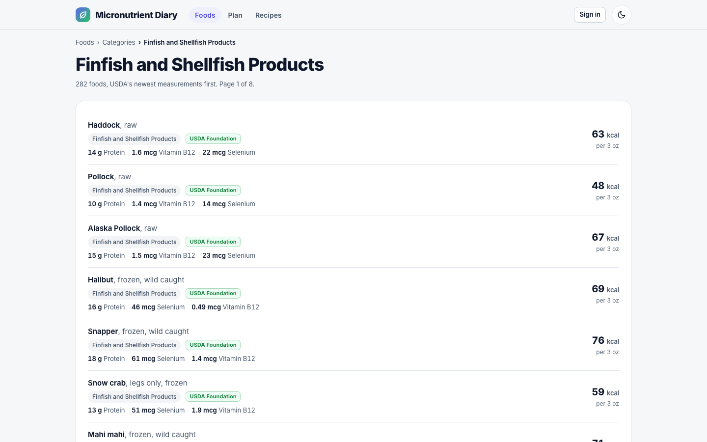

**A category page** lists its foods with USDA's newest measurements first, with **Next** and **Previous** links through the pages. Rows work the same as search results.

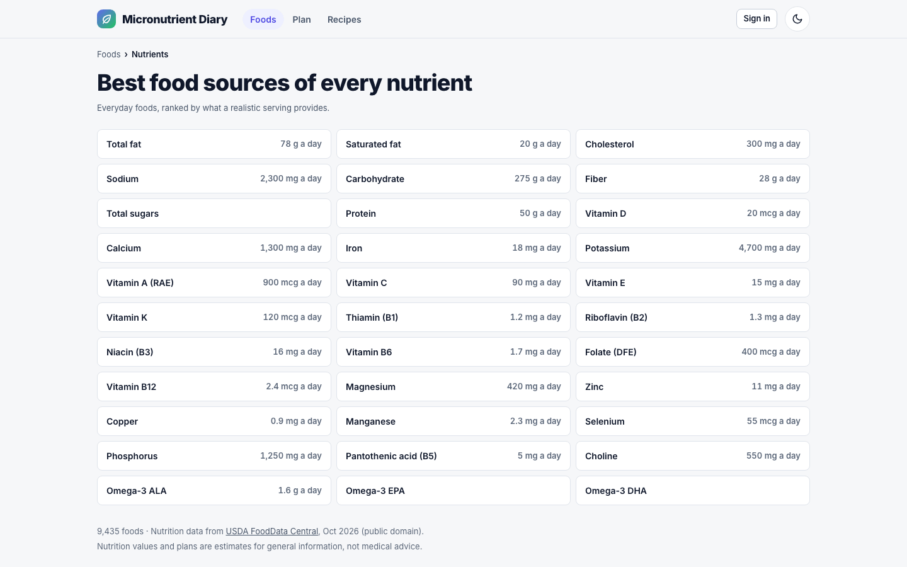

**All nutrients** (`/nutrients`) lists each nutrient with its daily reference amount.

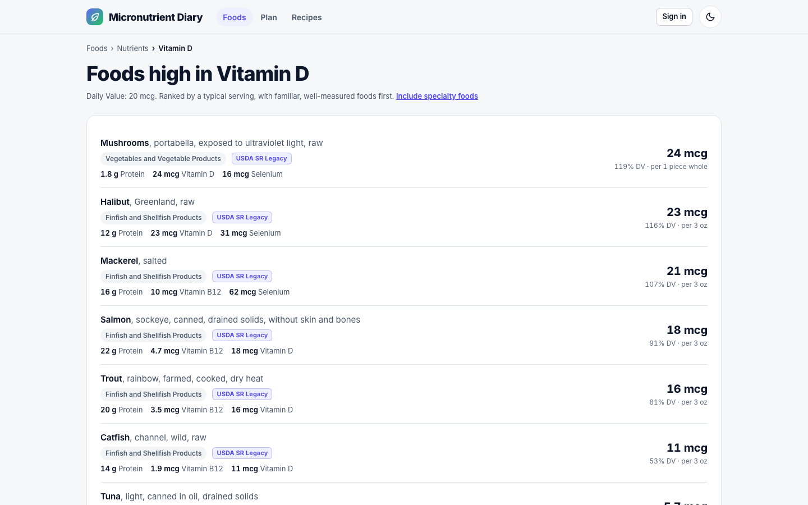

**A nutrient page** ranks foods by what a realistic serving provides, with familiar, well-measured foods first. Each row shows the amount and % Daily Value. **Include specialty foods** adds supplements, powders, organ meats and the like. This ranking matches the planner's **Best sources of…** tab.

---

## 6. The planner

The planner answers "how much of each food should I eat today?". It has three steps, shown as a stepper you can click at any time: **Pick foods**, **Set goals**, **Your plan**. It works without an account.

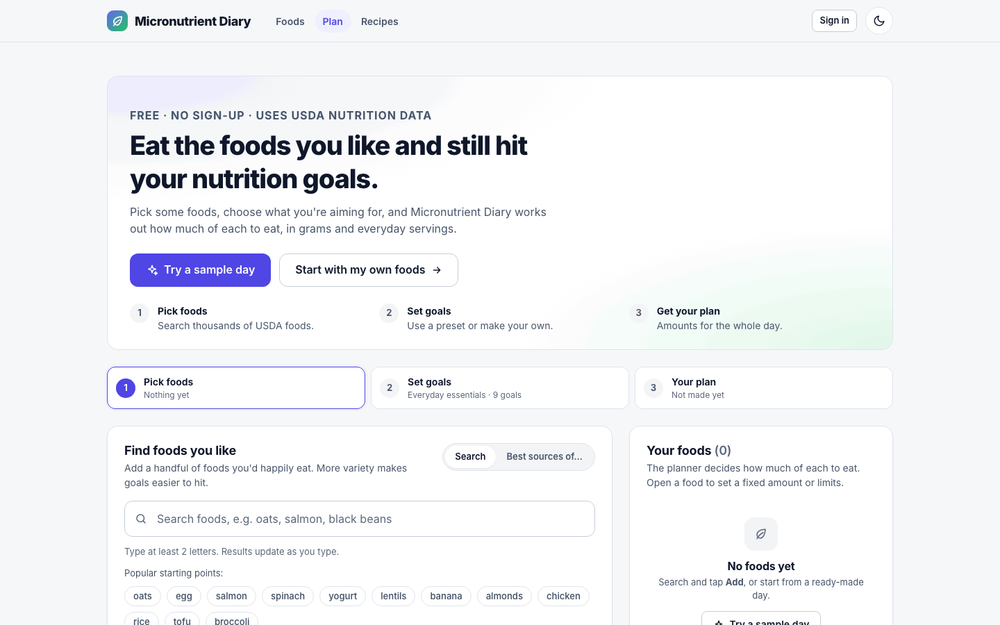

A first visit shows a welcome panel with two buttons. **Try a sample day** loads 15 staples and builds a plan straight away. **Start with my own foods** puts the cursor in the search box. The panel goes away once you've added a food.

### 6.1 Your plan

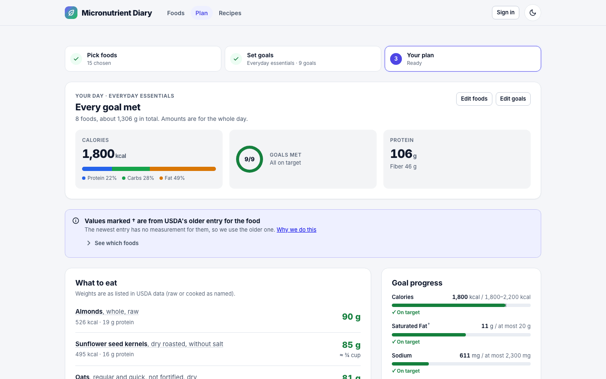

**The summary.** The sample day took about 0.1 seconds and gives "Every goal met":

- 8 of the 15 foods are used, about 1,306 g in total.
- **Calories:** 1,800 kcal, with a protein, carbs and fat split.
- **Goals met:** a 9/9 ring.
- **Protein:** 106 g, with fiber underneath.
- **Edit foods** and **Edit goals** jump back to those steps.
- A yellow note lists any foods missing data for your goals, under **See which foods**. A blue note says which values come from USDA's older entry for a food, and those goals are marked **†**.

Signed in, each plan is also saved to your account, under **Account**, tab **Plans**.

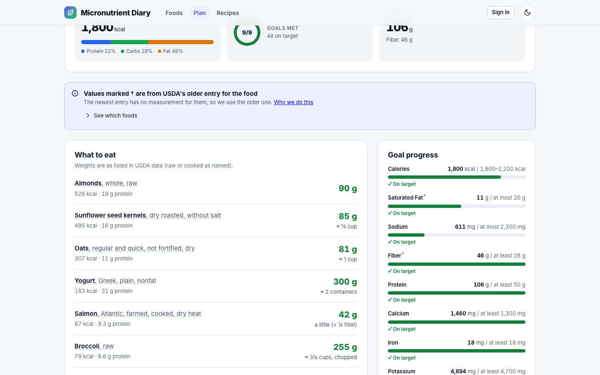

**What to eat** lists each food with its calories, protein, grams and a household amount such as "≈ 3 large". Each name links to the food's page, where its nutrients and contaminants are. A recipe links back to the recipe. Foods you fixed show a **Fixed amount** tag.

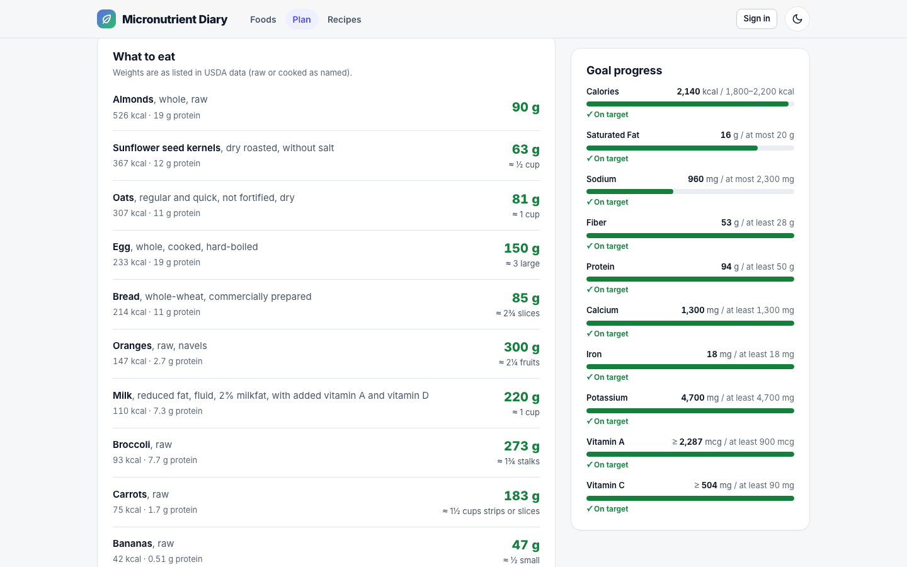

**Goal progress** gives each goal a bar, the amount against the target, and a status such as "On target" or "Short by…". A total that includes unmeasured foods shows "≥", meaning at least this much.

Below those:

- **Foods the plan didn't need.** "7 of your 15 foods weren't needed", each with a reason and **Include it**.
- **Where each nutrient comes from.** Pick a nutrient to see each food's share.
- **Show the math (advanced).** The actual equations the solver used.

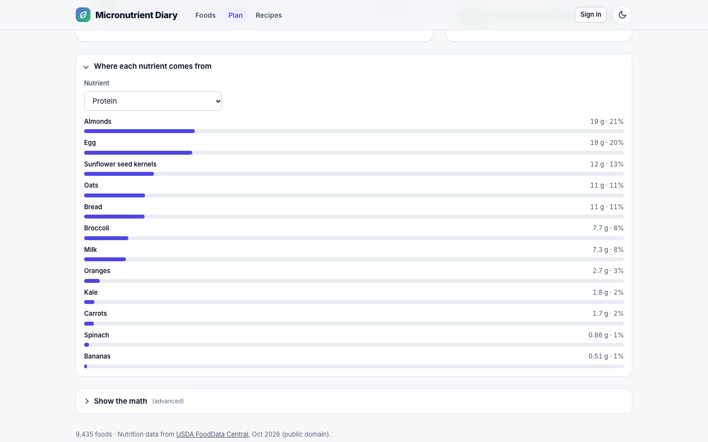

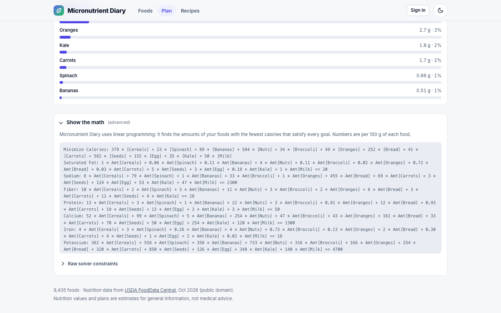

### 6.2 Pick foods

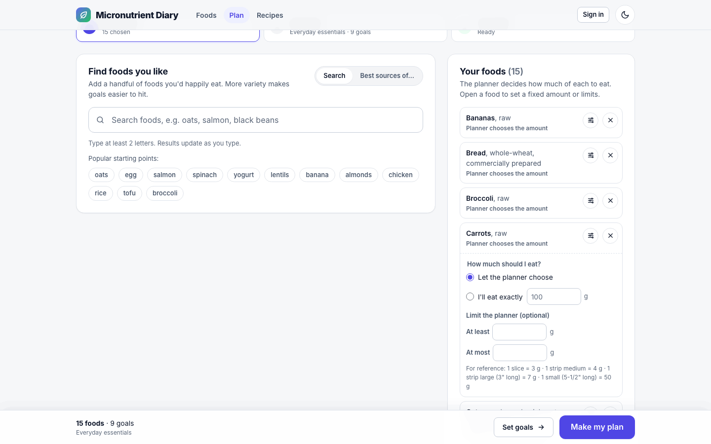

**Find foods you like** searches the same way as the home page, but each row has an **Add** button. The name links to the food's page. **Popular starting points** are one-click searches.

**Your foods** is the list the plan is built from. Each food has two buttons:

- **Sliders** opens its options: **Let the planner choose**, or **I'll eat exactly ___ g**, which makes it a fixed amount and plans the rest of the day around it. There are also optional **At least** and **At most** limits, with USDA serving weights for reference.
- **×** removes it.

**Compare nutrition labels** opens the labels, and **Clear all** empties the list with an **Undo**, which also brings back the plan. With no foods there's no plan: **Your plan** says "No plan yet" and offers **Pick foods** or **Try a sample day**.

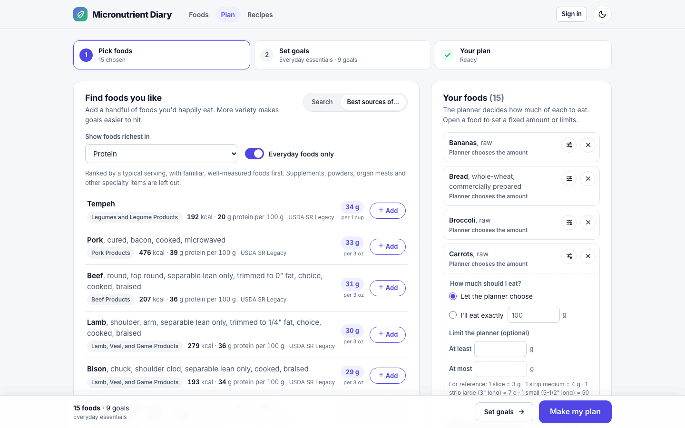

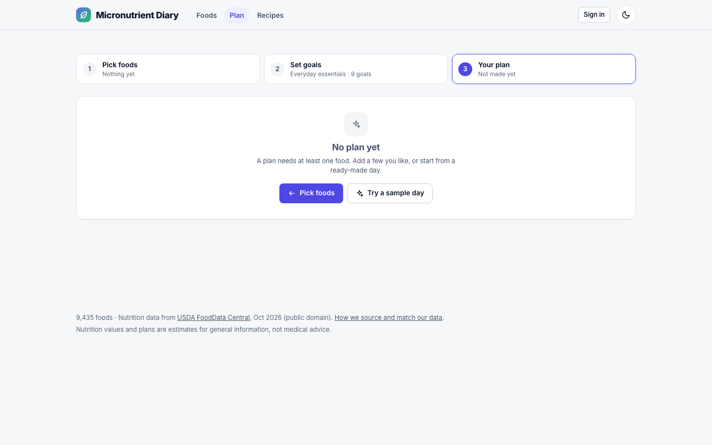

**Best sources of…** swaps search for a nutrient menu. It ranks by typical serving, and **Everyday foods only** keeps out supplements and other specialty items.

### 6.3 Set goals

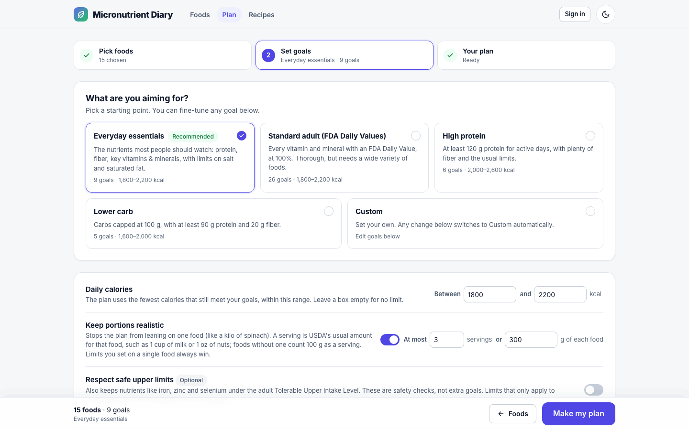

| Preset | What it asks for | Calories |
|---|---|---|
| **Everyday essentials** (default) | 9 goals: protein, fiber, key vitamins and minerals, with limits on salt and saturated fat | 1,800–2,200 |
| **Standard adult (FDA Daily Values)** | 26 goals: everything with a Daily Value, at 100% | 1,800–2,200 |
| **High protein** | 6 goals, including at least 120 g protein | 2,000–2,600 |
| **Lower carb** | 5 goals: carbs capped at 100 g, at least 90 g protein and 20 g fiber | 1,600–2,000 |
| **Custom** | Whatever you set. Any edit switches to this | yours |

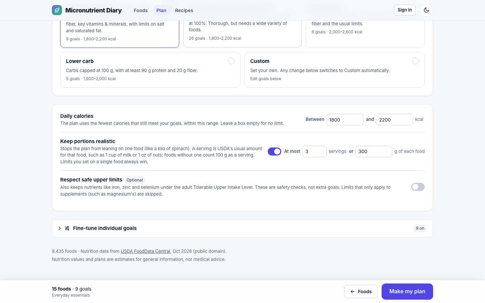

- **Daily calories:** a range. The plan uses the fewest calories that still meet your goals.
- **Keep portions realistic:** on by default, at most 3 servings or 300 g of each food. Limits you set on one food always win.
- **Respect safe upper limits:** optional. It also keeps nutrients like iron and zinc under the adult upper limit, and skips limits that apply only to supplements.

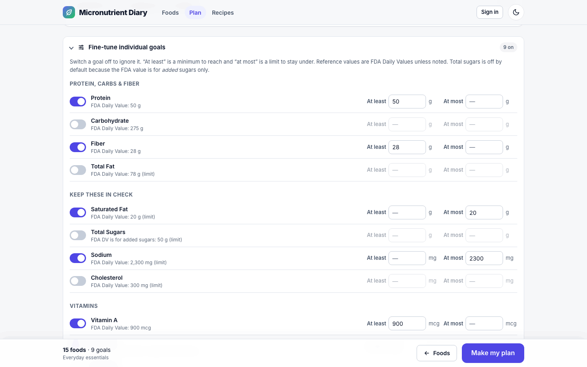

**Fine-tune individual goals** lists every nutrient with an on/off switch, its reference value, and **At least** and **At most** boxes.

The bar along the bottom of steps 1 and 2 shows the food and goal counts and the **Make my plan** button.

### 6.4 When things change, or can't be met

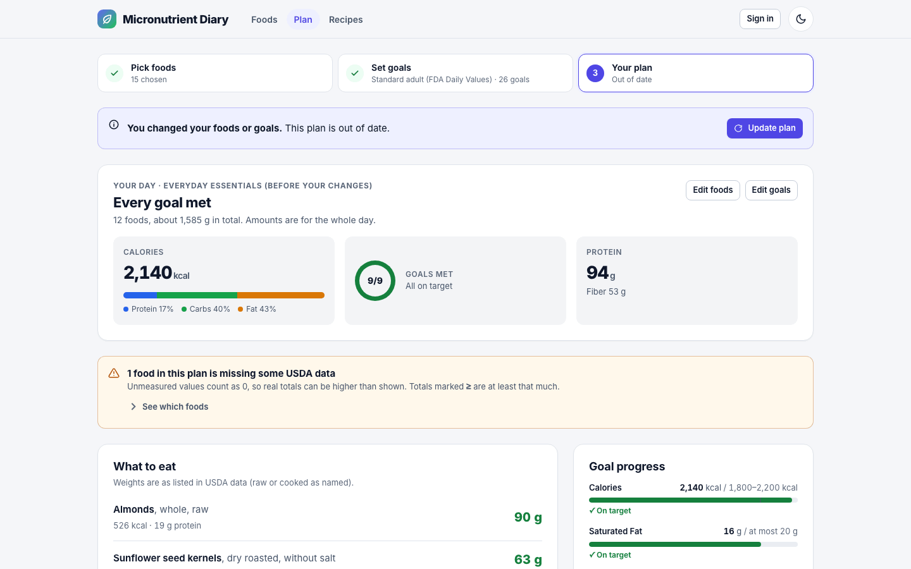

**Change anything** after making a plan, including adding a food from another page, and the old plan stays visible with an **Update plan** banner. The stepper says "Out of date".

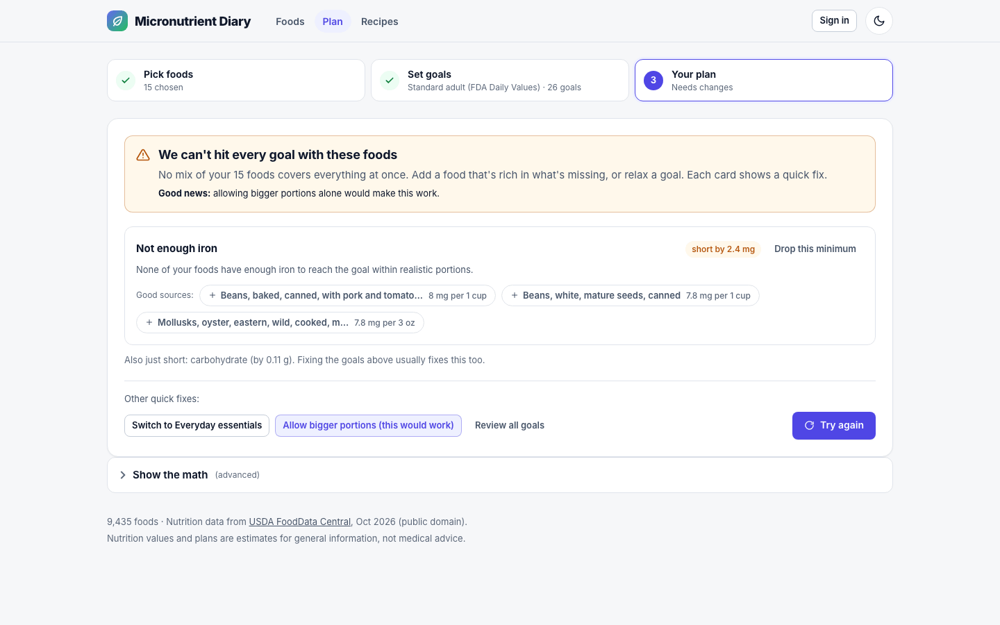

**If the goals can't all be met,** you get "We can't hit every goal with these foods" and one card per problem:

- the shortfall ("short by 2.4 mg");
- **Drop this minimum**;
- **Good sources**, which add a food in one click.

**Other quick fixes** are **Switch to Everyday essentials**, **Allow bigger portions** (highlighted when that alone would work) and **Review all goals**. Then **Try again**.

**What's remembered.** Foods, goals, the last plan and your current step are all kept in this browser, through reloads and visits to other pages. The step also appears in the address (`/plan#goals`).

---

## 7. Recipes

### 7.1 Three ways in

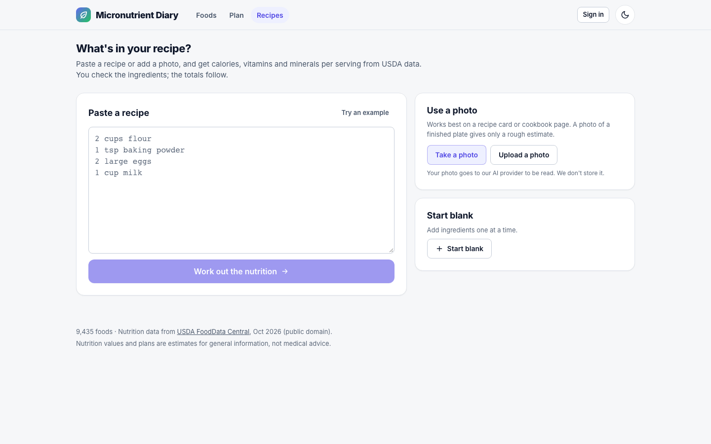

- **Paste a recipe,** then **Work out the nutrition.** **Try an example** fills in banana oat pancakes.
- **Use a photo:** **Take a photo** or **Upload a photo.** It works best on a recipe card. A photo of a plate gives only a rough estimate.
- **Start blank:** add ingredients one at a time.

### 7.2 Checking the ingredients

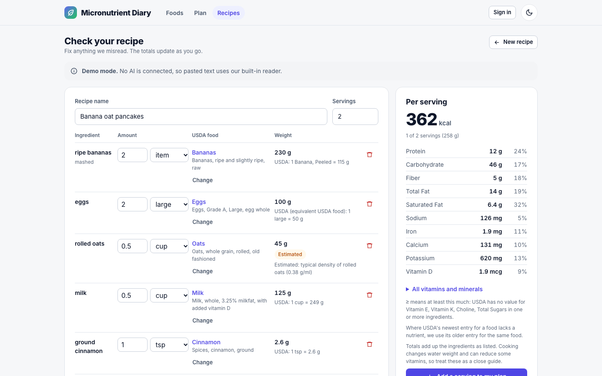

"Check your recipe" is an editor, and the totals update as you type.

- **Recipe name** and **Servings** are at the top. **New recipe** goes back to the start.
- **Ingredient:** what was read, with any preparation note.
- **Amount:** a number and a unit you can change.
- **USDA food:** the match. Its name is a link that opens the food page in a new tab. **Change** opens a search under the row, with suggestions.
- **Weight:** the grams used, and how they were worked out, such as "USDA: 1 cup = 249 g". An **Estimated** badge means a typical density was used instead of a USDA measure.
- **Trash** removes a row, with **Undo**.
- **Add an ingredient** takes a line like "2 tbsp olive oil".

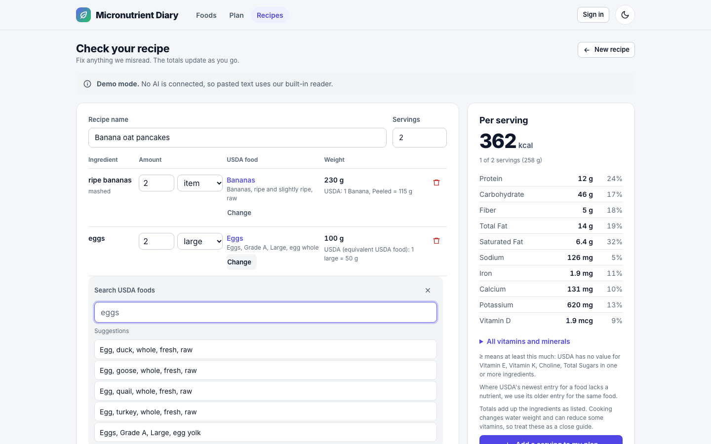

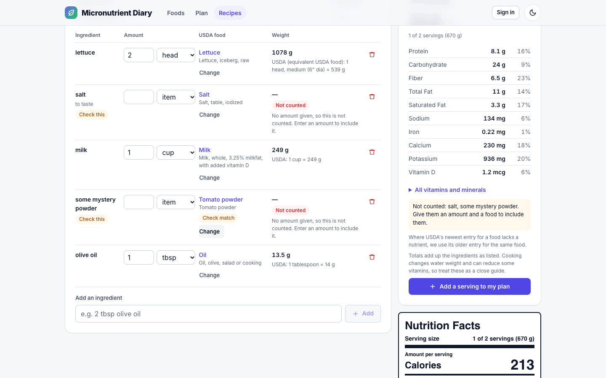

**Ingredients it isn't sure about** show **Check this** or **Check match**. An ingredient with no amount ("salt to taste") shows **Not counted**, and the totals list what was left out.

### 7.3 The totals

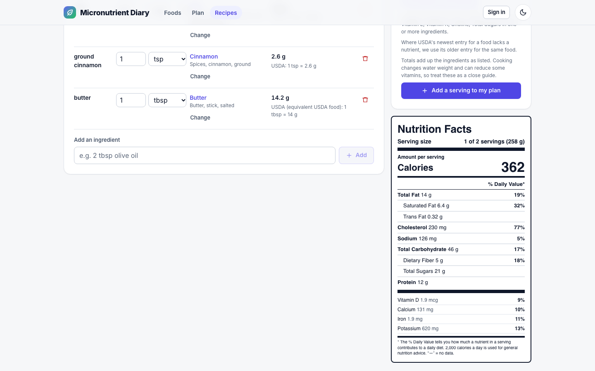

**Per serving** shows calories, ten key nutrients with % Daily Value, and **All vitamins and minerals**. Then:

- "≥" means at least this much, because one or more ingredients have no USDA value for that nutrient.
- If the newest USDA entry lacks a nutrient, the older entry for the same food fills it in. The value is marked **†**, and a note names the ingredients. Food pages and plans use the same values.
- A Nutrition Facts label for one serving sits underneath.

**Photos, in demo mode.** No AI is connected on a laptop, so any photo returns a built-in sample meal, and the page says so. A plated-meal result adds a warning and a calorie range ("Could be roughly 407 to 846 kcal"). **Show my photo** shows your picture. Pasted text is read by a simple built-in reader with its own Demo mode note.

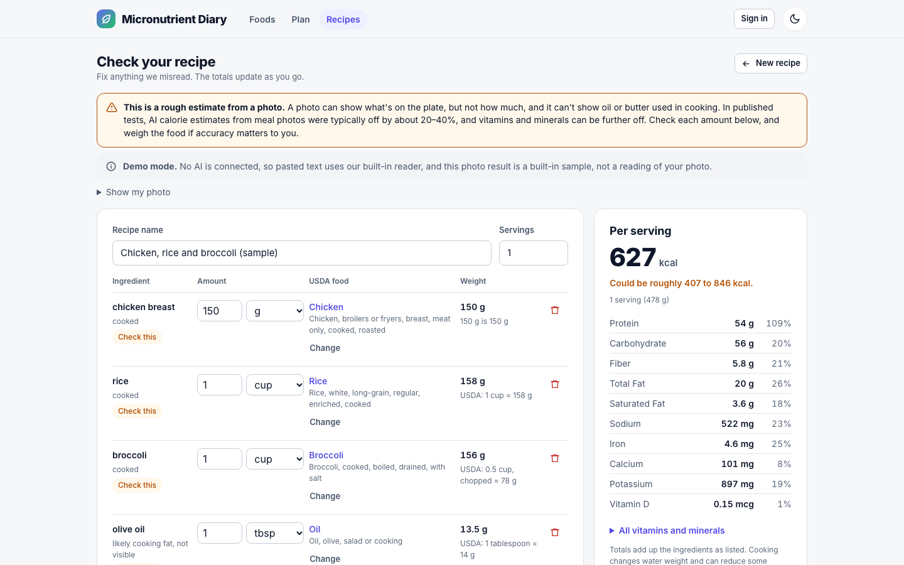

**Recent recipes.** Each analysis saves itself about a second after you stop editing. Click one to reopen it with all its ingredients, or × to remove it. These live in this browser only.

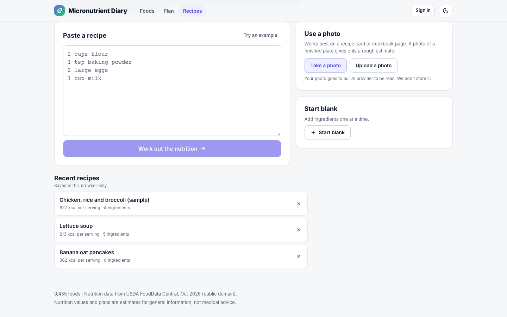

### 7.4 Adding a recipe to a plan

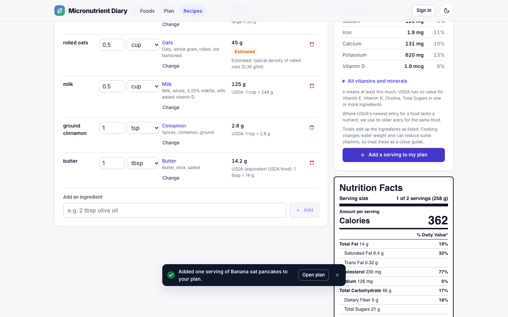

**Add a serving to my plan** shows a message with **Open plan**. The recipe joins **Your foods** as a fixed amount, one serving's weight, and the button becomes **In your plan: 1 serving · Open plan**, with **Add another serving** and **Remove one**. Edits to the recipe reach the plan, which then says **Out of date** until you update it.

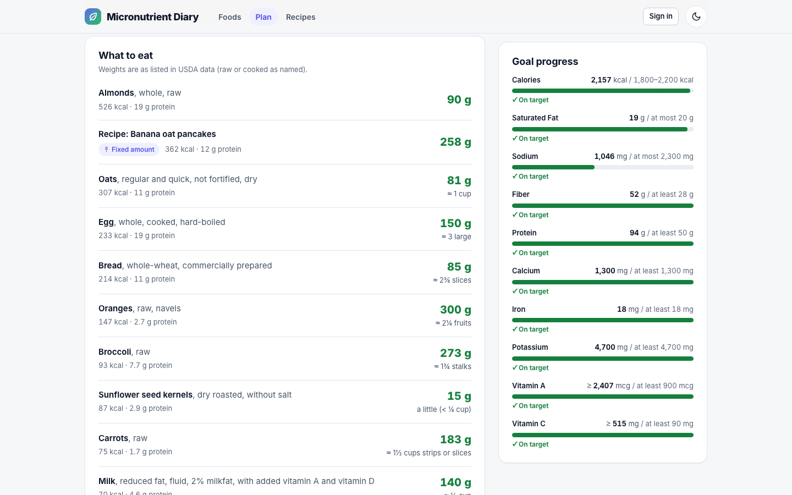

After **Make my plan**, it appears in **What to eat** as "Recipe: Banana oat pancakes" with a Fixed amount tag, and the planner fills in the rest of the day around it. Anything the recipe couldn't count is called out at the top of the plan.

The open recipe is in the address, so the browser's **Back** button, a reload and signing in all return to it.

---

## 8. Accounts

Accounts are optional, and every feature above works without one. They add a history of what you've looked at, which reopens recipes and plans on any device, plus export and delete.

### 8.1 Signing in

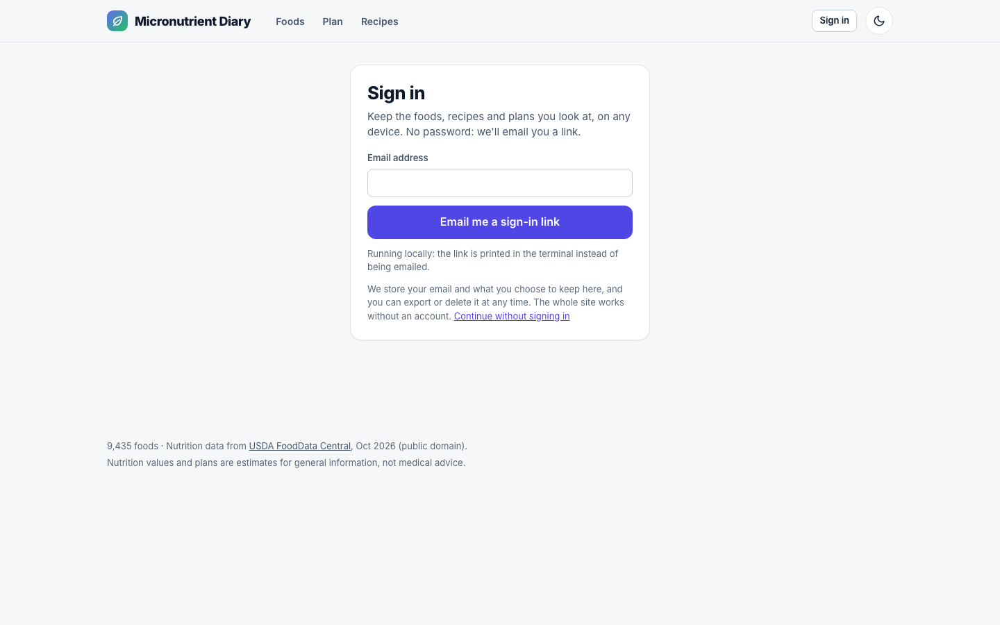

**Sign in** in the header opens this page. Enter an email and click **Email me a sign-in link.** There are no passwords. **Continue without signing in** goes home.

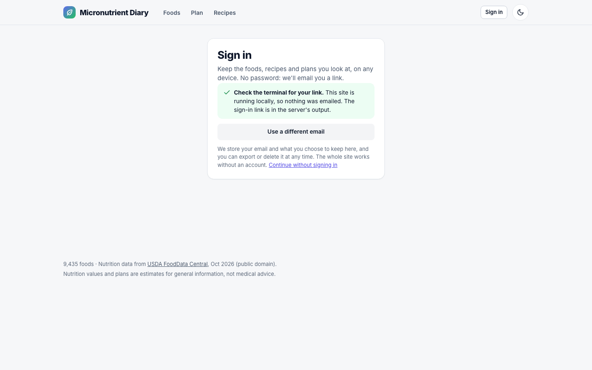

**On a laptop nothing is emailed.** The page says to check the terminal, where the link is printed. A deployed site would say "Check your email", and the link works once and expires in 15 minutes.

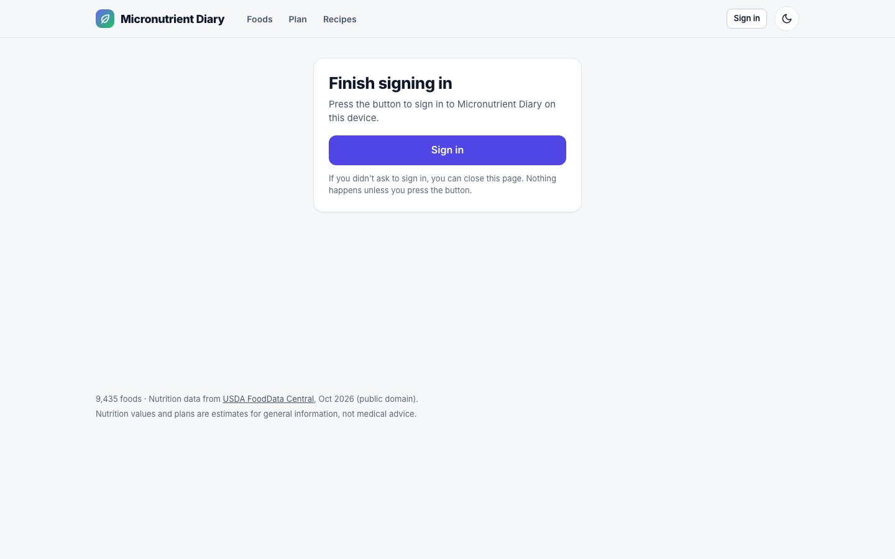

**The link opens a page with one button.** Email security scanners open links automatically, so the link is spent only when you press **Sign in**. You return to the page you started signing in from. An already-used link brings you back to sign-in with an explanation.

### 8.2 Your account

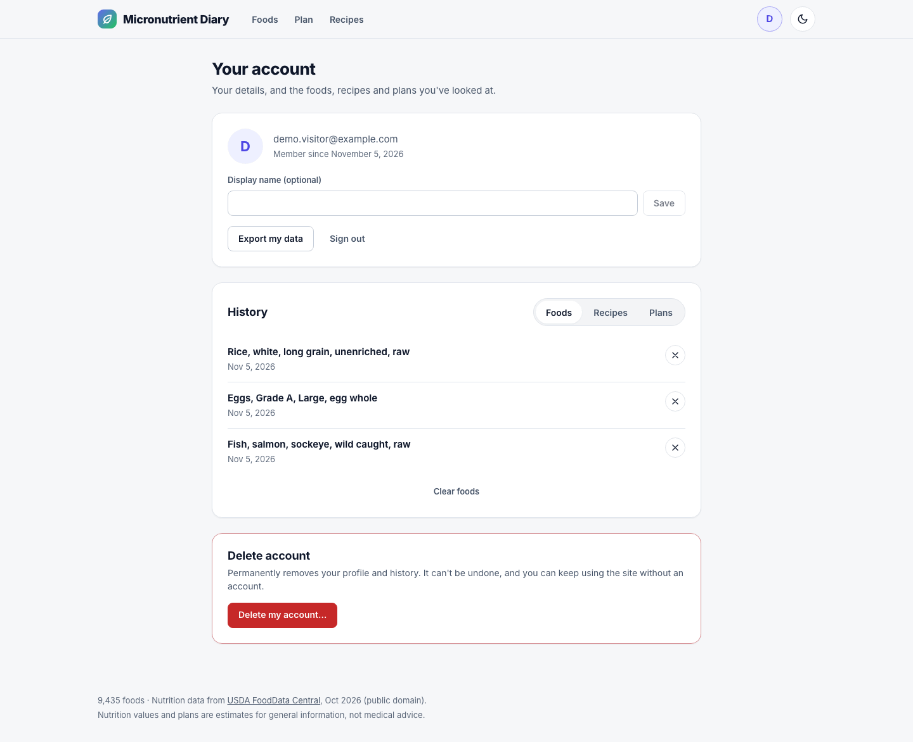

- **Display name** is optional. Your initial appears in the header.
- **Export my data** downloads everything held about you as a JSON file.
- **Sign out** returns you to the home page, and clears your foods, recipes and plan from this browser. Anything saved to your account stays there.
- **History** has three tabs. Food rows link back to the food. Each row has an × to remove it, and **Clear** empties the tab.
- **Delete account** is at the bottom.

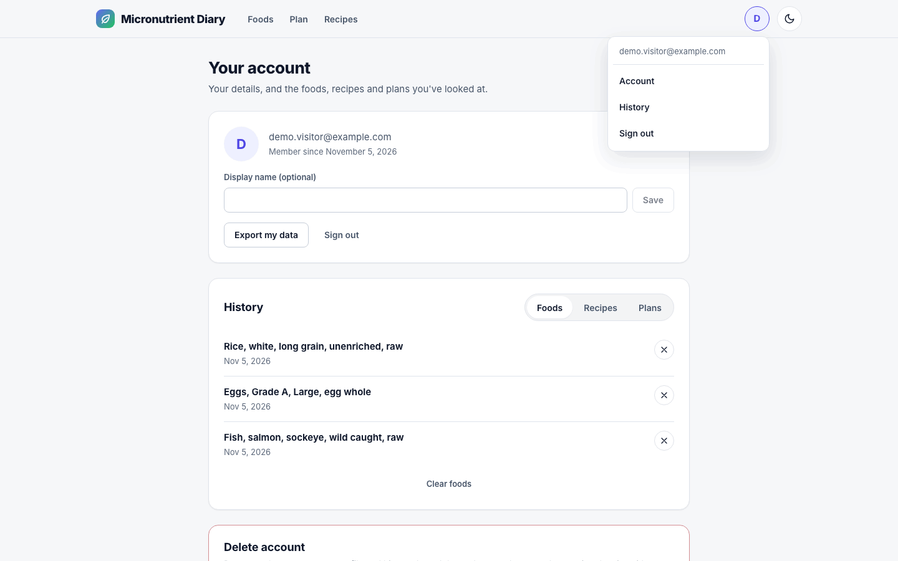

The **account menu** behind your initial offers **Account**, **History** (the history on a page of its own) and **Sign out**. Signing in or out in one tab updates the header in your other tabs.

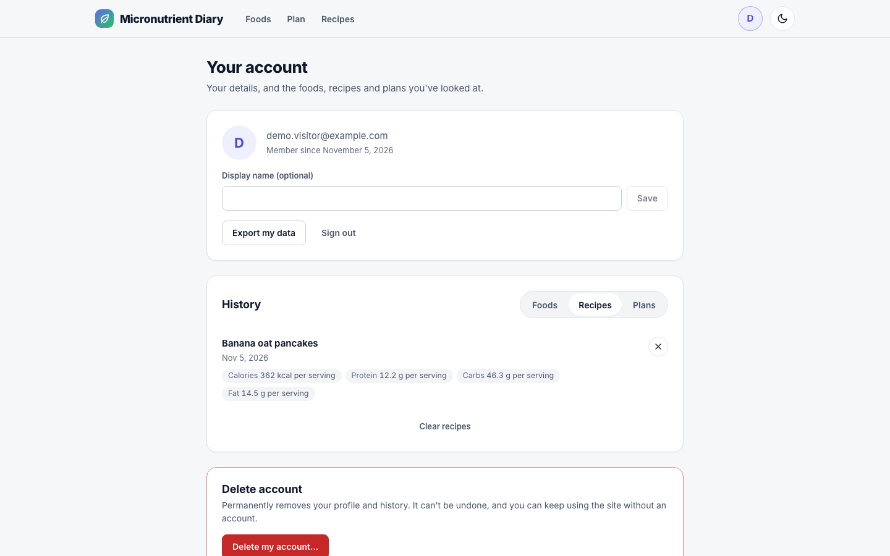

**Recipes** show per-serving calories, protein, carbs and fat. The row updates as you edit, so one recipe stays one row. Its link opens that recipe, with its ingredients, in any browser you're signed in on.

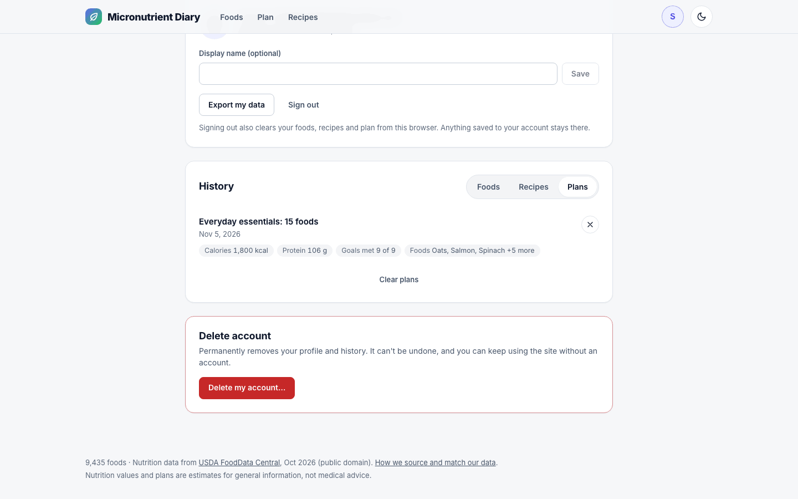

**Plans** lists each plan you've made while signed in, with its calories, protein, goals met and foods. Its link makes that plan the current one again, on any device. On a second browser, an empty planner also offers **Your last plan**.

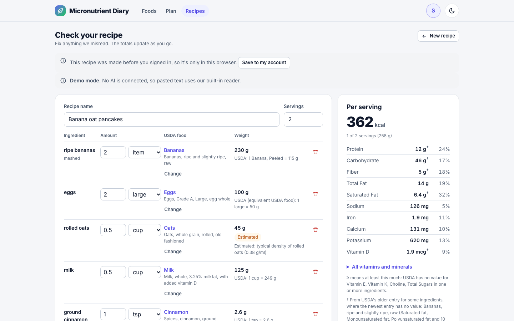

**Work from before you signed in** stays in this browser and isn't uploaded. A recipe or plan made that way says so and offers **Save to my account**. Details are in [ACCOUNTS.md](ACCOUNTS.md#data-in-this-browser).

### 8.3 Deleting an account

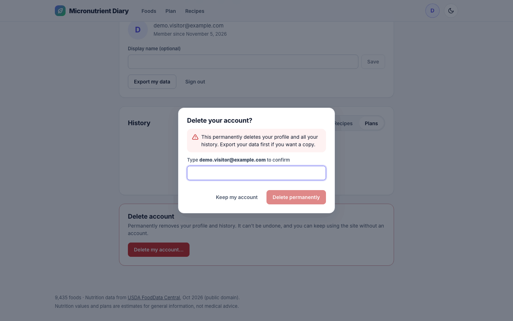

**Delete my account…** asks you to type your email before **Delete permanently** will work. **Keep my account** or Esc backs out.

Afterwards you're signed out, with a confirmation, and the site works as normal. Everything kept in this browser is gone too: no recent recipes, no plan.

---

## 9. Dark mode

The theme follows your device on a first visit, with no white flash. The moon/sun button overrides it, and that choice is remembered. Labels, meters, tables and dialogs all have proper dark versions.

## 10. On a phone

| | | |
|---|---|---|
|  |  |  |
|  |  |  |
|  |  |  |

At 390 px everything becomes one column and no page scrolled sideways.

- The navigation becomes a row of three tabs under the logo, so nothing hides behind a menu.
- The search box isn't focused automatically, so the keyboard doesn't jump up.
- The planner's stepper becomes three tiles, and **Make my plan** stays fixed at the bottom.
- Recipe ingredients stack, and a bar at the bottom keeps "362 kcal per serving" and **See totals** in view.

## 11. Keyboard

- The first Tab on most pages shows **Skip to content**.
- Focus rings are visible on every control reached.
- On the home page, `/` focuses search, ↓ and ↑ move through results, Enter opens one.
- The account menu works with Enter, the arrow keys and Esc, and returns focus to its button.
- The delete dialog holds focus inside it, and Esc closes it.
- After a recipe is read, focus moves to "Check your recipe". **Change** opens its search with focus in the box, and Esc closes it and returns to **Change**.

Two small gaps are listed as [L10](#14-rough-edges-checklist). No screen reader was run.

---

## 12. Behind the scenes

> **Nutrition data.** 9,435 foods from USDA FoodData Central (October 2026 release, public domain), from three USDA collections: Foundation (newest lab analyses), SR Legacy (the classic reference) and FNDDS (mixed dishes). Everything is stored per 100 g. When USDA didn't measure something the site stores "unknown", not zero.
>
> **Contaminant data.** Heavy metals come from FDA's Total Diet Study (FY2018 to FY2020), FDA's fish mercury tables and its rice arsenic assessment. Pesticides come from USDA's Pesticide Data Program (2016 to 2024). References come from FDA and EPA. Microplastics come from a few published studies, and no health limit exists for them. Details and citations are at `/methodology` on the site.
>
> **How a plan is calculated.** A method called linear programming finds the amounts of your foods with the fewest total calories that satisfy every goal, calorie bound and portion limit. If no mix can, it reports what's blocking it. Where USDA's newest entry lacks a value, its older entry fills the gap, on every page, and the value is marked †. Anything still unmeasured counts as 0, which is why plans can undercount and why the yellow note exists.
>
> **How a recipe is calculated.** The AI (or, in demo mode, a built-in reader) only reads the ingredient list. It never supplies nutrition. Each ingredient is matched to a USDA food, converted to grams, and added up. Cooking changes aren't modelled. See [RECIPES.md](RECIPES.md).
>
> **What's stored where.**
>
> | Where | What | Who can see it |
> |---|---|---|
> | **This browser** | Planner foods, goals, last plan and step; recent recipes with their ingredients; recent searches; theme; flags that say "this browser was signed in" and as whom | Anyone using this browser. Cleared by signing out or deleting the account, apart from the theme |
> | **The site's database, if you have an account** | Email, display name, sign-in sessions, and history rows: title, link, date and a summary, plus a recipe's ingredients and a plan's foods and goals, so they can be reopened | You, through export. Delete removes it |
> | **The AI provider** | Pasted recipes and photos, when a real provider is switched on. Photos aren't stored by the site | Nothing is sent in demo mode |
>
> Anonymous visitors make no account requests and have nothing stored on the server.
>
> **More depth:** [ACCOUNTS.md](ACCOUNTS.md) · [RECIPES.md](RECIPES.md) · [CONTAMINANT_DATA.md](CONTAMINANT_DATA.md) · [KEY_NUTRIENTS.md](KEY_NUTRIENTS.md) · [README_API.md](README_API.md) · [LOCAL_TESTING.md](LOCAL_TESTING.md)

## 13. Tips: questions people will ask

**"Why does rice read High?"** Mainly because the arsenic reference is very cautious. A 45 g serving of raw long-grain white rice has about 4.6 µg of inorganic arsenic, against EPA's 4.8 µg a day. EPA's own estimate is that typical US intake is already about 61% of that reference. Any single serving over half of it counts as High on the site's scale. FDA doesn't advise avoiding rice. Cooking it in plenty of water and draining it removes 40–60% of the inorganic arsenic, though the meter doesn't adjust for that, and eating a variety of grains helps too.

**"Why do some values show "—"?"** USDA has no measurement for that nutrient, in this entry or its older entry. It does not mean zero.

**"What does † mean?"** Foundation entries are the newest but often the sparsest. Raw spinach has no vitamin K in its "mature" Foundation entry, so the site uses the 483 mcg from USDA's older entry for spinach, and marks it †. A value the newest entry does have is never replaced.

**"What do the meters actually mean?"** Each compares one serving with a health-based reference, as a share of a day (a week for mercury). High doesn't mean harmful, and Low doesn't mean none: references are cautious planning values, and exposure adds up across everything you eat, over time. The bands are the site's judgment. See the [table](#3-contaminant-meters).

**"Why does the meter change when I change the serving?"** It's per serving, because a bigger portion is more exposure. Compare foods at similar, realistic servings. A spoonful of a spice and a cup of rice aren't comparable at 100 g.

**"No data, Not detected, Not rated: what's the difference?"** Not detected means tested and not found, down to the test's limit. No data means no usable testing, so it says nothing either way. Not rated means an amount is known but can't be fairly judged.

**"Why do similar foods have identical numbers?"** Testing programs measure a food once, while USDA lists many versions. The **Based on** line says which record was used and how many foods share it. A brand maps to the general food.

**"Why does the plan leave out some of my foods?"** The planner uses the fewest calories that meet your goals, so it doesn't need everything. Use **Include it**, or set **At least** on that food.

**"Why can't the FDA preset be met?"** It turns on 26 goals at 100%, so it needs a wide variety of foods. The sample foods now meet all 26, using 10 foods and 1,800 kcal. A shorter list often won't, and the plan says which goals fall short and which foods would help.

**"Is the recipe reader really AI?"** Not on a laptop or until a provider is switched on. The page says "Demo mode" when it isn't.

---

## 14. Rough edges checklist

**Severity:** **High** means it misleads people or breaks a promise the site makes. **Medium** means it's confusing or doesn't do what it says. **Low** is polish. Unless a step says otherwise, start from a fresh browser profile. A ticked item has been fixed, and a headless browser repeated its steps. The descriptions and steps are how each problem looked when it was found.

### High

- [x] **H1. The same food gives different nutrition in different features.** Recipes fill gaps in a newer USDA entry from the older entry. Food pages and the planner don't. So spinach has no vitamin K on its page and in a plan, but 483 mcg in a recipe, and the plan tells people spinach can't help with vitamin K. Vitamin E, cholesterol and sugars do the same.

  *Fixed. One server-side rule (`lib/nutrient-fill.ts`, applied in `lib/db.ts`) fills only NULLs, keeps per-nutrient provenance, and every value from an older entry is marked †. A test compares one food through the food page path, `/api/food`, `/api/search`, `/api/optimize` and recipes.*

  1. Open `/food/1999633-spinach-mature`, set **Serving size** to **100 g**. **Vitamin K** shows **—** ([screenshot](walkthrough/64-edge-spinach-food-page.png)).
  2. Open `/recipes`, click **Start blank**, type `100 g spinach` under **Add an ingredient**, click **Add**. It matches "Spinach, mature". Set **Servings** to 1 and open **All vitamins and minerals**. **Vitamin K** shows **483 mcg, 402%** ([screenshot](walkthrough/65-edge-spinach-recipe.png)).
  3. Back on the spinach page, click **Add to my plan**. Go to **Plan**, **Set goals**, choose **Standard adult (FDA Daily Values)**, click **Make my plan**. The plan says **Not enough Vitamin K, short by 120 mcg. None of your foods have enough Vitamin K**.

- [x] **H2. Plans are promised but never saved to an account.** The sign-in page says "Keep the foods, recipes and plans you look at, on any device". The account pages repeat it, and the Plans tab says "Plans you make will show up here". Nothing recorded a plan. `docs/ACCOUNTS.md` notes this as not built yet, but the customer-facing words don't.

  *Fixed. Plans are recorded to history and reopen at `/plan?open=<id>`. The Plans tab shows calories, protein, goals met and foods, and an empty planner offers the last plan. A plan too big for the 8 KB cap (roughly 10 recipes or more) keeps its summary but can't be reopened.*

  1. Sign in. Go to **Plan**, click **Try a sample day**.
  2. Open the account menu, **Account**, tab **Plans**. It's empty.
  3. Sign in to the same account in a second browser and open **Plan**. It says "Nothing yet".

### Medium

- [x] **M1. The methodology links are dead today, and go to a developer page.** "How we match foods" and "Read the full methodology and all sources" on contaminant panels open `github.com/yonaadug/FoodNutritionOptimize/blob/main/docs/CONTAMINANT_DATA.md`. That returns **404** without a login, because local `main` is 106 commits ahead of GitHub. Pushing will fix the 404, but customers still land on a code-hosting page ending in a "For developers" section.

  *Fixed. `/methodology` is a real page with the same content, linked from the panel and every footer. A test keeps it in step with `docs/CONTAMINANT_DATA.md`.*

  1. Open `/food/2512381`, then **How we work this out**, then **Read the full methodology and all sources**.
  2. In a signed-out browser, you get GitHub's 404. (Checked with an anonymous request.)

- [x] **M2. A recipe in History can't be reopened.** The row's link goes to the blank Recipes page. Only a summary is stored, so on another device the ingredients are gone.

  *Fixed. History rows hold the ingredients and link to `/recipes?id=<id>`, which opens from this browser or the account. A recipe too long for the 8 KB cap keeps its summary and opens only where it was made.*

  1. Sign in and analyze a recipe. On **Account**, tab **Recipes**, click its name. You land on the start page, not the recipe.
  2. Sign in on a second browser and do the same. The start page has no **Recent recipes** at all.

- [x] **M3. Browser-kept data outlives sign-out and deletion, and can move between accounts.** After "Your account and history have been deleted", the recipes with all their ingredients and the plan are still there. On a shared computer, the next person sees them, and opening one copies it into their own history.

  *Fixed. Sign-out, deletion, an ended session or a different person signing in clears this browser. Work from before signing in stays local and isn't uploaded unless **Save to my account** is pressed. The rule is in `docs/ACCOUNTS.md`.*

  1. Sign in as person A. Analyze a recipe. Sign out.
  2. Sign in as person B in the same browser. Open **Recipes**. A's recipe is under **Recent recipes**.
  3. Click it, then open **Account**, tab **Recipes**. It's now in B's history.
  4. Alternatively, delete an account and open **Recipes** and **Plan**. Both still show its work.

- [x] **M4. Clear all leaves a plan behind, and Update plan does nothing.** With no foods, step 3 still shows the old plan under an **Update plan** banner, and the button has no effect, even after a reload ([screenshot](walkthrough/66-edge-plan-with-no-foods.png)). If the old plan had failed, it reads "No mix of your 0 foods covers everything".

  *Fixed. With no foods there is no plan, on screen or in storage. Your plan shows "No plan yet" with **Pick foods** and **Try a sample day**, and **Undo** restores both foods and plan.*

  1. Open `/plan`, click **Try a sample day**.
  2. Click **Pick foods**, then **Clear all**.
  3. Click **Your plan**, then **Update plan**. Nothing changes.

- [x] **M5. The planner is a dead end for food pages.** Food pages link to the planner, but nothing links back. Names in **Your foods**, search results, **Best sources**, **What to eat**, **Good sources** and the compare labels aren't links. Contaminant information can't be reached from the planner at all, and a plan can suggest a large amount of a High food without any mention. The recipe editor does link to food pages, so the two features behave differently.

  *Fixed. Food names link to their pages in Your foods, search results, Best sources, What to eat, Foods the plan didn't need, Where each nutrient comes from, Good sources and the compare labels. A plan still doesn't mention a High contaminant reading by itself.*

  1. Open `/plan`, click **Try a sample day**.
  2. Try to click any food name. None of them is a link: the plan step has no links at all.

- [x] **M6. Add to my plan ignores the serving you chose.** You pick a serving, the label and meters change, and the button discards it. Recipes do the opposite and add a fixed serving.

  *Fixed. **Add exactly 216 g** fixes the chosen serving in the plan. **Add to my plan** still lets the planner choose, and a line under the buttons says so.*

  1. Open `/food/171689`, choose **1 large (3-1/4" dia) (216 g)**, click **Add to my plan**.
  2. Open `/plan#foods`. The apple says **Planner chooses the amount**.

- [x] **M7. A recipe in the plan is a disconnected copy.**

  *Fixed. Each press adds a serving and the page shows the count. Edits reach the plan and make it read **Out of date**. "Not counted" gets its own note on the plan, and lower bounds show "≥".*

  - Clicking **Add a serving** again says "Added one serving" but the plan stays at one serving, and the button never shows it's already in the plan, unlike the food page.
  - Edits to the recipe don't reach the plan, which still says **Ready**.
  - "Not counted" ingredients and "≥" warnings don't carry over.

  To reproduce:
  1. Analyze the example recipe. Click **Add a serving to my plan** twice. **Open plan** shows one recipe at **Fixed: 258.1 g**.
  2. Click **Make my plan**, go to **Recipes**, reopen the recipe from **Recent recipes**, and set **Servings** to 1. Return to **Plan**. The stepper says **Ready** and the recipe is still 258 g.
  3. Analyze a recipe with these three lines: `2 heads lettuce`, `salt to taste`, `1 cup milk`. The page warns "Not counted: salt". Add it to a plan and click **Make my plan**. The plan doesn't mention this.

- [x] **M8. Leaving the recipe editor loses your place, and Sign in doesn't bring you back.** The editor isn't in the address or the browser history, so Back, a reload or the header goes to the start page. The work is safe under **Recent recipes**, but it looks lost. Sign in always lands on **Account**, and a recipe analyzed just before it isn't in History until reopened, which contradicts "what someone viewed before signing in is not added" in `docs/ACCOUNTS.md`.

  *Fixed. The recipe is in the address (`/recipes?id=<id>`), so Back and reload restore it. Sign-in returns to the page it started from, through a same-site check (`lib/auth/next-path.ts`). A recipe analyzed before signing in stays out of History until **Save to my account**, as the docs say.*

  1. Analyze the example. Click **Add a serving to my plan**, then **Open plan**, then the browser's Back button. You're on the start page, not the editor.
  2. Analyze the example. Click **Sign in** and finish signing in. You land on **Account**, with an empty **Recipes** tab.
  3. Open **Recipes** and reopen it from **Recent recipes**. It's now in History.

- [x] **M9. A failed recipe read throws away the pasted text.** The error appears, but the box is empty, so people have to find and paste the recipe again. Demo mode rarely fails, but a real AI provider will sometimes be busy, rate-limited or slow, so this will matter more. **Cancel** while reading clears it too.

  *Fixed. The paste box survives a failed read and **Cancel**, and clears only after a successful read.*

  1. Open `/recipes`, then stop the server in its terminal.
  2. Paste some text and click **Work out the nutrition**. An error appears and the box is empty. (Checked by forcing a 503 reply in the test browser, which takes the same path.)

- [ ] **M10. There's no privacy or terms page.** The site now holds email addresses and, once AI is on, sends recipes and photos to a provider. The footer has only the data credit and disclaimer, and a crawl of the whole site found no such page.

  *Still open, on purpose: privacy and terms pages need legal review.*

  1. Scroll to the footer of any page. There are no links besides USDA.

### Low

- [x] **L1. One Back press seems to do nothing in the planner.** Click **Plan** in the header while on step 3, click **Pick foods**, press Back. The address changes to `/plan` but step 1 stays.

  *Fixed. Leaving a bare `/plan` now names its step in that history entry, so Back returns to it.*
- [x] **L2. A second open tab doesn't get the new plan.** Open a plan in two tabs. In tab 2, add a food and click **Make my plan**. Tab 1 says **Out of date** until reloaded.

  *Fixed. Other tabs pick up the new plan as soon as it's saved.*
- [x] **L3. Compare starts at a different serving.** On `/food/2684440` the page shows 3 oz, 116 kcal. Click **Compare**. The label for the same food shows 100 g, 136 kcal.

  *Fixed. Compare labels use the same serving choices and default as the food page.*
- [x] **L4. Two spellings of microgram.** Nutrients use "mcg" and contaminants use "µg", on the same food page. Compare **All nutrients** and **Contaminants** on any food.

  *Fixed. "mcg" throughout, in contaminants and on the methodology page.*
- [ ] **L5. Inconsistent food and category names.**

  *Partly fixed. History now uses the site's food names. **Still open:** the home chips and category pages use different names, which needs a decision on wording.*

  - History shows raw USDA names ("Fish, salmon, sockeye, wild caught, raw") where everywhere else says "Salmon, sockeye, wild caught, raw".
  - The home chip says "Fish & shellfish" and leads to "Finfish and Shellfish Products". "Grains & pasta" leads to "Cereal Grains and Pasta".
- [x] **L6. Small wording slips.**

  *Fixed. "Untitled recipe" everywhere, "1 ingredient", and "an 80 kg adult".*

  - An unnamed recipe is "My recipe" (Start blank), "Untitled recipe" (Recent recipes), "Recipe: Untitled" (planner) or "your recipe" (message).
  - Recent recipes can say "1 ingredients".
  - Details say "a 80 kg adult".
- [x] **L7. Food rows in History show only a date.** The home cards show calories and what a food is rich in. History has none of that, as `docs/ACCOUNTS.md` notes. Open a food signed in, then **Account**.

  *Fixed. Food rows show calories per typical serving and what the food is rich in. Rows saved earlier keep what they have until the food is viewed again.*
- [x] **L8. A tab left open after signing out elsewhere.** Open `/account/history` in two tabs. Sign out in one. The other's header changes to **Sign in**, but the page stays, and changing tabs gives "Couldn't load your history".

  *Fixed. Signing out in one tab sends an account page in another tab to sign-in, and so does an expired session.*
- [x] **L9. Page titles and headings.** `/account/sign-in` and `/account/history` have the title "Sign in" and "History" with no site name, while other pages have one. `/plan` has no main heading once the welcome panel is gone.

  *Fixed. Account pages now carry the site name, and `/plan` always has a main heading.*
- [ ] **L10. Keyboard gaps.** After **Add to my plan** the button is replaced and focus drops to the page, and **Open plan** in the message is the far end of the page by Tab. On the home page focus starts in search, so the skip link is only reachable with Shift+Tab.

  *Partly fixed. After adding a food, focus moves to the link that replaces the button. **Still open:** the home page skip link is reachable only with Shift+Tab, because search takes focus first.*
- [ ] **L11. Search order for "rice".** The first results are black and then red rice, ahead of everyday white or brown rice. Search `rice` on the home page.

  *Still open. Changing the ranking affects every search, so it needs its own test set.*
- [ ] **L12. Some contaminant matches look loose.** All disclosed in **Based on**, but they may surprise people.

  *Still open. These are data-matching decisions, and all are disclosed under **Based on**.*

  - Sockeye salmon's microplastics are based on "Alaska pollock".
  - "Apples, raw, without skin" uses "Apple, red, with peel, raw".
  - Black rice has no metals data, while white rice does.
- [ ] **L13. Demo-mode wording.** "Your photo goes to our AI provider" appears even when no provider is connected. The demo reader treats any text as ingredients: paste `hello there, how are you today?`, and you get a row called "hello there how are you today?". Neither applies once real AI is on.

  *Still open. Neither applies once real AI is on.*
- [ ] **L14. A console warning.** Pages left open for a few seconds log "preloaded using link preload but not used" for one stylesheet. It's harmless and doesn't affect anything visible.

  *Still open. Harmless, and it comes from the framework.*
- [x] **L15. The site's one-line description is out of date.** The home tagline and search-engine description mention looking up nutrients and planning, but not recipes or contaminants.

  *Fixed. The tagline and search description now mention contaminants and recipes.*
- [ ] **L16. Rest of the README.** The first page and Features are updated. The Usage Guide, Project Structure and Screenshots sections weren't in scope and still describe the planner as the main page.

  *Still open. A documentation job, outside this round.*

## 15. What was checked, and what couldn't be

**Checked and working:**

| Looked for | Result |
|---|---|
| Meters disagreeing with the serving selector | None. Every serving on salmon, egg, white rice, spinach and apple, custom amounts, invalid amounts and rapid switching all matched the label and table |
| Broken links | None. Crawled 9,772 internal addresses from the page HTML and sitemap, including all 9,435 food pages. The only redirects were `/account` and `/account/history` to sign-in when signed out |
| Duplicate headers or footers | None on any page type, including 404s. Every page has one header, one footer and one main area |
| Sign-in state updating without a reload | Works, including across tabs |
| Planner state across navigation | Foods, goals, plan and step all survive leaving `/plan`, reloads, and Back and Forward |
| Home card numbers against food pages | All 12 match on serving and calories |
| Best sources rankings | The nutrient page and the planner tab match (checked vitamin D) |
| Anonymous use after sign-out and account deletion | Works |
| Sideways scrolling at 390 px | None on 12 page types, plus the plan, recipe and account screens |
| Error states | Contaminants, search and the planner each explain a failed request and offer **Try again**, and the planner keeps your foods and goals. Recipes show the error and keep the text |
| 404 pages | Friendly on food, nutrient, category and general addresses, each with a way back |
| Console errors | None in normal use. The only ones were for the deliberate 404s, forced failures, and L8 |
| Speed | Nothing over 1 second. Across the crawl, the typical page took 79 ms and the slowest 325 ms. Reading a recipe took about 0.4 s and a sample day about 0.1 s. This is on a laptop with no network in between, so a deployed site will be slower |

**Couldn't reach:**

- **Real email:** links were read from the terminal. **Google sign-in** isn't set up locally.
- **A real AI provider:** recipes and photos ran on the offline demo reader, so real-world reading accuracy is unknown.
- **Stripe and any paid features,** which were out of scope, and the deployed site on AWS.
- **External links:** USDA and the contaminant source links weren't opened.
- **Screen readers.** Labels, roles and focus were checked in code and by keyboard, but no screen reader was run.
