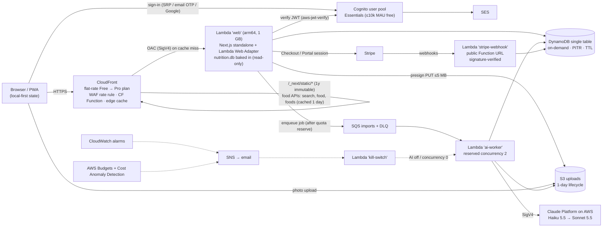
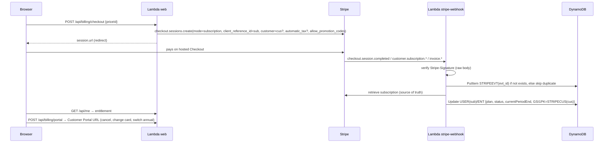

# NutritionDictionary: AWS Hosting and Monetization Design

**Status:** proposal, not implemented · **Prepared:** 2026-11-03 · **Scope:** `food-nutrition-app/` (web). `electron-app/` stays offline-first and is unaffected.
**Priority:** lowest possible cost for a solo developer, with hard limits so neither abuse nor AI usage can cost more than the app earns.

All prices are USD, us-east-1, and were taken from official pricing pages on **2026-11-03** (sources in [§10](#10-sources-accessed-2026-11-03)). Values marked **(unverified)** could not be confirmed on an official page and should be checked before you rely on them. Values marked **(est.)** are my own estimates.

> **Update, 2026-11-05: accounts don't use Cognito.** They were built with Better Auth email links (see [ACCOUNTS.md](../ACCOUNTS.md)), because Cognito can't be tested on a laptop. Read the Cognito rows below as $0, which removes the largest cost at scale (about $165–450/mo at 100k users), but add SES for each sign-in email ($0.10 per 1,000). We now own security patches and abuse handling. The cost tables have not been recalculated. [ACCOUNTS.md](../ACCOUNTS.md) lists the deployment steps, including one that matters: forward `CloudFront-Viewer-Address`, or everyone shares one sign-in rate limit.

---

## 1. One-page recommendation

### Architecture (TL;DR)

| Layer | Choice | Why |
|---|---|---|
| CDN / edge | **CloudFront**: flat-rate **Free plan** at launch, **Pro ($15/mo)** at about 6k MAU, pay-as-you-go plus WAF beyond about 60k MAU | The Free plan costs $0 and includes 5 WAF rules (with IP rate limiting), DDoS protection, a Route 53 zone, a TLS certificate, and **no overage charges** |
| Compute | **One Lambda function (arm64, 1 GB)** running the existing `output: 'standalone'` Next.js server through **AWS Lambda Web Adapter**, packaged as a container image and exposed through a Function URL with **CloudFront OAC** | Works with any Next.js version because it does not depend on OpenNext supporting Next 16. The Lambda always-free tier (1M requests and 400k GB-s per month) covers the app up to about 100k MAU. It reuses the Dockerfile that is being written in parallel |
| Nutrition DB | **Baked into the function image** (`/app/data/nutrition.db`, opened read-only) | 5–40 MB fits easily. Deploys are atomic (code and data version together), there is no runtime download, and there is no extra cost |
| User data | **DynamoDB on-demand, single table**, with PITR in prod | $0 when idle, 25 GB of always-free storage, no connections to manage, and PITR costs $0.20/GB-month |
| Auth | **Cognito user pool (Essentials)**: 10k MAU free forever. Switch the pool to **Lite** ($0.0055/MAU) if you outgrow the free tier and don't need passwordless | Managed, so you don't own password security. You can switch tiers at any time |
| Payments | **Stripe Checkout + Billing + Customer Portal**, with webhooks going to a small dedicated Lambda that writes entitlements | No monthly fee. 2.9% + 30¢ + 0.7% Billing (+0.5% Tax) |
| AI (recipe import by URL or photo) | **Async SQS → worker Lambda (reserved concurrency 2) → Claude Haiku 5.5 through Claude Platform on AWS**, escalating to Sonnet 5.5 only when validation fails. Per-user monthly $ budget, plus a global daily $ cap tied to the number of payers | IAM/SigV4 auth (no API key to store), billed on your AWS invoice at Anthropic's list prices, and AI cost is capped mathematically below revenue |
| Email | **SES** ($0.10 per 1,000) used by Cognito | Cheapest option |
| IaC / CI | **AWS CDK (TypeScript)** + **GitHub Actions with OIDC**, using two AWS accounts (dev, prod) | AWS-native, state is free in CloudFormation, and there are no long-lived keys |
| Guardrails | AWS Budgets (free) + Cost Anomaly Detection (free) + 8 CloudWatch alarms (≤10 are free) + a kill-switch Lambda | Lets you find out about and stop runaway spend |

### Estimated monthly cost (details and math in [§2.3](#23-cost-model-recommended-architecture))

| MAU | 0 | 100 | 1k | 10k | 100k |
|---|---|---|---|---|---|
| AWS + AI total | **$1.28** | **$1.73** | **$5.81** | **$62** | **$933** (Cognito Essentials) / **$648** (Cognito Lite) |
| ...of which AI | $0 | $0.44 | $4.43 | $44 | $443 |
| ...of which fixed (domain, ECR) | $1.28 | $1.28 | $1.28 | $1.28 | $1.78 |
| Expected net revenue (3% pay, blended $4.31 after Stripe) | $0 | $13 | $129 | $1,293 | $12,930 |
| **Break-even paying users** | 1 | 1 | 1 | **7** (0.07%) | **143** (0.14%) |

### Proposed price

**Free** (no account required, works offline) + **NutritionDictionary Plus: $5.99/month or $39.99/year** (the annual plan works out to $3.33/mo, 44% off). New accounts get a **14-day "reverse trial" of Plus without a card**, with a capped AI quota. For comparison: Cronometer Gold is $10.99/mo or $59.99/yr, MacroFactor is ~$11.99/mo or $71.99/yr, Eat This Much is ~$59.99/yr, and MyFitnessPal Premium is $19.99/mo or $79.99/yr ([§4](#4-monetization)).

### The five things that matter most

1. **AI is the only cost that grows quickly.** Everything else stays under $25/month up to 10k MAU. The AI cost is capped per user and globally ([§3.7](#37-ai-pipeline-async-quotas-hard-spend-caps)).
2. **Cognito becomes the biggest line item at about 25k+ MAU** (40% of MAU sign in, and the first 10k are free). If that happens, switch the pool to Lite or migrate to self-hosted auth ([§3.5](#35-auth)).
3. **Remove `verbose: console.log` from `lib/db.ts` and clamp `?limit=` in `/api/search` before going public.** The first logs every SQL statement to CloudWatch. The second lets anyone dump the entire database in one request ([§5](#5-code-changes-needed-list-only--not-implemented)).
4. **The DB lives in Git LFS** (`food-nutrition-app/nutrition.db`, ~7 MB, built by `scripts/build_db.py`). CI can check it out with `lfs: true`. If LFS bandwidth quotas become a problem, publish versioned DB artifacts to S3 and pin a version in the repo ([§3.3](#33-read-only-nutrition-db)).
5. **Compliance:** a diet app that combines user-entered data with a nutrition database is *likely covered by the FTC Health Breach Notification Rule*, and *likely* processes "consumer health data" under Washington's MHMDA. **Do not put ad pixels on the app**, and get separate consent ([§6](#6-security--compliance)).

---

## 2. Options compared

### 2.1 What the app is today (grounding)

- Next.js 16 App Router. `app/page.tsx` is a large client component (888 lines). There are 4 route handlers: `GET /api/search`, `GET /api/food?ids=`, `GET /api/foods/top`, `POST /api/optimize`.
- `lib/db.ts` opens `process.cwd()/nutrition.db` with **better-sqlite3 (a native module)** and does LIKE queries. `lib/optimizer.ts` runs javascript-lp-solver in-process (milliseconds of CPU).
- `next.config.js` uses `output: 'standalone'` and externalizes `better-sqlite3`. `package.json` also lists **`sqlite3`, which is unused** (a second native module that only adds weight).
- All state (selected foods, constraints, calorie bounds, theme) is in `localStorage`. There is no backend persistence. The nutrition DB is tracked in Git LFS.

**Implication:** the server is stateless and read-only, with very little CPU per request. That suits scale-to-zero serverless well. The only stateful parts that need to be added are accounts, sync, billing, and AI jobs.

### 2.2 Hosting options

The costs below cover **hosting only** (compute + CDN + static). Auth, DynamoDB, email, and AI cost the same under every option and are listed in §2.3. Load assumptions are A1–A4 from §2.3.

| # | Option | 0 MAU | 1k MAU | 10k MAU | 100k MAU | Cold start | Ops burden | How the SQLite DB fits | Lock-in |
|---|---|---|---|---|---|---|---|---|---|
| **A** ✅ | **CloudFront + Lambda (arm64 container, Lambda Web Adapter running `node server.js`) + Function URL with OAC** | $0 | $0 | $0–15 | ~$11 (+$17 WAF) | ~1–2.5 s after idle (est.). Warm requests take ms | Low: one image, one function | Copied into the image. Read-only FS is fine | Low: the same container runs on any host |
| B | **SST v3 `sst.aws.Nextjs` (OpenNext) on Lambda + S3 + CloudFront** | $0 | $0 | $0–15 | ~$11 (+WAF) | ~0.5–1.5 s (est.) | Lowest *when it works* (one line of config) | `server.install: ["better-sqlite3"]` with an arm64/linux binary, plus copying the DB file (**unverified** for Next 16) | Medium (OpenNext + SST conventions) |
| C | **Static export to S3 + API on Lambda (Hono)** | $0 | $0 | $0–15 | ~$8 | API only: ~300–800 ms (est.) | Medium: two deployables, and route handlers have to be moved out of `app/api` | DB bundled in the API zip | Low |
| D | **Lambda *Web* Functions** (launched 2026-10-12; runs `node server.js` natively, no adapter) | $0 | ~$0.1–3 | ~$1–5 | ~$11 | Scale-to-zero with "headroom" pre-warming | Low, *but the service is 3 weeks old*. IaC support is unclear | Included in the zip (≤512 MB unzipped) | Low |
| E | **Amplify Hosting (SSR)** | $0 (12-mo free tier) | ~$1.5 | ~$7 | ~$120 | ~1 s (est.) | Lowest (Git push to deploy) | Native-module support on Amplify compute is **unverified** | Medium-high |
| F | **One Lightsail instance** ($7/mo, 1 GB, 2 vCPU, 2 TB transfer) + Docker + Caddy, optionally behind CloudFront | $7 | $7 | $7–12 | $24–44 (bigger instance) | None | **High**: OS patching, TLS, backups, single point of failure | A local file, and user data could also live in SQLite + Litestream | None |
| G | **ECS Fargate (+Spot) / ECS Express Mode + ALB** | ~$25–30 | ~$25–30 | ~$30 | ~$60+ | None | Medium-high | In the image | Low |
| ✖ | App Runner | **Closed to new customers since 2026-04-30** | | | | | | | |

**How the numbers were derived**
- **A/B:** Lambda always-free tier is 1M requests + 400k GB-s. At 100k MAU: 6M invocations → (6M−1M)×$0.20/M = $1.00. Duration: 6M × 0.125 GB-s = 750k GB-s, minus 400k free = 350k × $0.0000133334 = $4.67. CloudFront PAYG: (15M−10M req)/10k × $0.01 = $5.00, and data stays under the 1 TB free tier. That gives about $11 in total.
- **D:** Web Functions have **no free tier**. They charge $0.30 per M requests, $0.0000276944 per active vCPU-s, and $0.0000036667 per GB-s of memory *for the whole life of the environment*. At 100k MAU: 6M × $0.30/M = $1.80. CPU: 6M × 20 ms = 120k vCPU-s × rate = $3.32. Memory: assume an average of 1.5 environments × 0.4 GB × 2,592,000 s = 1.56M GB-s × rate = $5.70. Total about $10.8. At low traffic the cost depends on how long an idle environment survives before scale-down, which is **not documented**: anywhere from cents up to ~$2.85/mo for one 0.3 GB environment that never shuts down.
- **E:** Amplify charges $0.30 per M SSR requests, $0.20/GB-hour of SSR duration, $0.15/GB transfer out, and $0.01 per build minute. At 100k MAU: 6M × 0.125 s ≈ 208 GB-h → $41.7. Transfer: 500 GB × $0.15 = $75. Requests: ~$1.65. Builds: ~$1.5. Total ≈ $120. WAF on Amplify adds $15/app/mo plus the WAF charges themselves.
- **G:** The smallest Fargate ARM task (0.25 vCPU / 0.5 GB) is 0.25×$0.0324×730 + 0.5×$0.0036×730 = **$7.22/mo**. Spot is up to 70% cheaper. An ALB (~$16+/mo **(unverified)**) and public IPv4 (~$3.65/IP-mo **(unverified)**) come on top. An AWS Japan blog estimates **$121–139/mo** for Fargate Next.js setups that use a NAT gateway.

**Decision: Option A.** At launch it is as cheap as B, C, and D ($0). It doesn't depend on OpenNext's support for Next 16, which I could not verify (SST docs say "Next.js 15+ uses OpenNext 3.9.14", and the OpenNext docs only mention Next 15). It solves the native-module problem by building the image for `linux/arm64` in Docker. It also matches the Dockerfile that is being added in parallel.
**Planned migrations:** (1) Move to **D (Web Functions)** once CDK/CloudFormation support is confirmed and traffic is high enough that losing the Lambda free tier doesn't matter (it's the same `server.js`, so no code change). (2) Move to **B** if you start needing ISR or image optimization and OpenNext supports Next 16.

### 2.3 Cost model (recommended architecture)

**Assumptions (adjust these and recompute):**

| ID | Assumption | Value |
|---|---|---|
| A1 | CloudFront requests per MAU per month (HTML, JS, cached API) | 150 |
| A2 | Data transfer per MAU per month | 5 MB |
| A3 | Requests per MAU that reach Lambda (after edge caching of food APIs) | 60 |
| A4 | Lambda arm64, 1024 MB, 125 ms average billed (including cold starts) | 0.125 GB-s / invocation |
| A5 | Share of MAU that sign in (Cognito MAU) | 40% |
| A6 | Paid conversion (share of MAU) | 3% |
| A7 | DynamoDB per signed-in user per month | 40 writes, 100 reads, 30 KB stored |
| A8 | Transactional emails per signed-in user per month | 2 |
| A9 | AI ops: 15/mo per payer, 0.4/mo per free signed-in user, at a blended **$0.0074/op** (§3.7) | |
| A10 | Logs | ~1 KB per invocation, 14-day retention |

**Unit prices used:** Lambda $0.20/M req, $0.0000133334/GB-s (arm, **implied** from the official page's example), 1M req + 400k GB-s free. CloudFront PAYG: first 10M req + 1 TB free, then $0.01/10k req and $0.085/GB. DynamoDB: $0.625/M writes, $0.125/M reads, $0.25/GB storage (25 GB free), PITR $0.20/GB-mo. Cognito Essentials: 10k free, then $0.015. Cognito Lite: $0.0055 (first 90k billed). SES: $0.10/1k. CloudWatch logs: $0.50/GB after 5 GB free; custom metrics $0.30. Route 53 zone: $0.50 (included if attached to a flat-rate plan). WAF: $5/ACL + $1/rule + $0.60/M req. Domain: $16/yr for .com at Route 53 (registration, renewal, and transfer; $20/yr for .app), verified 2026-11-04. The target nutritiondictionary.com is unregistered (RDAP, 2026-11-04), so it costs the standard .com price; see [DOMAIN.md](DOMAIN.md).

| Line item | 0 | 100 | 1k | 10k | 100k | Math at 100k |
|---|---|---|---|---|---|---|
| CloudFront + WAF | $0 (Free plan) | $0 | $0 | **$15** (Pro plan) | **$22** | PAYG: (15M−10M)/10k×$0.01 = $5. WAF: $5 + 3 rules×$1 + 15M×$0.60/M = $17 |
| Lambda (web) | $0 | $0 | $0 | $0 | **$5.67** | $1.00 req + $4.67 duration (see §2.2) |
| Lambda (worker, webhook, kill-switch) + SQS | $0 | $0 | $0 | $0 | ~$0 | ~60k AI jobs × ~3 SQS req, under the 1M free |
| DynamoDB (+PITR) | $0 | $0 | $0.02 | $0.17 | **$1.74** | 40k users: 1.6M W = $1.00, 4M R = $0.50, 1.2 GB storage free, PITR 1.2×$0.20 = $0.24 |
| Cognito | $0 | $0 | $0 | $0 | **$450** / $165 | 40k MAU − 10k free = 30k × $0.015 (Essentials) or × $0.0055 (Lite) |
| SES | $0 | $0.01 | $0.08 | $0.80 | **$8.00** | 80k emails × $0.10/1k |
| CloudWatch | $0 | $0 | $0 | $0.90 | **$1.40** | 6 GB logs − 5 free = $0.50, plus 3 custom metrics $0.90 |
| S3 (uploads, artifacts) + ECR | $0.03 | $0.03 | $0.03 | $0.05 | $0.13 | Under 1 GB |
| Route 53 + domain | $1.33 | $1.33 | $1.33 | $1.33 | $1.83 | $16/yr .com renewal at Route 53 ÷ 12. Zone included in the flat plan until 100k (PAYG there). The domain is nutritiondictionary.com ($16/yr at Route 53, available on 2026-11-14, not yet registered); see [DOMAIN.md](DOMAIN.md). Totals in this table still use the earlier $1.25 (+$0.08/mo) |
| **Infra subtotal** | **$1.28** | **$1.29** | **$1.38** | **$18.17** | **$490** / $205 | |
| AI (Claude) | $0 | $0.44 | $4.43 | $44.25 | **$442.50** | 3,000 payers × 15 × $0.0074 = $333, plus 37,000 free × 0.4 × $0.0074 = $109.50 |
| **Total** | **$1.28** | **$1.73** | **$5.81** | **$62.42** | **$933** / **$648** | |

**Revenue and break-even** (at 3% paid, a 50/50 split of monthly and annual subscribers, and $4.31 average net per payer per month after Stripe; see §4.3):

| MAU | 100 | 1k | 10k | 100k |
|---|---|---|---|---|
| Payers | 3 | 30 | 300 | 3,000 |
| Net revenue / mo | $12.93 | $129 | $1,293 | $12,930 |
| Costs not tied to payers (total − payer AI) | $1.40 | $2.48 | $29.12 | $600 (Essentials) |
| Contribution per payer ($4.31 − $0.111 AI) | $4.20 | $4.20 | $4.20 | $4.20 |
| **Break-even payers** | 1 | 1 | 7 | 143 |
| Gross margin | 87% | 95% | 95% | 93% |

---

## 3. Target architecture

### 3.1 Diagram



### 3.2 CDN and edge

- **One distribution** with 5 cache behaviors, which is exactly the Free plan's limit:
  1. `/_next/static/*`: managed `CachingOptimized`. Next marks these files immutable, so the origin sees each asset about once per edge per deploy.
  2. `/api/search*`, 3. `/api/food*`, 4. `/api/foods/*`: a custom cache policy keyed on **all query strings, no headers, no cookies**. The origin sends `Cache-Control: public, s-maxage=86400, stale-while-revalidate=604800`. The data is read-only and versioned, so this is safe, and repeated searches never reach Lambda.
  5. Default `*` (HTML, `/api/*` POSTs, user APIs): honor origin `Cache-Control`. User APIs send `private, no-store`. Methods are `ALLOW_ALL`.
- **Plan:** subscribe the distribution to the **flat-rate Free plan** ($0: 1M req, 100 GB, 5 WAF rules including IP rate limiting, Route 53 zone, CloudWatch Logs ingestion for access/WAF logs). Pricing-plan constraints:
  - The account **must not be on the AWS "Free plan"**. Upgrade to the Paid plan, which keeps your credits.
  - The account can have at most 3 Free-plan distributions.
  - The distribution must not use legacy `ForwardedValues`/OAI, real-time logs, or shared CloudFront Functions/WAF ACLs.
  - Edge KeyValueStore requires Pro.
  - When requests exceed about 1M/mo (≈6k MAU) you aren't billed overages, but "delivery may be adjusted". At that point move to **Pro ($15, 10M req, 25 rules)**. Above ~60k MAU, **PAYG + standalone WAF (~$22)** is cheaper than Business ($200).
- **Origin protection:** use a Lambda Function URL with `AuthType AWS_IAM` and **CloudFront OAC**, so nobody can bypass the edge cache or WAF. Two documented gotchas follow from this:
  - **POST/PUT bodies need an `x-amz-content-sha256` header.** A 10-line `apiFetch()` wrapper hashes JSON bodies with `crypto.subtle.digest`.
  - **CloudFront signs with the `Authorization` header.** Send the Cognito JWT in **`X-Auth-Token`** instead.
  - Stripe can't add the hash header, which is why webhooks go to a separate public function.
  - *Fallback if OAC proves annoying:* use `AuthType NONE` plus a secret custom origin header (`X-Origin-Verify`) checked in `proxy.ts`. This is simpler, but direct hits still invoke Lambda (bounded by reserved concurrency).
- **Free abuse controls that don't need standalone WAF:**
  - WAF rate-based rule (included in the flat plans): for example 300 req / 5 min / IP on `/api/*` and 20 / 5 min on `/api/imports`.
  - **Lambda reserved concurrency:** `web` = 25 and `ai-worker` = 2. This caps how fast money can be spent. New accounts start with a reduced concurrency quota, so **request an increase to 1,000 before launch**.
  - Input clamps (limit ≤ 50, ids ≤ 100, optimize body ≤ 256 KB, ≤ 100 foods).
  - A DynamoDB token-bucket per user and IP for authenticated and AI routes.
  - An optional CloudFront Function ($0.10/M, 2M free) that rejects obviously bad requests (no `User-Agent`, query > 512 chars).
  - Optionally, Cloudflare Turnstile (free) on sign-up and AI endpoints.

### 3.3 Read-only nutrition DB

**Choice: bake the DB into the function image.** Compare the alternatives:

| | Bundled in the image ✅ | S3 → `/tmp` on cold start | Lambda layer |
|---|---|---|---|
| Cold-start cost | None (lazy-loaded image) | +100–500 ms download for 40 MB (est.) plus S3 GET | None |
| Atomic with code | Yes: one artifact, one rollback | No: code and data can drift | Partly: separate version numbers |
| Limits | 10 GB image | 512 MB–10 GB `/tmp` (paid above 512 MB) | 250 MB unzipped total. Not usable with Web Functions |
| Extra infra/cost | None | Bucket, IAM, retry logic | Layer publishing step |

**Required details:**

- **DB delivery.** Default: CI checks out the LFS-tracked DB and copies it into the image. Optional, if LFS bandwidth becomes a concern: the pipeline (`scripts/build_db.py`) publishes `s3://<artifacts>/nutrition-db/<yyyymmdd>-<sha8>/nutrition.db` plus a `.sha256` file. The repo pins the version in `food-nutrition-app/nutrition-db.version`. CI downloads the file, checks the checksum, and copies it into the image. The bucket uses Versioning and Object Lock **(optional)**.
- **Build the DB for read-only use.** Run `PRAGMA journal_mode=DELETE; VACUUM; ANALYZE;` and add **FTS5** (or at least an index on `description`) once it holds thousands of foods.
- **Open it read-only and immutable.** For better-sqlite3: `new Database(path, { readonly: true, fileMustExist: true })`. Lambda's filesystem is read-only except for `/tmp`, so a WAL-mode DB fails to open.
- **Avoid the native module entirely (recommended):** Node 24's built-in **`node:sqlite`** (`new DatabaseSync(path, { readOnly: true })`) has a near-identical `prepare().all/get` API. Using it removes better-sqlite3 from the web build and avoids arm64/x86 binary mismatches. **(Verify that `node:sqlite` is non-experimental in your Node 24 minor and that its read-only open works on a read-only FS.)** Keep better-sqlite3 in Electron behind a 20-line `DbAdapter` interface.

### 3.4 User data: DynamoDB single-table design

**Why not Aurora DSQL or Serverless v2:**

- DSQL is reasonable: 100k DPUs + 1 GB free each month, then $8/M DPU and $0.33/GB-mo. But it adds SQL migrations, IAM-token connections, and a Postgres client to a Lambda, for data that is entirely per-user key-value.
- Aurora Serverless v2 costs $0.12/ACU-hr: about $43/mo at a 0.5 ACU floor. Scaling to 0 means multi-second resumes, so it's ruled out.
- DynamoDB is $0 when idle, needs no connection management, and every access pattern below is a single-partition Query.

**Table `nutrition-dictionary-<stage>`**: `PK` (S), `SK` (S), `GSI1PK`/`GSI1SK`, TTL attribute `expiresAt`, on-demand, PITR in prod, deletion protection in prod.

| Entity | PK | SK | Key attributes | Notes |
|---|---|---|---|---|
| Profile | `USER#<sub>` | `PROFILE` | email, displayName, units, sex/age band (optional), consentVersion, createdAt, updatedAt, `v` | `sub` is the Cognito user id |
| Entitlement | `USER#<sub>` | `ENT` | plan (`free`/`plus`), status, stripeCustomerId, subscriptionId, priceId, currentPeriodEnd, cancelAtPeriodEnd, trialEndsAt | `GSI1PK=STRIPECUS#<cus_id>`, `GSI1SK=USER#<sub>` (webhook lookup) |
| Optimizer settings | `USER#<sub>` | `SETTINGS#optimizer` | selectedFoodIds, guaranteed[{foodId,grams}], customConstraints, foodConstraints, min/maxCalories, maxFoodAmount, updatedAt | Maps 1:1 to today's localStorage keys, but stores **IDs, not full Food objects** |
| Saved food | `USER#<sub>` | `SAVEDFOOD#<foodId>` | addedAt, note | |
| Custom food | `USER#<sub>` | `CUSTOMFOOD#<ulid>` | name, per-100g nutrients, servings | |
| Saved plan | `USER#<sub>` | `PLAN#<ulid>` | name, inputs, result (grams per food, totals), updatedAt, deleted | Tombstones support sync |
| Weekly plan | `USER#<sub>` | `WEEK#<yyyy-Www>` | days[{meals:[planId|recipeId, servings]}] | |
| Grocery list | `USER#<sub>` | `GROCERY#<yyyy-Www>` | items[{foodId,grams,checked}] | Derived from the weekly plan |
| Recipe | `USER#<sub>` | `RECIPE#<ulid>` | title, sourceUrl, servings, ingredients[{text,foodId,grams,confidence}], perServing nutrients | Imported or manual |
| AI usage counter | `USER#<sub>` | `USAGE#<yyyy-mm>` | aiOps, urlImports, photoImports, **aiMicroUsd** | `expiresAt` = +13 months |
| Import job | `USER#<sub>` | `JOB#<ulid>` | status, kind, input ref, result recipeId, error, costMicroUsd | `expiresAt` = +7 days |
| Rate-limit bucket | `RL#<route>#<user|ip>` | `W#<epochMinute>` | count | `expiresAt` = +2 min |
| Global AI spend | `GLOBAL` | `AISPEND#<yyyy-mm-dd>` | microUsd, capMicroUsd | Atomic `ADD` |
| Stripe event (idempotency) | `STRIPEEVT#<evt_id>` | `STRIPEEVT` | type, processedAt | `expiresAt` = +30 days |

**Access patterns:**

| Pattern | Operation |
|---|---|
| Load everything for a user (sync pull) | `Query PK=USER#sub` (paginate; a typical user is well under 1 MB) |
| Incremental sync | Same Query with `FilterExpression updatedAt > :cursor`. Optimize later with a `GSI2 (USER#sub, updatedAt)` if partitions get big |
| Webhook to find user | `Query GSI1 GSI1PK=STRIPECUS#cus_x` |
| Reserve AI budget | `UpdateItem USAGE#month ADD aiMicroUsd :est` with `ConditionExpression aiMicroUsd + :est <= :cap` (and the same for `GLOBAL`) |
| Delete account | Query all `USER#sub`, then `BatchWriteItem` deletes |

**Backups:** PITR (35-day window) at $0.20/GB-mo, which is about $0.24/mo at 100k MAU. Run a restore drill once before launch.

### 3.5 Auth

| Option | Cost at 1k / 10k / 25k / 100k app MAU (40% sign in) | Notes |
|---|---|---|
| **Cognito Essentials** ✅ (launch) | $0 / $0 / $0 / $450 | Managed login, **passwordless email OTP / passkeys**, Google sign-in. The 10k free MAU **never expires** |
| Cognito Lite | $0 / $0 / $0 / $165 | Keeps password + social sign-in, but no passwordless or managed login. You can switch tiers at any time |
| Cognito Plus | $8 / $80 / $200 / $800 | Not needed |
| Self-hosted (Better Auth / Auth.js on DynamoDB + SES) | ~$0 | **You** own password hashing, session security, and account recovery. Only consider it beyond ~25k MAU |

Implementation notes:

- Federated SAML/OIDC users get only 50 free MAU, so use **social** sign-in (Google), which counts against the 10k.
- Route Cognito email through **SES** (the default Cognito email has low limits).
- Set `preventUserExistenceErrors`, use 1-hour access tokens and 30-day refresh tokens, and verify tokens server-side with `aws-jwt-verify`.
- **Anonymous use stays free and needs no account**. Only sync, Plus features, and AI need sign-in, which is what keeps Cognito MAU at about 40% of app MAU.

### 3.6 Payments: Stripe → entitlements



- **Events to handle:** `checkout.session.completed`, `customer.subscription.created|updated|deleted`, `invoice.paid`, `invoice.payment_failed`.
- **Entitlement rule:** `plus` while `status ∈ {active, trialing}`, plus a 3-day grace period for `past_due`. Re-derive from the Subscription object rather than trusting event order.
- Use **Smart Retries and dunning emails** (built into Billing). The **Customer Portal** has no fee; only a custom domain costs $10/mo.
- Keep separate Stripe *test-mode* keys in dev and *live* keys in prod. Store keys in **SSM Parameter Store SecureString (standard tier, free)** and read them at cold start. Secrets Manager would cost $0.40/secret/mo for no benefit here.
- **Tax:** Stripe Tax costs 0.5%/transaction (no-code) or $0.50/API transaction. It monitors US economic-nexus thresholds for you.
  - Selling B2C digital services to the EU/UK triggers VAT from the first sale for non-EU sellers **(verify)**.
  - Options: (a) restrict paid checkout to US/CA at launch, (b) register for VAT OSS, or (c) use **Stripe Managed Payments (merchant of record, +3.5%)** so Stripe owns tax liability.

### 3.7 AI pipeline (async, quotas, hard spend caps)

**Features:** recipe import by URL (schema.org Recipe JSON-LD, falling back to an LLM) and by photo (Claude vision). **Weekly plans and grocery lists use the LP optimizer and deterministic aggregation, not an LLM.**

**Flow:**

1. `POST /api/imports {kind:'url', url}` or `{kind:'photo', uploadKey}`. Photos first go through `POST /api/uploads`, which returns a presigned S3 POST with `content-length-range ≤ 5 MB` and `image/*`. The client downscales images to ≤ 1.2 MP before upload.
2. The web function checks entitlements and **reserves the estimated cost** with two conditional DynamoDB updates (user month and global day). It writes `JOB#ulid = queued` and sends an SQS message, then returns `202 {jobId}`. The client polls `GET /api/imports/:id` every 2 s.
3. `ai-worker` processes jobs (SQS batch 1, `maxConcurrency 2`, reserved concurrency 2, timeout 60 s, DLQ after 3 tries):
   - **URL path:** fetch the page with SSRF protection: https only; resolve DNS and reject private, link-local, and metadata IP ranges; ≤ 2 MB; 5 s timeout; ≤ 3 redirects, each re-validated. Parse `application/ld+json` `@type: Recipe`, which costs **$0**. Only if that's missing, strip the HTML to text (≤ 8k tokens) and send it to **Haiku 5.5** with **structured outputs** (a JSON schema for title, servings, and ingredient lines).
   - **Photo path:** send the image to Haiku 5.5 with the same schema.
   - **Ingredient matching:** the server runs DB search (FTS) for each ingredient and gives the model the top-5 candidate food IDs. Haiku picks one and estimates grams. **The model never invents food IDs**, because the IDs are validated against the candidates.
   - **Escalate to Sonnet 5.5** only if the schema validation or confidence check fails, and at most once per job.
   - Page and image content is untrusted data. There are **no tools**, the system prompt says to treat the content as data, and output is schema-constrained (prompt-injection containment).
   - Record actual cost from `response.usage` and true up the reservation.
4. **Model access:** use **Claude Platform on AWS** (Anthropic-operated, SigV4/IAM auth, billed through AWS Marketplace at Anthropic list prices, same API surface as first-party). The worker's IAM role is the credential, so there's no API key to rotate.
   - Bedrock is an alternative, but at the time of checking its pricing page didn't list Haiku 5.5, accepts only base64 images, and does not support Message Batches.
   - The direct Anthropic API also works, but adds a second bill and a secret to manage.

**Per-operation cost (Claude list prices: Haiku 5.5 $0.10 in / $0.50 out per MTok for prompts ≤100k tokens; Sonnet 5.5 $2 / $10; images: 1000×1000 px ≈ 1,296 tokens, 1092² ≈ 1,521):**

| Operation | Tokens (est.) | Haiku 5.5 | Sonnet 5.5 |
|---|---|---|---|
| URL import, JSON-LD found + matching | 3k in / 600 out | $0.0006 | $0.012 |
| URL import, LLM extraction + matching | 9k in / 1.6k out | $0.0017 | $0.034 |
| Photo import (≤1.2 MP ≈ 1.6k image tokens) + matching | 5.4k in / 1.6k out | $0.0013 | $0.027 |
| **Blended per op**: 80% Haiku-only (rounded up to $0.003) + 20% escalated (Haiku attempt + Sonnet retry, averaged over the three op types ≈ $0.025) | | 0.8×$0.003 + 0.2×$0.025 = **$0.0074** | |

To keep output tokens down, set `output_config.effort: "low"`. Haiku 5.5 also allows `thinking: {type:"disabled"}` at effort ≤ high. Batch API (−50%) doesn't fit, because users are waiting. Prompt caching would save little at these prompt sizes.

**Hard caps (AI cost can't exceed revenue):**

| Cap | Value | Enforcement |
|---|---|---|
| Free account (incl. reverse trial) | 5 imports **lifetime**, $0.05 lifetime | Conditional update on `USAGE#lifetime` |
| Plus, per month | 60 URL + 20 photo imports **and** $0.75 AI spend (~100 Haiku or ~30 Sonnet ops) | Conditional update on `USAGE#yyyy-mm` |
| **Global, per day** | `$1 + $0.025 × activePayers` (that is, a Plus user's $0.75/mo cap ÷ 30) | Conditional update on `GLOBAL/AISPEND#day`. When the cap is hit, return "AI imports are busy, try again tomorrow" |
| Infra rate | Worker reserved concurrency 2, SQS `maxConcurrency 2` | Limits how fast spend can happen |
| Kill switch | AWS Budget (ACTUAL > 150% of the monthly budget) → separate SNS topic → Lambda sets SSM `/nutrition-dictionary/prod/ai-enabled=false` and the worker's reserved concurrency to 0 | Budgets data lags hours, so this is the backstop. The DynamoDB caps are the real-time control |
| Provider-side | If available, set a spend limit on the Claude workspace **(unverified for Claude Platform on AWS)** | |

**Worst case:** every payer maxes out their cap, which costs $0.75 vs at least $3.17 net revenue per payer (annual plan, after Stripe). Free usage is capped at $1/day ≈ **$30/mo** total.

### 3.8 Email

- Use SES in us-east-1 with DKIM, SPF, and DMARC (`p=quarantine`) on the domain. **Request production access** (new SES accounts start in the sandbox).
- At launch, SES only sends Cognito messages (OTP, verification) and a welcome email. Stripe sends receipts and dunning emails itself.
- Defer marketing email. If you add it, include unsubscribe links (CAN-SPAM) and keep a suppression list.

### 3.9 Observability

- **Logs:** structured JSON with one line per request (route, status, ms, userHash, no PII). **Retention is 14 days.** At this volume you stay under the 5 GB/mo free tier until about 80k MAU.
- **Alarms (≤10 are free), all to SNS email:**
  1. web `Url5xxCount` > 5 in 5 min
  2. web `Throttles` > 0
  3. web `Duration` p95 > 3 s
  4. worker `Errors` > 3 in 15 min
  5. DLQ `ApproximateNumberOfMessagesVisible` > 0
  6. DynamoDB `ThrottledRequests` > 0
  7. webhook `Errors` > 0
  8. custom `NutritionDictionary/AiSpendMicroUsd` daily > 80% of cap
- **Frontend errors:** start with a `window.onerror` beacon to `/api/telemetry`, which costs $0. Consider Sentry's free tier later **(unverified limits)**.
- **Cost guardrails:**
  - AWS Budgets is free. Set a monthly cost budget with alerts at 50% ACTUAL and 100% FORECASTED, plus a 150% ACTUAL threshold that fires the kill switch.
  - Use one of your 2 free action-enabled budgets to trigger the kill switch.
  - Turn on **Cost Anomaly Detection**, which is free.
  - Start with a $10/mo budget and raise it as revenue grows.

### 3.10 Secrets and configuration

- **SSM Parameter Store** (standard tier, free) holds SecureString values for the Stripe secret key and webhook secret, plus plain values for `ai-enabled` and the price IDs.
- Lambda reads them at cold start and caches them for 5 minutes.
- Non-secret config (table name, pool IDs, region, stage) goes in Lambda environment variables set by CDK.
- **No** long-lived AWS keys anywhere.

### 3.11 Environments, CI/CD, IaC

- **Accounts:**
  - Use an AWS Organization (free) with a management account (billing only), plus `nutrition-dictionary-dev` and `nutrition-dictionary-prod` accounts.
  - Use IAM Identity Center for console access, MFA on all root users, and CloudTrail event history (90 days, free).
  - Two accounts give separate blast radius, separate budgets, and separate CloudFront Free-plan quotas (3 per account).
- **Stages:** `dev` deploys automatically on every push to `main`. `prod` deploys on a tag or manual dispatch with GitHub Environment approval. Each stage has its own Cognito pool, table, and Stripe mode.
- **CI (`.github/workflows/ci.yml`):** on PR, run lint, `tsc --noEmit`, unit tests (the existing `lib/optimizer.test.ts`), and `next build`.
- **Deploy:**
  - Authenticate with GitHub OIDC (`token.actions.githubusercontent.com`) to assume a role whose trust policy is pinned to `repo:yonaadug/FoodNutritionOptimize:environment:production`. That role can assume only the `cdk-*` bootstrap roles.
  - Build the arm64 image on `ubuntu-24.04-arm` runners, or on x86 with QEMU (slower) **(check arm-runner availability and pricing for your repo's visibility)**.
  - The Lambda-flavored Dockerfile (`Dockerfile.lambda`, kept next to the parallel `Dockerfile`) builds an image that ships with nutrition.db.
- **IaC: AWS CDK v2 (TypeScript)**:
  - Why CDK: it has first-class `DockerImageFunction` (arm64), `FunctionUrlOrigin.withOriginAccessControl`, `TableV2`, `UserPool` (with `featurePlan`), and `CfnBudget`. State lives in CloudFormation for free, and there's no third-party backend.
  - SST v3 is the alternative if you choose Option B.
  - See **`docs/aws/infra-example/` (UNTESTED)**.

Key config (excerpt from `infra-example/cdk/lib/nutrition-dictionary-stack.ts`):

```ts
const web = new lambda.DockerImageFunction(this, 'Web', {
  code: lambda.DockerImageCode.fromImageAsset(appDir, { file: 'Dockerfile.lambda', platform: ecrAssets.Platform.LINUX_ARM64 }),
  architecture: lambda.Architecture.ARM_64, memorySize: 1024, timeout: Duration.seconds(15),
  reservedConcurrentExecutions: isProd ? 25 : 5,
});
const webUrl = web.addFunctionUrl({ authType: lambda.FunctionUrlAuthType.AWS_IAM });
const origin = origins.FunctionUrlOrigin.withOriginAccessControl(webUrl);
new cloudfront.Distribution(this, 'Cdn', {
  defaultBehavior: { origin, allowedMethods: cloudfront.AllowedMethods.ALLOW_ALL,
    cachePolicy: cloudfront.CachePolicy.USE_ORIGIN_CACHE_CONTROL_HEADERS_QUERY_STRINGS,
    originRequestPolicy: cloudfront.OriginRequestPolicy.ALL_VIEWER_EXCEPT_HOST_HEADER },
  additionalBehaviors: { '/_next/static/*': { origin, cachePolicy: cloudfront.CachePolicy.CACHING_OPTIMIZED },
    '/api/search*': foodApi, '/api/food*': foodApi, '/api/foods/*': foodApi },
});
```

---

## 4. Monetization

### 4.1 Benchmarks (US list prices; third-party sources were used where official pages blocked fetching)

| App | Monthly | Annual | Free tier | Notes |
|---|---|---|---|---|
| Cronometer Gold | $10.99 | $59.99 | Yes (ads) | Price is from Cronometer's press page |
| MyFitnessPal Premium | $19.99 | $79.99 | Yes (ads) | Monthly price is third-party, **unverified** |
| MacroFactor | ~$11.99 | $71.99 | None (trial only) | Third-party, **unverified** |
| Eat This Much Premium | $8.99–14.99 (sources conflict) | $59.99 | Yes (1-day plans) | 14-day trial, 30-day refund (third-party) |
| Lose It! Premium | n/a | $39.99–79.99 (sources conflict) | Yes | **Unverified** |

### 4.2 Tiers

| | **Free** (no account needed) | **Free account** | **Plus: $5.99/mo or $39.99/yr** |
|---|---|---|---|
| Food search, labels, compare, top foods | ✓ | ✓ | ✓ |
| LP optimizer (min calories / cost), unlimited runs | ✓ (state in this browser) | ✓ | ✓ |
| Cloud sync across devices | — | 3 saved plans, 25 saved foods | Unlimited |
| Custom foods and recipes (manual) | — | 5 | Unlimited |
| **Recipe import by link / photo (AI)** | — | 5 lifetime (reverse trial) | 60 links + 20 photos / mo |
| Weekly meal planner (multi-day LP with variety constraints) | — | 14-day trial | ✓ |
| Grocery list (aggregated, by aisle) | — | 14-day trial | ✓ |
| Cost optimization with your own food prices | — | — | ✓ |
| Export (CSV / PDF), print | — | — | ✓ |

**Rationale:**

- The optimizer is the hook and costs almost nothing to run, so it stays free and unlimited.
- Plus charges for the things that have ongoing cost or recurring value: sync, AI imports, and planning over time.
- At $5.99/$39.99, NutritionDictionary undercuts every comparable app while still clearing 88–91% net margin per payer.

**Pricing details:**

- **Annual vs monthly:** lead with annual (default-selected toggle, "save 44%"). Annual cuts Stripe's fixed 30¢ from 12 charges to 1, collects cash up front, and lowers churn.
- **Founders' price:** $29.99/yr for the first 500 subscribers, locked in for as long as they stay subscribed. It's a cheap way to get launch traction.
- **Trial strategy:**
  1. A **reverse trial**: every new account gets Plus for 14 days **with no card**. AI is capped at 5 imports ≈ $0.04 max, so a trial can't cost more than that.
  2. On day 12 an in-app banner and an email go out. On expiry, data is kept read-only beyond the free limits (never deleted).
  3. Optionally, a 7-day card-required trial on annual via Checkout `trial_period_days` for users coming from paid ads.
- **Avoid lifetime deals**, because AI costs recur.

### 4.3 Unit economics per paid user

| per payer per month | Monthly $5.99 | Annual $39.99 (÷12 = $3.33) |
|---|---|---|
| Card fee 2.9% + 30¢ | $0.474 | $1.460/yr = $0.122 |
| Stripe Billing 0.7% | $0.042 | $0.280/yr = $0.023 |
| Stripe Tax 0.5% (if enabled) | $0.030 | $0.200/yr = $0.017 |
| **Net after Stripe** | **$5.444** | **$3.171** |
| AI, expected (15 ops × $0.0074) | $0.111 | $0.111 |
| AI, worst case (cap) | $0.75 | $0.75 |
| Infra for this user (DDB, SES, Lambda, Cognito beyond free ≈ $0.015) | ~$0.03 | ~$0.03 |
| **Contribution (expected)** | **$5.30 (88%)** | **$3.03 (91%)** |
| Contribution (worst case) | $4.66 (78%) | $2.39 (72%) |

International cards cost +1.5% and currency conversion +1%. Disputes cost $15 each. Blended net used in §1/§2 (50/50 mix): ($5.444 + $3.171)/2 = **$4.31**. If you use Stripe Managed Payments (merchant of record, +3.5%), net per payer drops by about $0.21 (monthly) or $0.12 (annual), in exchange for handling global tax for you.

---

## 5. Code changes needed (list only, not implemented)

| Area / file | Change | Why |
|---|---|---|
| `lib/db.ts` | Read the path from `NUTRITION_DB_PATH` (default `./nutrition.db`). Open with `{ readonly: true, fileMustExist: true }`. **Remove `verbose: console.log`**. Move the nutrient-column allow-list check *into* `getTopFoodsByNutrient`. Escape `%`/`_` in LIKE. Add FTS5 search once the DB has thousands of rows. Put this behind a `DbAdapter` so web can use `node:sqlite` while Electron keeps better-sqlite3 | Lambda FS is read-only. Verbose logging means CloudWatch cost and leaking queries. Native-module risk |
| `app/api/search/route.ts` | Clamp `limit` to 1–50, `page` to 1–200, and `q` to 1–64 chars. Return 400 otherwise. Add `Cache-Control: public, s-maxage=86400, stale-while-revalidate=604800` | Today `?limit=1000000` dumps the whole DB in one request. Edge caching takes load off Lambda |
| `app/api/food/route.ts` | Cap `ids` at 100 and add the same cache headers | Abuse protection, caching |
| `app/api/foods/top/route.ts` | Add cache headers | Caching |
| `app/api/optimize/route.ts` | Validate with zod. Body ≤ 256 KB, ≤ 100 foods, ≤ 60 constraints. **Accept food IDs and load nutrient data server-side** instead of trusting client-sent `Food` objects. Optional 5 s solve guard | CPU-DoS and data integrity. Smaller payloads |
| `app/api/health/route.ts` (new) | Return `200 {ok, dbVersion}` | Lambda Web Adapter readiness check, smoke tests |
| `next.config.js` | Use `serverExternalPackages: ['better-sqlite3']` (or drop it with `node:sqlite`) instead of the webpack hack. Use `outputFileTracingIncludes` or a Docker COPY for the DB. Set `poweredByHeader: false`. Add security `headers()` (CSP, HSTS, `X-Content-Type-Options`, `Referrer-Policy`). Keep `output: 'standalone'` | Clean standalone trace, security |
| `package.json` | **Remove unused `sqlite3`**. Add `"engines": {"node": ">=24"}`. Add `test` and `typecheck` scripts. Add deps: `@aws-sdk/client-dynamodb`, `@aws-sdk/lib-dynamodb`, `@aws-sdk/client-sqs`, `@aws-sdk/s3-presigned-post`, `@aws-sdk/client-ssm`, `aws-jwt-verify`, `stripe`, `zod`, `ulid`, `@anthropic-ai/aws-sdk` (worker only) | Lighter image, a new backend |
| `Dockerfile.lambda` (new, beside the parallel `Dockerfile`) | Multi-stage `node:24-bookworm-slim` build for `linux/arm64`. Copy in `aws-lambda-adapter` as an extension. `PORT=3000`, `AWS_LWA_READINESS_CHECK_PATH=/api/health`. Copy `.next/standalone`, `.next/static`, and `nutrition.db`. See `infra-example/Dockerfile.lambda` | Lambda packaging |
| `nutrition-db.version` (new) and an ingest-script publish step | Pin the DB artifact version, upload it to S3 with sha256 | Optional: only if Git LFS bandwidth becomes a constraint |
| `lib/config.ts` (new) | Parse env with zod (`STAGE`, `TABLE_NAME`, `USER_POOL_ID`, `USER_POOL_CLIENT_ID`, `UPLOADS_BUCKET`, `IMPORTS_QUEUE_URL`, `SITE_URL`, SSM param names). Fail fast on startup | Env-based config |
| `lib/auth.ts` (new) | `requireUser(req)`: read `X-Auth-Token`, verify the Cognito access token with `aws-jwt-verify` (JWKS cached), return `{sub, email}`. Apply it per route handler. Use `proxy.ts` (Next 16 renamed `middleware.ts` to `proxy.ts`) only for the cheap origin-header check and security headers | Auth. `Authorization` is taken by OAC |
| `lib/api-fetch.ts` (new, client) | Wrap `fetch`: JSON-stringify the body, compute its SHA-256 → `x-amz-content-sha256`, attach `X-Auth-Token`, and retry on 429 with backoff | CloudFront OAC requires the payload hash on POST/PUT to Lambda URLs |
| `lib/userdata.ts` (new) | DynamoDB repository for the entities in §3.4: get, put with optimistic `v`, query-since, and delete-all | Persistence |
| `app/api/me/route.ts` (new) | `GET` returns profile + entitlement + usage. `PATCH` updates the profile. `DELETE` deletes the account (Cognito `AdminDeleteUser`, every DynamoDB item, Stripe subscription cancel) | Account and GDPR/MHMDA deletion |
| `app/api/me/export/route.ts` (new) | JSON export of all user items | Data portability |
| `app/api/sync/route.ts` (new) | `POST {cursor, changes[]}` applies last-writer-wins per item (server-stamped `updatedAt`, tombstones) and returns server changes since the cursor plus a new cursor | Offline-first sync |
| `app/page.tsx` + new `lib/store/*` | Replace the scattered `localStorage` reads and writes (lines 39–111) with a local-first store (IndexedDB via `idb-keyval`, localStorage fallback). Store **food IDs, not full Food objects**, and rehydrate through `/api/food?ids=`. Sync in the background when signed in (on focus, on change debounced at 2 s, on reconnect). On first sign-in, offer to upload the existing local state. Split the 888-line page into components while doing this | Sync, smaller payloads |
| `components/ThemeToggle.tsx` | Keep using localStorage (device preference, don't sync) | n/a |
| Auth UI (`app/(auth)/*`) | Sign-in/up with Cognito: Amplify JS `aws-amplify/auth` or the hosted managed login | Accounts |
| `app/api/billing/checkout/route.ts`, `app/api/billing/portal/route.ts` (new) | Create Checkout Sessions (`mode: subscription`, `client_reference_id`, reuse `customer`, `allow_promotion_codes`, `automatic_tax` optional) and Portal sessions | Payments |
| `workers/stripe-webhook.ts` (new, separate Lambda) | Use the raw body, `stripe.webhooks.constructEvent`, an idempotency item, re-fetch the subscription, write the `ENT` item. Must **not** sit behind OAC | Entitlements |
| `lib/entitlements.ts` (new) | Map plan → limits (§4.2). Provide `assertCan(user, feature)` | Paywall |
| `app/api/uploads/route.ts`, `app/api/imports/route.ts`, `app/api/imports/[id]/route.ts` (new) | Presigned POST (≤5 MB, `image/*`). Create job with **atomic quota and spend reservation**, enqueue to SQS. Poll status | AI pipeline |
| `workers/import.ts`, `lib/recipe/{jsonld,extract,match,ssrf}.ts` (new) | The worker from §3.7: SSRF-safe fetch, JSON-LD parse, Claude structured-output extraction (Haiku → Sonnet), candidate-constrained ingredient matching, usage accounting | AI pipeline |
| `lib/ratelimit.ts` (new) | DynamoDB fixed-window counter keyed by user or IP (from `CloudFront-Viewer-Address`) | Abuse protection without WAF |
| `lib/log.ts` (new) | JSON logger, PII scrubbing, request ID from the `x-amz-cf-id` header | Observability |
| `app/(legal)/{privacy,terms,health-data-privacy,disclaimer}/page.tsx` (new) + footer links + first-run consent dialog | See §6 | Compliance |
| Optimizer UI | Show warnings and floors for very low calorie targets (for example < 1,200 kcal), and a "not medical advice" note next to results | Safety, disclaimer |
| `electron-app/` | No cloud dependency. Gate sync/Plus behind a build flag. It keeps bundling better-sqlite3 | Desktop stays offline |
| Tests | Keep `lib/optimizer.test.ts`. Add route tests for the clamps, webhook signature and idempotency, quota reservation races, and the SSRF guard | Safety net |

---

## 6. Security & compliance

> Not legal advice. Have a lawyer review the privacy documents before charging users, especially for the Washington MHMDA.

| Topic | What applies | What to do |
|---|---|---|
| **HIPAA** | Generally **not**: you're not a covered entity or business associate unless you sell to providers or health plans | Don't claim "HIPAA compliant" |
| **FTC Health Breach Notification Rule** (16 CFR 318, amended 2024) | **Likely applies.** The FTC's guidance says "a diet app that combines user-entered weights with calorie data from restaurant menus likely has a covered PHR." A "breach" includes **unauthorized disclosure**, such as sending health data to ad or analytics vendors without authorization, not only hacks | **No ad pixels or third-party analytics SDKs that receive health inputs.** Use CloudFront logs and server-side aggregate counts. Encrypt data at rest (default). Write an incident runbook: notify individuals within **60 days**, notify the FTC at the same time if ≥500 people are affected, and notify the media if ≥500 in one state. Penalties run up to **$53,088 per violation** |
| **FTC Act §5** | Deceptive privacy claims (the GoodRx/BetterHelp-style cases) | Say exactly what you share, with whom, and why |
| **Washington My Health My Data Act** (RCW 19.373) and similar laws (Nevada SB 370, Connecticut) | Applies to entities serving WA consumers, with **no revenue threshold** and a **private right of action**. "Consumer health data" covers data that identifies past, present, or future physical health, and the AG's FAQ treats wellness-tracking apps as in scope. Treat nutrition goals, diet constraints, and imported recipe photos as covered | Show a **separate consent for collection** (unbundled, at sign-up and before first sync) and a **separate consent for any sharing**. Never sell. Publish a **Consumer Health Data Privacy Policy linked from the homepage**. Honor access and deletion, including from processors. Don't geofence. Keep a processor list (AWS, Stripe, Anthropic) with contracts |
| **CCPA/CPRA** | Thresholds: ~$26.6M revenue (**verify the current figure**), or buying/selling/sharing data of 100k+ CA consumers, or 50% of revenue from selling data. You probably fall below them at launch, but health data is "sensitive personal information" | Implement access, deletion, and correction anyway (it's the same code as MHMDA). Add "Do Not Sell or Share" language (you don't sell). Honor Global Privacy Control |
| **GDPR / UK GDPR** | Health data is special-category data (Art. 9) and requires **explicit consent** | Use explicit consent checkboxes, DPAs with AWS, Stripe, and Anthropic (all offer them), and EU-US Data Privacy Framework/SCC transfers. Support Art. 15/17/20 through export and delete. Write a ROPA (record of processing) on one page. *Option to cut scope at launch:* geo-restrict EU/UK sign-ups (CloudFront geo-restriction is free) until ready |
| **COPPA / minors** | n/a if you exclude children | Terms set an age minimum of 18 (or 16 with parental consent outside the US). Add an age attestation at sign-up |
| **Privacy policy & Terms** | Required by Stripe, the stores, and the laws above | Cover data categories, purposes, processors, retention (the deleted-account backup window is up to 35 days, from PITR), AI processing disclosure (photos and recipe text are sent to Anthropic, and by default the API does not train on your data **(verify current commercial terms)**), subscription and auto-renewal terms (state auto-renewal laws require clear disclosure and easy online cancellation, which the Customer Portal provides), and refunds |
| **Medical disclaimer** | Optimizer output can be extreme (it minimizes calories) | Use visible text: "Educational tool, not medical or dietetic advice. Consult a professional, especially if pregnant, under 18, or with a medical condition or history of disordered eating." Enforce calorie floors and warnings in the UI. USDA data attribution (public domain) |
| **Data deletion / export** | Required by MHMDA, GDPR, CCPA, and the app stores | `DELETE /api/me` removes the Cognito user, every `USER#sub` item, uploads (1-day lifecycle anyway), and cancels the Stripe subscription. Stripe keeps invoices for tax law, and the policy should say so. `GET /api/me/export` returns JSON |
| **App security** | | Least-privilege IAM per function, no long-lived keys (OIDC), MFA on root, Dependabot, `npm audit` in CI, CSP, SSRF guard, upload type and size checks, prompt-injection containment, no PII in logs, rate limits |

---

## 7. Launch checklist (≈ 80 hours)

| # | Step | Est. hours |
|---|---|---|
| **0. Accounts & guardrails** | | **4** |
| 0.1 | AWS Organization with dev and prod accounts. Upgrade to the **Paid plan** (needed for CloudFront flat-rate). Root MFA, IAM Identity Center | 1 |
| 0.2 | Budgets ($10/mo with 50/100% alerts), Cost Anomaly Detection, billing alerts email | 0.5 |
| 0.3 | Request quota increases: Lambda concurrency → 1,000, SES production access | 0.5 |
| 0.4 | Choose and register the domain (see [DOMAIN.md](DOMAIN.md)). Stripe account activation (business details, bank). Subscribe to Claude Platform on AWS in prod | 2 |
| **1. Make the app deployable** | | **10** |
| 1.1 | `lib/db.ts`, route clamps, cache headers, `/api/health`, remove `sqlite3`, `node:sqlite` adapter (§5) | 5 |
| 1.2 | `Dockerfile.lambda`, DB artifact publishing (S3 + version pin), local `docker run` test with LWA | 3 |
| 1.3 | Security headers, `apiFetch` wrapper (sha256 + auth header) | 2 |
| **2. Infrastructure** | | **10** |
| 2.1 | CDK app: table, Cognito, web function + URL + OAC, CloudFront behaviors, uploads bucket, SQS/DLQ, worker, webhook, alarms, budget (adapt `infra-example`) | 6 |
| 2.2 | Custom domain + ACM (us-east-1), Route 53 alias, subscribe the distribution to the Free plan | 1 |
| 2.3 | GitHub OIDC role, CI + deploy workflows, dev auto-deploy, prod approval gate | 3 |
| **3. Accounts & sync** | | **16** |
| 3.1 | Cognito sign-in UI (email OTP + Google), token handling, `requireUser` | 5 |
| 3.2 | DynamoDB repository, `/api/me`, `/api/sync`, export, delete | 5 |
| 3.3 | Local-first store refactor of `page.tsx`, migration of existing localStorage, sync loop | 6 |
| **4. Payments** | | **10** |
| 4.1 | Stripe products and prices (monthly, annual, founders), Checkout, Portal config | 2 |
| 4.2 | Webhook Lambda, idempotency, entitlement derivation, Stripe CLI + test clocks for renewals, failures, and cancels | 5 |
| 4.3 | Paywall UI, reverse-trial logic, limits enforcement | 3 |
| **5. AI imports** | | **16** |
| 5.1 | Upload presign, job API, SQS worker skeleton, status polling UI | 4 |
| 5.2 | JSON-LD parser, SSRF-safe fetcher, Claude structured-output extraction, Haiku→Sonnet escalation | 6 |
| 5.3 | Candidate-constrained ingredient matching, recipe editor for corrections | 4 |
| 5.4 | Quotas, spend reservation, global cap, kill-switch Lambda | 2 |
| **6. Compliance** | | **8** |
| 6.1 | Privacy policy, Consumer Health Data Privacy Policy, Terms, disclaimer pages | 4 |
| 6.2 | Consent dialogs, age attestation, auto-renewal disclosure at checkout, subprocessor list, DSAR inbox | 2 |
| 6.3 | Incident/breach runbook (FTC HBNR timelines), lawyer review scheduling | 2 |
| **7. Hardening & go-live** | | **6** |
| 7.1 | Load test (k6: 50 rps search, 5 rps optimize, AI cap trip), verify alarms fire | 2 |
| 7.2 | PITR restore drill, rollback drill (redeploy previous image tag) | 1.5 |
| 7.3 | Switch Stripe to live mode, smoke-test a real $0.50 coupon purchase and refund, launch | 2.5 |
| | **Total** | **≈ 80 h** |

---

## 8. If not AWS (footnote)

**Cloudflare is materially cheaper and a natural fit for this app.** It costs $0 on the Workers Free plan (100k requests/day) or **$5/mo on Workers Paid**, which includes 10M requests and 30M CPU-ms. Static assets are free and unlimited, and there's no egress charge. **D1 is SQLite**, so `nutrition.db` imports as-is and user data can live in a second D1 database (free: 5 GB storage, 5M rows read/day). The OpenNext Cloudflare adapter reportedly reached 1.0 in Feb 2026 (third-party source; Next 16 support **unverified**). At 100k MAU the whole stack (minus auth and AI) would likely stay at about $5–10/mo versus about $35 on AWS (excluding Cognito). The trade-offs:

- You give up better-sqlite3 (Workers aren't Node; you'd use D1 bindings).
- You need a separate auth provider.
- WAF-style protection on the free plan is less configurable.

If you'd rather run a server, a $4–7/mo VPS (Lightsail $7, or similar) running `node server.js` + SQLite + Litestream backups to S3 is the cheapest flat option, at the cost of patching and having a single point of failure.

---

## 9. Unverified assumptions & open questions

1. **Lambda arm64 price** ($0.0000133334/GB-s) is *implied* from a worked example on the official page. The rate table didn't render.
2. **OpenNext / SST support for Next.js 16** and **native modules via `server.install` on arm64** were not confirmed. This is why Option A avoids OpenNext.
3. **Lambda Web Functions** (launched 2026-10-12): the idle environment lifetime before scale-down, CloudFormation/CDK support (a third-party site lists `AWS::Lambda::WebFunction`), and the free tier (none listed) are unverified.
4. **CloudFront flat-rate plans:** whether a CDK-created distribution with Function URL + OAC origins qualifies, and whether pay-as-you-go/plan switching has edge cases. Check in the console ("Manage plan") before relying on it. The "AWS Free Tier accounts are ineligible" restriction is documented.
5. **Claude Platform on AWS:** the IAM action names, regional availability, and whether a hard workspace spend limit exists. Bedrock pricing for Haiku 5.5/Sonnet 5.5 wasn't listed on the Bedrock pricing page when checked.
6. **Usage assumptions A1–A10**, the **3% conversion**, and the **80/20 Haiku/Sonnet split** are estimates. Instrument `aiMicroUsd` and recompute after the first month.
7. **Competitor prices** for MyFitnessPal (monthly), MacroFactor, Eat This Much, and Lose It! come from third-party sites, because the official pricing pages returned 404 or redirects to the fetcher.
8. ALB, public IPv4, and S3 storage prices were not re-fetched (they're marked in the tables). Domain prices were re-checked on 2026-11-04 in [DOMAIN.md](DOMAIN.md).
9. `node:sqlite` stability in Node 24 and Lambda Web Adapter behavior with Next 16 standalone (the `.next/cache` write path on a read-only FS) are untested.
10. EU VAT treatment and Stripe Managed Payments availability for your account need confirming in the Stripe dashboard.

---

## 10. Sources (accessed 2026-11-03)

- AWS Lambda pricing (Event Functions, Web Functions, streaming, SnapStart): https://aws.amazon.com/lambda/pricing/
- Lambda Web Functions announcement: https://aws.amazon.com/blogs/aws/announcing-aws-lambda-web-functions-for-fast-consistent-web-app-performance-anywhere/
- Lambda Web Functions docs: https://docs.aws.amazon.com/lambda/latest/dg/web-functions.html · scaling: https://docs.aws.amazon.com/lambda/latest/dg/web-functions-scaling.html · lifecycle: https://docs.aws.amazon.com/lambda/latest/dg/web-functions-env-lifecycle.html · samples: https://docs.aws.amazon.com/lambda/latest/dg/web-functions-samples.html
- Lambda quotas: https://docs.aws.amazon.com/lambda/latest/dg/gettingstarted-limits.html
- CloudFront pricing / flat-rate plans: https://aws.amazon.com/cloudfront/pricing/ · https://docs.aws.amazon.com/AmazonCloudFront/latest/DeveloperGuide/flat-rate-pricing-plan.md · PAYG: https://aws.amazon.com/cloudfront/pricing/pay-as-you-go/
- CloudFront OAC for Lambda URLs: https://docs.aws.amazon.com/AmazonCloudFront/latest/DeveloperGuide/private-content-restricting-access-to-lambda.html
- API Gateway pricing: https://aws.amazon.com/api-gateway/pricing/
- DynamoDB on-demand pricing: https://aws.amazon.com/dynamodb/pricing/on-demand/
- Cognito pricing: https://aws.amazon.com/cognito/pricing/
- Amplify Hosting pricing: https://aws.amazon.com/amplify/pricing/
- App Runner pricing / availability change: https://aws.amazon.com/apprunner/pricing/ · https://docs.aws.amazon.com/apprunner/latest/dg/apprunner-availability-change.html
- Lightsail pricing: https://aws.amazon.com/lightsail/pricing/
- Fargate pricing: https://aws.amazon.com/fargate/pricing/
- Aurora DSQL pricing: https://aws.amazon.com/rds/aurora/dsql/pricing/ · Aurora pricing: https://aws.amazon.com/rds/aurora/pricing/
- SES pricing: https://aws.amazon.com/ses/pricing/ · Route 53 pricing: https://aws.amazon.com/route53/pricing/ · CloudWatch pricing: https://aws.amazon.com/cloudwatch/pricing/ · WAF pricing: https://aws.amazon.com/waf/pricing/ · Secrets Manager pricing: https://aws.amazon.com/secrets-manager/pricing/ · Budgets pricing: https://aws.amazon.com/aws-cost-management/aws-budgets/pricing/ · S3 pricing: https://aws.amazon.com/s3/pricing/ · AWS Free Tier: https://aws.amazon.com/free/
- Bedrock pricing: https://aws.amazon.com/bedrock/pricing/
- Claude pricing: https://platform.claude.com/docs/en/about-claude/pricing · Vision token costs: https://platform.claude.com/docs/en/build-with-claude/vision
- Stripe pricing: https://stripe.com/pricing
- SST Nextjs component: https://sst.dev/docs/component/aws/nextjs/ · OpenNext AWS: https://opennext.js.org/aws · Next.js on AWS 2026 (AWS Japan): https://zenn.dev/aws_japan/articles/nextjs-on-aws-2026 · OpenNext news: https://opennext.js.org/news/2026-03-25-3-years-of-opennext
- Next.js 16 `proxy.ts`: https://nextjs.org/docs/pages/building-your-application/routing/middleware
- Cloudflare Workers/D1 pricing: https://developers.cloudflare.com/workers/platform/pricing/
- FTC Health Breach Notification Rule guidance: https://www.ftc.gov/business-guidance/resources/complying-ftcs-health-breach-notification-rule-0
- Washington MHMDA (AG): https://atg.wa.gov/protecting-washingtonians-personal-health-data-and-privacy · FAQ PDF: https://nursing.wa.gov/sites/default/files/2025-03/My-Health-My-Data-FAQ.pdf
- Competitor pricing (third-party unless noted): Cronometer press page https://cronometer.com/blog/media/ · https://nutrola.app/en/blog/calorie-tracker-pricing-guide-free-vs-premium-comparison-2026 · https://www.promealplan.com/en/blog/eat-this-much-review-2026 · https://calorie-trackers.com/compare/cronometer-vs-macrofactor/ · https://nutrola.app/en/blog/how-much-does-lose-it-cost-2026
